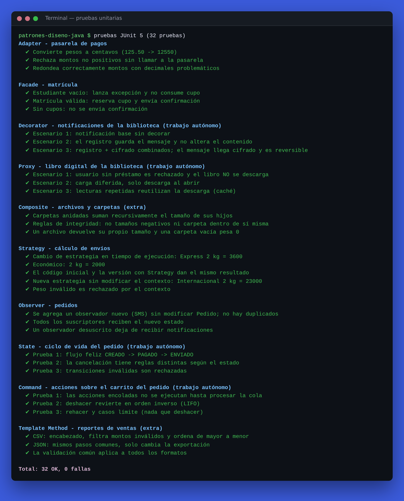

# Patrones de diseño en Java — Estructurales y Comportamentales

  [](https://github.com/SrDiego18/Patrones-dise-o-java/actions/workflows/ci.yml)   

**Asignatura:** Patrones y metodologías de desarrollo

### 👥 Integrantes

| Integrante |
|---|
| Diego Romero |
| Maicol Rubiano |
| Camilo Bastidas |
| Santiago Solano |

**Fecha:** 10 de noviembre de 2026

## 🌐 Acceso rápido

| | |
|---|---|
| 🎮 **Página interactiva** (probar los 10 patrones en vivo) | **https://srdiego18.github.io/Patrones-dise-o-java/** |
| ▶️ **Ejecutar el Java real en el navegador** (sin instalar nada) | [](https://codespaces.new/SrDiego18/Patrones-dise-o-java?quickstart=1) |
| 📖 **Guía final** (las dos guías unidas en un solo documento) | [**docs/GUIA-FINAL.md**](docs/GUIA-FINAL.md) |
| 📄 Guía final en **Word** y **PDF** (para descargar o imprimir) | [Word](entrega/Guia_final_patrones_diseno.docx) · [PDF](entrega/Guia_final_patrones_diseno.pdf) |
| 🟣 Guía 1 — Patrones estructurales | [Ir a la Guía 1](docs/GUIA-FINAL.md#guía-1--patrones-estructurales) |
| 🔵 Guía 2 — Patrones comportamentales | [Ir a la Guía 2](docs/GUIA-FINAL.md#guía-2--patrones-comportamentales) |
| ✅ Resultado de las pruebas automáticas | [GitHub Actions](https://github.com/SrDiego18/Patrones-dise-o-java/actions) |

> En Codespaces, cuando abra la terminal: `mvn test` ejecuta las 32 pruebas y `mvn -q compile exec:java` ejecuta la demostración.

Solución completa de las dos guías del estudiante: laboratorios paso a paso, actividad de análisis, preguntas de verificación y trabajo autónomo (con diagramas, código y pruebas).

## 📘 Guías resueltas

| Guía | Laboratorio | Trabajo autónomo | Sección de la guía final |
|---|---|---|---|
| 🟣 **Guía 1 — Patrones estructurales** | Adapter (pagos) · Facade (matrícula) | Decorator + Proxy — *Biblioteca digital* · **Extra:** Composite | [Secciones 1.1 – 1.10](docs/GUIA-FINAL.md#guía-1--patrones-estructurales) |
| 🔵 **Guía 2 — Patrones comportamentales** | Strategy (envíos) · Observer (pedidos) | State + Command — *Sistema de pedidos* · **Extra:** Template Method | [Secciones 2.1 – 2.10](docs/GUIA-FINAL.md#guía-2--patrones-comportamentales) |

Las dos guías están unidas en [**docs/GUIA-FINAL.md**](docs/GUIA-FINAL.md) (también en Word y PDF en [`entrega/`](entrega)), y cada una incluye:

- ✅ Laboratorio paso a paso con diagrama UML y salida obtenida
- ✅ Actividad de análisis: las 5 situaciones con el patrón elegido y su justificación
- ✅ Verificación: las 5 preguntas respondidas
- ✅ Trabajo autónomo: problema, diagrama, código, 3 pruebas por patrón, justificación, alternativa y limitación
- ✅ Autoevaluación frente a la rúbrica (25 / 30 / 20 / 15 / 10 %)

### ⭐ Valor agregado (más allá de lo solicitado)

- **Los 10 patrones implementados y probados**, no solo los 4 exigidos: también Composite y Template Method, que las guías solo piden reconocer.
- **32 pruebas unitarias JUnit 5** (las guías piden 3 por patrón del trabajo autónomo).
- **Integración continua con GitHub Actions**: cada `push` compila y ejecuta todas las pruebas automáticamente (insignia verde arriba).
- **Mejoras sobre el código base de las guías**: validaciones, `desuscribir()` y control de duplicados en Observer, cupos reales e inyección de dependencias en Facade, redondeo correcto en Adapter, deshacer **y rehacer** en Command.
- **Diagramas UML** de clases, secuencia y estados (Mermaid, se ven directamente en GitHub).
- **Capturas** del código y de la ejecución de cada patrón en [`docs/capturas`](docs/capturas), y el **código completo pegado** en cada guía.
- **Página web interactiva** con una demostración en vivo de cada patrón, su código, diagrama UML y capturas.
- **Codespaces configurado**: el proyecto se abre y se ejecuta en el navegador con un clic.

## 📸 Vista previa



## 🗂️ Estructura del proyecto

```
patrones-diseno-java/
├── pom.xml
├── README.md
├── .github/workflows/ci.yml           ← pruebas automáticas en cada push
├── .devcontainer/                     ← configuración de Codespaces
├── entrega/                           ← guía final en Word y PDF
├── docs/
│   ├── index.html                     ← página web interactiva (GitHub Pages)
│   ├── GUIA-FINAL.md                  ← las dos guías resueltas en un solo documento
│   └── capturas/                      ← capturas del código y de la ejecución
└── src/
    ├── main/java/co/edu/patrones/
    │   ├── Main.java                      ← demostración de los 10 patrones
    │   ├── estructurales/                 ← GUÍA 1
    │   │   ├── adapter/     (laboratorio)
    │   │   ├── facade/      (laboratorio)
    │   │   ├── decorator/   (trabajo autónomo)
    │   │   ├── proxy/       (trabajo autónomo)
    │   │   └── composite/   (extra)
    │   └── comportamentales/              ← GUÍA 2
    │       ├── strategy/    (laboratorio)
    │       ├── observer/    (laboratorio)
    │       ├── state/       (trabajo autónomo)
    │       ├── command/     (trabajo autónomo)
    │       └── templatemethod/ (extra)
    └── test/java/co/edu/patrones/
        ├── estructurales/      (Guía 1) AdapterTest, FacadeTest, DecoratorTest, ProxyTest, CompositeTest
        └── comportamentales/   (Guía 2) StrategyTest, ObserverTest, StateTest, CommandTest, TemplateMethodTest
```

## ▶️ Cómo ejecutar

Requisitos: **JDK 17 o superior** y **Maven 3.8+** (o abrir el proyecto en IntelliJ IDEA / VS Code / NetBeans, que lo reconocen como proyecto Maven).

```bash
# Ejecutar las 32 pruebas unitarias
mvn test

# Ejecutar la demostración de todos los patrones
mvn compile exec:java
```

Sin Maven, solo con el JDK:

```bash
javac -d out $(find src/main/java -name "*.java")
java -cp out co.edu.patrones.Main
```

### Salida esperada (extracto)

```
--- Adapter (laboratorio) ---
Cobro externo: 12550 centavos

--- Proxy (trabajo autónomo - biblioteca) ---
Acceso denegado: el usuario no tiene préstamo activo
Descargando 'Design Patterns' del servidor remoto...
Contenido completo de Design Patterns
Contenido completo de Design Patterns      ← segunda lectura: no vuelve a descargar

--- Strategy (laboratorio) ---
2000.0
3600.0

--- State (trabajo autónomo - pedidos) ---
Pedido P-001: CREADO -> PAGADO
Pedido P-001: PAGADO -> ENVIADO
Regla de negocio: No se puede cancelar un pedido ENVIADO
```

## 🧪 Pruebas

| Patrón | Clase de prueba | Pruebas |
|---|---|---|
| Adapter | `AdapterTest` | 3 |
| Facade | `FacadeTest` | 3 |
| Decorator | `DecoratorTest` | 3 |
| Proxy | `ProxyTest` | 3 |
| Strategy | `StrategyTest` | 5 |
| Observer | `ObserverTest` | 3 |
| State | `StateTest` | 3 |
| Command | `CommandTest` | 3 |
| Composite *(extra)* | `CompositeTest` | 3 |
| Template Method *(extra)* | `TemplateMethodTest` | 3 |
| **Total** | | **32** |

## 🧭 Resumen: ¿qué patrón usar?

| Si el problema es… | Patrón |
|---|---|
| Dos interfaces incompatibles | Adapter |
| Un subsistema complejo que el cliente debe usar de forma sencilla | Facade |
| Añadir responsabilidades combinables sin subclases | Decorator |
| Tratar hojas y grupos de una jerarquía por igual | Composite |
| Controlar acceso, carga diferida o caché de un objeto | Proxy |
| Varios algoritmos intercambiables en ejecución | Strategy |
| Avisar a muchos interesados cuando algo cambia | Observer |
| Guardar, encolar o deshacer acciones | Command |
| Comportamiento que depende del estado y sus transiciones | State |
| Algoritmo con pasos fijos y uno o varios pasos variables | Template Method |

## 📚 Referencias

- Gamma, E., Helm, R., Johnson, R., & Vlissides, J. (1994). *Design Patterns: Elements of Reusable Object-Oriented Software*. Addison-Wesley.
- Freeman, E., Robson, E., Bates, B., & Sierra, K. (2004). *Head First Design Patterns*. O'Reilly Media.
