# Guía resuelta — Patrones estructurales

> Patrones y metodologías de desarrollo · Java
> **Resultado de aprendizaje:** reconocer problemas de integración, composición y acceso entre objetos, y seleccionar un patrón estructural justificando beneficios y costos.

[⬅ Volver al README](../README.md)

---

## Contenido

1. [Concepto central](#1-concepto-central)
2. [Los cinco patrones estructurales](#2-los-cinco-patrones-estructurales)
3. [Laboratorio: Adapter para integrar pagos](#3-laboratorio-adapter-para-integrar-pagos)
4. [Segundo ejemplo: Facade para matrícula](#4-segundo-ejemplo-facade-para-matrícula)
5. [Actividad de análisis (resuelta)](#5-actividad-de-análisis-resuelta)
6. [Verificación (resuelta)](#6-verificación-resuelta)
7. [Trabajo autónomo: Biblioteca digital con Decorator y Proxy](#7-trabajo-autónomo-biblioteca-digital-con-decorator-y-proxy)
8. [Extra: Composite implementado](#8-extra-composite-implementado)
9. [Código completo, capturas y funcionamiento](#9-código-completo-capturas-y-funcionamiento)
10. [Autoevaluación frente a la rúbrica](#10-autoevaluación-frente-a-la-rúbrica)

---

## 1. Concepto central

Los patrones estructurales describen **cómo se relacionan clases y objetos para formar estructuras mayores**. A diferencia de los creacionales (que deciden *cómo se crea* un objeto), los estructurales se ocupan de *cómo se conectan y colaboran* los objetos ya creados: traducir interfaces, simplificar subsistemas, añadir comportamiento envolviendo, tratar jerarquías de forma uniforme o controlar el acceso.

## 2. Los cinco patrones estructurales

| Patrón | Problema que resuelve | Ejemplo | ¿Dónde está en el repo? |
|---|---|---|---|
| **Adapter** | Interfaces incompatibles | Pasarela externa → contrato interno de pagos | [`adapter/`](../src/main/java/co/edu/patrones/estructurales/adapter) — laboratorio |
| **Facade** | Subsistema complejo | Proceso de matrícula | [`facade/`](../src/main/java/co/edu/patrones/estructurales/facade) — laboratorio |
| **Decorator** | Añadir responsabilidades sin explosión de subclases | Registro y cifrado de notificaciones | [`decorator/`](../src/main/java/co/edu/patrones/estructurales/decorator) — trabajo autónomo |
| **Composite** | Tratar elementos y grupos de forma uniforme | Archivos y carpetas | [`composite/`](../src/main/java/co/edu/patrones/estructurales/composite) — **extra** |
| **Proxy** | Controlar el acceso a un objeto real | Carga diferida, autorización, caché | [`proxy/`](../src/main/java/co/edu/patrones/estructurales/proxy) — trabajo autónomo |

---

## 3. Laboratorio: Adapter para integrar pagos

**Situación.** El sistema espera `ProcesadorPago.pagar(double)`, pero la librería externa ofrece `PasarelaExterna.realizarCobroEnCentavos(int)`. No podemos modificar la librería.

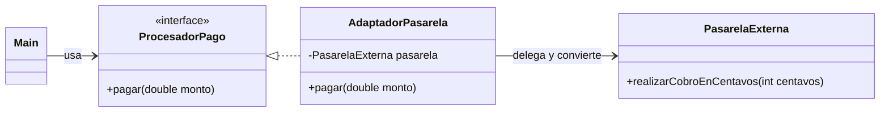

| Paso | Qué se hizo | Archivo |
|---|---|---|
| 1 | Interfaz que espera el sistema (*Target*) | [`ProcesadorPago.java`](../src/main/java/co/edu/patrones/estructurales/adapter/ProcesadorPago.java) |
| 2 | Clase externa incompatible (*Adaptee*) | [`PasarelaExterna.java`](../src/main/java/co/edu/patrones/estructurales/adapter/PasarelaExterna.java) |
| 3 | Incompatibilidad: **nombre de método** distinto y **unidad** distinta (pesos `double` vs. centavos `int`) | — |
| 4 | Adaptador: implementa `ProcesadorPago`, convierte con `Math.round(monto * 100)` y delega | [`AdaptadorPasarela.java`](../src/main/java/co/edu/patrones/estructurales/adapter/AdaptadorPasarela.java) |
| 5 | Cliente invoca solo la interfaz interna | [`Main.java`](../src/main/java/co/edu/patrones/Main.java) |

**Salida obtenida:** `Cobro externo: 12550 centavos` ✅

**Mejora añadida:** el adaptador rechaza montos `<= 0` antes de llamar a la pasarela.

**Pruebas** ([`AdapterTest`](../src/test/java/co/edu/patrones/estructurales/AdapterTest.java)):
1. `125.50` → `12550` centavos.
2. `0.29` → `29` (en `double`, `0.29 * 100 = 28.999…`; `Math.round` evita perder un centavo, mientras que un simple `(int)` daría `28`).
3. Monto `0` → `IllegalArgumentException` y la pasarela **no** es invocada.

> **Nota de diseño:** como indica la guía, en un sistema financiero real el dinero se representa con `BigDecimal` (con moneda, escala y modo de redondeo definidos). Aquí se usa `double` solo para simplificar el ejemplo.

---

## 4. Segundo ejemplo: Facade para matrícula

**Problema.** Matricular requiere validar datos, reservar cupo y enviar confirmación. El controlador no debería coordinar manualmente cada subsistema.

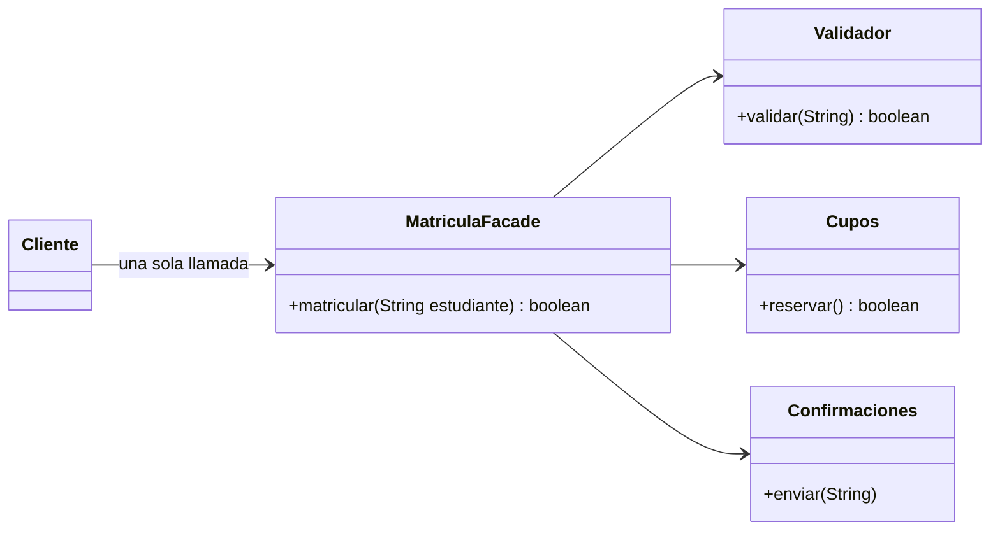

1. **Subsistemas identificados**, cada uno con una única responsabilidad: `Validador`, `Cupos`, `Confirmaciones`.
2. **`MatriculaFacade`** es el punto de entrada simplificado.
3. El **cliente** llama `matricular(estudiante)` sin conocer la secuencia interna.

**Mejoras añadidas:** `Cupos` tiene capacidad real (antes siempre devolvía `true`), `matricular` devuelve `boolean`, y existe un constructor con **inyección de dependencias** para poder probar la fachada con subsistemas controlados.

**Pruebas** ([`FacadeTest`](../src/test/java/co/edu/patrones/estructurales/FacadeTest.java)): matrícula válida descuenta cupo y confirma · estudiante vacío lanza excepción sin consumir cupo · sin cupos no se envía confirmación.

---

## 5. Actividad de análisis (resuelta)

| # | Situación | Patrón | Justificación |
|---|---|---|---|
| 1 | Una aplicación integra una API externa cuya interfaz no coincide con la interna. | **Adapter** | Hay dos interfaces que ya existen y no podemos cambiar la externa; el adaptador traduce llamadas y datos sin tocar ninguno de los dos lados. |
| 2 | Una compra coordina inventario, pago, envío y notificación, pero el controlador necesita una operación sencilla. | **Facade** | Hay un subsistema con varios componentes y un orden de invocación; la fachada expone `comprar()` y oculta la coordinación, reduciendo el acoplamiento del controlador. |
| 3 | Se requiere añadir registro y cifrado a una notificación sin modificar su clase. | **Decorator** | Se agregan responsabilidades dinámicamente envolviendo el objeto con la misma interfaz. Evita subclases combinatorias (`NotifConLog`, `NotifCifrada`, `NotifConLogYCifrada`…). |
| 4 | Una aplicación calcula el tamaño de archivos y carpetas anidadas. | **Composite** | Hay una jerarquía en árbol; `Archivo` (hoja) y `Carpeta` (contenedor) implementan `ElementoArchivo.tamano()`, y la carpeta suma recursivamente el tamaño de sus hijos. El cliente no distingue entre ambos. |
| 5 | Un archivo remoto solo debe descargarse al abrirlo y requiere autorización. | **Proxy** (virtual + de protección) | Un objeto con la misma interfaz se interpone, verifica permisos y crea el objeto real solo cuando se necesita. Implementado en el trabajo autónomo. |

---

## 6. Verificación (resuelta)

**1. ¿Qué diferencia existe entre Adapter y Facade?**
Ambos envuelven código existente, pero con intenciones distintas. **Adapter** *convierte* una interfaz en otra que el cliente ya espera; normalmente envuelve **un** objeto y la interfaz destino ya está definida. **Facade** *simplifica*: define una interfaz **nueva y más sencilla** sobre **varios** objetos de un subsistema. Adapter resuelve incompatibilidad; Facade resuelve complejidad.

**2. ¿Por qué Decorator y Proxy implementan normalmente la misma interfaz del objeto envuelto?**
Para ser **sustituibles de forma transparente** (principio de sustitución de Liskov): el cliente programa contra la interfaz y no sabe si habla con el objeto real, con un decorador o con un proxy. Esto permite apilar decoradores (`new Registro(new Cifrado(base))`) o interponer un proxy sin cambiar el código cliente. La diferencia está en la intención: el Decorator **añade** comportamiento; el Proxy **controla** el acceso.

**3. ¿Qué ventaja aporta Composite al recorrer jerarquías?**
El cliente trata **igual a hojas y contenedores**, por lo que no necesita `if (esCarpeta) … else …` ni `instanceof`. Las operaciones (tamaño, búsqueda, impresión) se resuelven por **recursión polimórfica**: cada nodo sabe calcular su parte y delega en sus hijos. Agregar un nuevo tipo de nodo no obliga a cambiar el código de recorrido.

**4. ¿Qué responsabilidad adicional asume un Proxy?**
Decidir **si, cuándo y cómo** se delega al objeto real: control de acceso/autorización (proxy de protección), creación diferida de objetos costosos (proxy virtual), caché de resultados, registro/auditoría, o representación de un objeto remoto (proxy remoto). En este repositorio, `LibroDigitalProxy` asume autorización, carga diferida y caché.

**5. ¿Qué costo de mantenimiento puede introducir un patrón?**
Más clases e indirecciones (el flujo es más difícil de seguir y depurar), mayor curva de aprendizaje para el equipo, posible impacto en rendimiento por capas adicionales y el riesgo de **sobreingeniería** si el patrón se aplica sin que exista el problema que resuelve. Ejemplos concretos: una Facade que crece hasta convertirse en un "objeto dios"; decoradores cuyo **orden** altera el resultado (ver prueba 3 del Decorator); un Proxy que oculta latencia o errores de red.

---

## 7. Trabajo autónomo: Biblioteca digital con Decorator y Proxy

> Dominio elegido: **biblioteca**. Se implementan dos patrones distintos a los del laboratorio para ampliar la práctica.

### 7.1 Decorator — notificaciones de préstamo

**Problema.** La biblioteca envía notificaciones de préstamo. Algunas deben quedar **registradas** (auditoría), otras deben viajar **cifradas** (datos personales) y otras ambas cosas. Crear una subclase por combinación generaría `2ⁿ` clases y obligaría a modificar la clase de notificación cada vez que aparezca un requisito nuevo.

**Diagrama.**

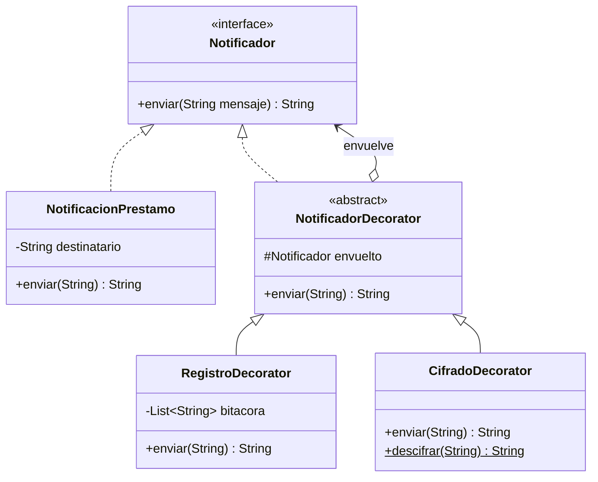

**Código:** [`decorator/`](../src/main/java/co/edu/patrones/estructurales/decorator)

```java
Notificador n = new RegistroDecorator(
                    new CifradoDecorator(
                        new NotificacionPrestamo("ana@biblioteca.edu")));
n.enviar("Tu préstamo vence mañana");
```

**Escenarios de prueba** ([`DecoratorTest`](../src/test/java/co/edu/patrones/estructurales/DecoratorTest.java)):

| # | Escenario | Resultado esperado |
|---|---|---|
| 1 | Notificación sin decorar | `"Para ana: Libro listo"` |
| 2 | Solo registro | Mismo contenido + 1 entrada en la bitácora |
| 3 | Registro + cifrado | El texto plano **no** viaja; se puede descifrar; la bitácora guarda el original (porque el registro está por fuera del cifrado) |

**Justificación.** Las responsabilidades se combinan en tiempo de ejecución y cada una vive en su propia clase (responsabilidad única). `NotificacionPrestamo` no se modificó nunca (abierto/cerrado).

**Alternativa considerada.** *Herencia* (`NotificacionCifrada extends NotificacionPrestamo`): es más simple con un solo requisito, pero con dos o más requisitos combinables produce explosión de subclases y las combinaciones quedan fijas en compilación.

**Limitación.** El **orden** de los decoradores cambia el resultado (registrar antes o después de cifrar), lo que puede causar errores sutiles; además hay muchos objetos pequeños que dificultan la depuración. Por último, `CifradoDecorator` usa Base64, que es una **codificación**, no un cifrado seguro: en producción se usaría AES-GCM (`javax.crypto`) con gestión de claves.

### 7.2 Proxy — acceso a libros digitales

**Problema.** Los libros digitales están en un servidor remoto: descargarlos es **costoso** y solo los usuarios con **préstamo activo** pueden leerlos. Si el catálogo creara todos los `LibroDigitalReal` al cargar, se descargarían libros que nadie abre y sin control de permisos.

**Diagrama.**

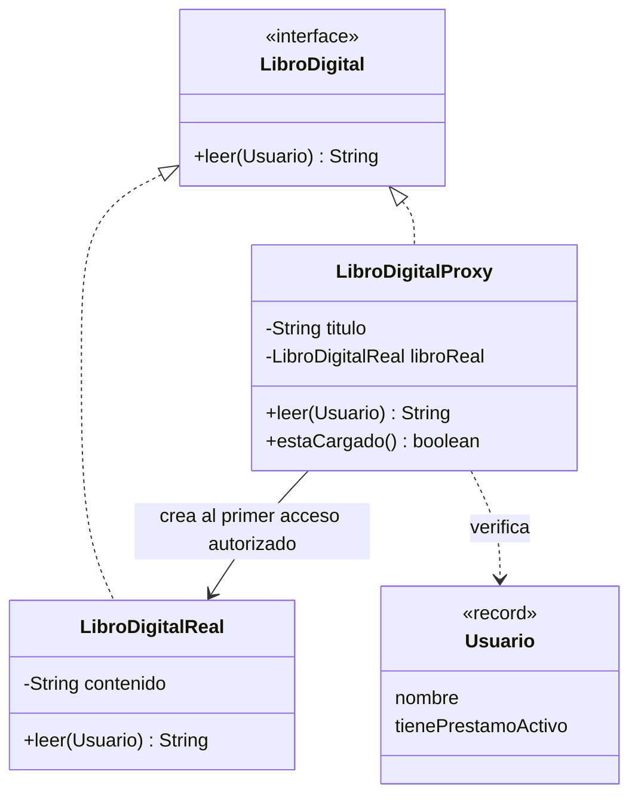

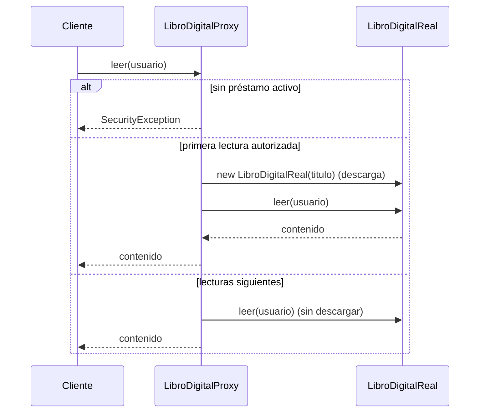

**Código:** [`proxy/`](../src/main/java/co/edu/patrones/estructurales/proxy)

**Escenarios de prueba** ([`ProxyTest`](../src/test/java/co/edu/patrones/estructurales/ProxyTest.java)):

| # | Escenario | Resultado esperado |
|---|---|---|
| 1 | Usuario sin préstamo | `SecurityException` y **0** descargas |
| 2 | Crear el proxy y luego leer | No se descarga al crear; sí al primer `leer()` |
| 3 | Tres lecturas seguidas | Solo **1** descarga (caché) |

**Justificación.** El proxy agrega autorización, carga diferida y caché **sin tocar** `LibroDigitalReal` y sin que el cliente cambie: ambos implementan `LibroDigital`.

**Alternativa considerada.** Poner la validación de permisos y el `if (contenido == null)` dentro de `LibroDigitalReal`: funciona, pero mezcla la responsabilidad de *representar el libro* con *seguridad* y *rendimiento*, y obliga a modificar la clase real cada vez que cambie la política de acceso.

**Limitación.** El proxy agrega una indirección y puede **ocultar latencia**: la primera lectura es lenta y el cliente no lo sabe. La implementación no es segura para hilos (dos lecturas simultáneas podrían descargar dos veces; se resolvería con `synchronized` o *double-checked locking*). Además, el libro descargado permanece en memoria indefinidamente: con un catálogo grande haría falta una política de expiración de la caché.

---

## 8. Extra: Composite implementado

La guía solo pide *reconocer* Composite; aquí además se implementa con el ejemplo de la propia guía (`ElementoArchivo`, `Archivo`, `Carpeta`).

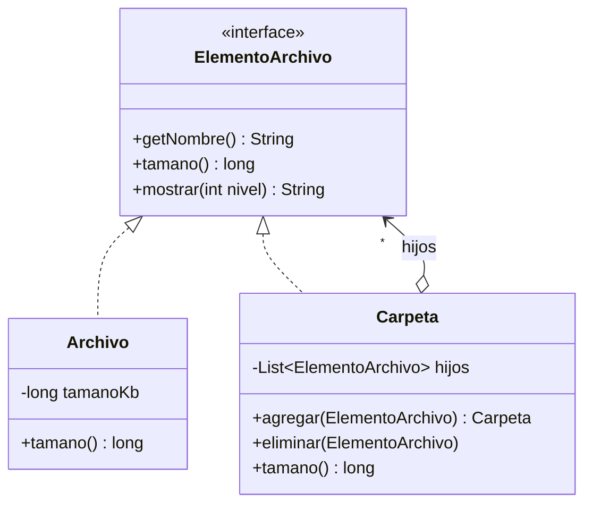

```java
Carpeta raiz = new Carpeta("biblioteca")
        .agregar(new Archivo("catalogo.pdf", 300))
        .agregar(new Carpeta("libros")
                .agregar(new Archivo("java.epub", 500))
                .agregar(new Archivo("gof.pdf", 200)));
raiz.tamano(); // 1000 — suma recursiva sin un solo instanceof
```

**Pruebas** ([`CompositeTest`](../src/test/java/co/edu/patrones/estructurales/CompositeTest.java)): hoja y carpeta vacía · suma recursiva en tres niveles · integridad (sin tamaños negativos ni carpeta dentro de sí misma).

## 9. Código completo, capturas y funcionamiento

> 🌐 **Pruébalo en vivo:** cada patrón tiene una demostración interactiva en la [página del proyecto](https://srdiego18.github.io/Patrones-dise-o-java/).
> El código de abajo es **exactamente** el que está en `src/` (se puede copiar). Debajo de cada bloque están la captura del código y la captura de la ejecución con sus pruebas.

### 9.1 Adapter · _Laboratorio_

🔗 [Probar Adapter en la página interactiva](https://srdiego18.github.io/Patrones-dise-o-java/#adapter) · 📁 [Ver carpeta en el repositorio](../src/main/java/co/edu/patrones/estructurales/adapter)

**Código fuente**

<details open><summary><code>AdaptadorPasarela.java</code></summary>

```java
package co.edu.patrones.estructurales.adapter;

/**
 * Adapter: implementa la interfaz interna y traduce la llamada a la pasarela externa,
 * convirtiendo unidades (pesos -> centavos).
 */
public class AdaptadorPasarela implements ProcesadorPago {
    private final PasarelaExterna pasarela;

    public AdaptadorPasarela(PasarelaExterna pasarela) {
        this.pasarela = pasarela;
    }

    @Override
    public void pagar(double monto) {
        if (monto <= 0) {
            throw new IllegalArgumentException("El monto debe ser positivo");
        }
        int centavos = (int) Math.round(monto * 100);
        pasarela.realizarCobroEnCentavos(centavos);
    }
}
```

</details>

<details open><summary><code>PasarelaExterna.java</code></summary>

```java
package co.edu.patrones.estructurales.adapter;

/**
 * Clase de una librería externa (Adaptee). No podemos modificar su firma:
 * cobra en centavos enteros y con otro nombre de método.
 */
public class PasarelaExterna {
    private int ultimoCobroEnCentavos = -1;

    public void realizarCobroEnCentavos(int centavos) {
        this.ultimoCobroEnCentavos = centavos;
        System.out.println("Cobro externo: " + centavos + " centavos");
    }

    /** Solo para verificar el comportamiento en las pruebas. */
    public int getUltimoCobroEnCentavos() {
        return ultimoCobroEnCentavos;
    }
}
```

</details>

<details open><summary><code>ProcesadorPago.java</code></summary>

```java
package co.edu.patrones.estructurales.adapter;

/** Interfaz que espera nuestro sistema (Target). */
public interface ProcesadorPago {
    void pagar(double monto);
}
```

</details>

<details><summary><code>AdapterTest.java</code> (pruebas)</summary>

```java
package co.edu.patrones.estructurales;

import co.edu.patrones.estructurales.adapter.*;
import org.junit.jupiter.api.DisplayName;
import org.junit.jupiter.api.Test;

import static org.junit.jupiter.api.Assertions.*;

@DisplayName("Adapter - pasarela de pagos")
class AdapterTest {

    @Test
    @DisplayName("Convierte pesos a centavos (125.50 -> 12550)")
    void convierteMontoACentavos() {
        PasarelaExterna pasarela = new PasarelaExterna();
        ProcesadorPago procesador = new AdaptadorPasarela(pasarela);
        procesador.pagar(125.50);
        assertEquals(12550, pasarela.getUltimoCobroEnCentavos());
    }

    @Test
    @DisplayName("Redondea correctamente montos con decimales problemáticos")
    void redondeaCorrectamente() {
        PasarelaExterna pasarela = new PasarelaExterna();
        new AdaptadorPasarela(pasarela).pagar(0.29); // 0.29*100 = 28.999... en double
        assertEquals(29, pasarela.getUltimoCobroEnCentavos());
    }

    @Test
    @DisplayName("Rechaza montos no positivos sin llamar a la pasarela")
    void rechazaMontoInvalido() {
        PasarelaExterna pasarela = new PasarelaExterna();
        ProcesadorPago procesador = new AdaptadorPasarela(pasarela);
        assertThrows(IllegalArgumentException.class, () -> procesador.pagar(0));
        assertEquals(-1, pasarela.getUltimoCobroEnCentavos());
    }
}
```

</details>

**Captura del código**

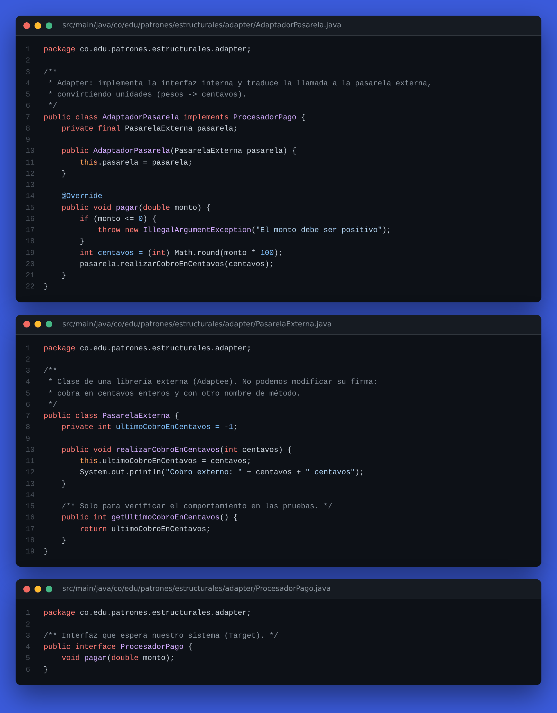

**Captura del funcionamiento (ejecución + pruebas)**

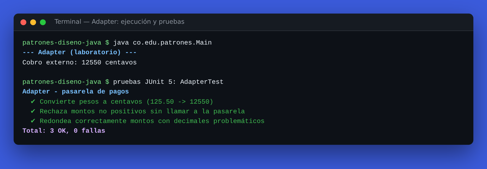

### 9.2 Facade · _Laboratorio_

🔗 [Probar Facade en la página interactiva](https://srdiego18.github.io/Patrones-dise-o-java/#facade) · 📁 [Ver carpeta en el repositorio](../src/main/java/co/edu/patrones/estructurales/facade)

**Código fuente**

<details open><summary><code>Confirmaciones.java</code></summary>

```java
package co.edu.patrones.estructurales.facade;

import java.util.ArrayList;
import java.util.List;

/** Subsistema: envía la confirmación de matrícula. */
public class Confirmaciones {
    private final List<String> enviadas = new ArrayList<>();

    public void enviar(String estudiante) {
        enviadas.add(estudiante);
        System.out.println("Confirmación enviada a " + estudiante);
    }

    public List<String> getEnviadas() {
        return enviadas;
    }
}
```

</details>

<details open><summary><code>Cupos.java</code></summary>

```java
package co.edu.patrones.estructurales.facade;

/** Subsistema: administra los cupos disponibles. */
public class Cupos {
    private int disponibles;

    public Cupos() {
        this(30);
    }

    public Cupos(int disponibles) {
        this.disponibles = disponibles;
    }

    public boolean reservar() {
        if (disponibles <= 0) {
            System.out.println("Sin cupos disponibles");
            return false;
        }
        disponibles--;
        System.out.println("Cupo reservado");
        return true;
    }

    public int getDisponibles() {
        return disponibles;
    }
}
```

</details>

<details open><summary><code>MatriculaFacade.java</code></summary>

```java
package co.edu.patrones.estructurales.facade;

/**
 * Facade: ofrece un único punto de entrada (matricular) y oculta al cliente
 * la secuencia validar -> reservar cupo -> confirmar.
 */
public class MatriculaFacade {
    private final Validador validador;
    private final Cupos cupos;
    private final Confirmaciones confirmaciones;

    public MatriculaFacade() {
        this(new Validador(), new Cupos(), new Confirmaciones());
    }

    /** Constructor con inyección de dependencias para facilitar las pruebas. */
    public MatriculaFacade(Validador validador, Cupos cupos, Confirmaciones confirmaciones) {
        this.validador = validador;
        this.cupos = cupos;
        this.confirmaciones = confirmaciones;
    }

    /** @return true si la matrícula quedó confirmada. */
    public boolean matricular(String estudiante) {
        if (!validador.validar(estudiante)) {
            throw new IllegalArgumentException("Estudiante inválido");
        }
        if (cupos.reservar()) {
            confirmaciones.enviar(estudiante);
            return true;
        }
        return false;
    }
}
```

</details>

<details open><summary><code>Validador.java</code></summary>

```java
package co.edu.patrones.estructurales.facade;

/** Subsistema: valida los datos del estudiante. */
public class Validador {
    public boolean validar(String estudiante) {
        return estudiante != null && !estudiante.isBlank();
    }
}
```

</details>

<details><summary><code>FacadeTest.java</code> (pruebas)</summary>

```java
package co.edu.patrones.estructurales;

import co.edu.patrones.estructurales.facade.*;
import org.junit.jupiter.api.DisplayName;
import org.junit.jupiter.api.Test;

import static org.junit.jupiter.api.Assertions.*;

@DisplayName("Facade - matrícula")
class FacadeTest {

    @Test
    @DisplayName("Matrícula válida: reserva cupo y envía confirmación")
    void matriculaExitosa() {
        Cupos cupos = new Cupos(2);
        Confirmaciones conf = new Confirmaciones();
        MatriculaFacade facade = new MatriculaFacade(new Validador(), cupos, conf);

        assertTrue(facade.matricular("Ana"));
        assertEquals(1, cupos.getDisponibles());
        assertEquals(1, conf.getEnviadas().size());
    }

    @Test
    @DisplayName("Estudiante vacío: lanza excepción y no consume cupo")
    void estudianteInvalido() {
        Cupos cupos = new Cupos(2);
        MatriculaFacade facade = new MatriculaFacade(new Validador(), cupos, new Confirmaciones());

        assertThrows(IllegalArgumentException.class, () -> facade.matricular("  "));
        assertEquals(2, cupos.getDisponibles());
    }

    @Test
    @DisplayName("Sin cupos: no se envía confirmación")
    void sinCupos() {
        Confirmaciones conf = new Confirmaciones();
        MatriculaFacade facade = new MatriculaFacade(new Validador(), new Cupos(0), conf);

        assertFalse(facade.matricular("Luis"));
        assertTrue(conf.getEnviadas().isEmpty());
    }
}
```

</details>

**Captura del código**

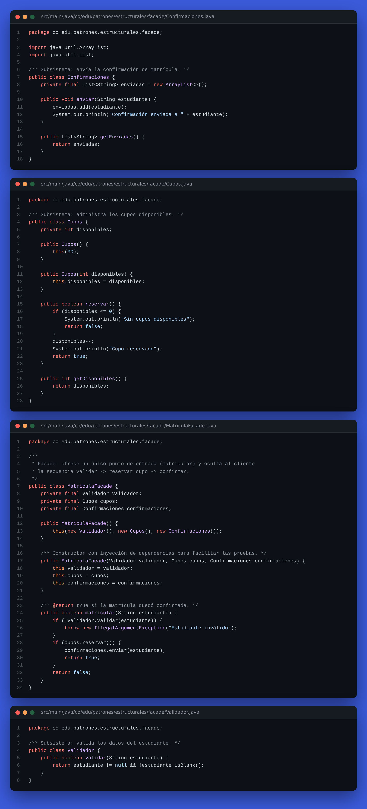

**Captura del funcionamiento (ejecución + pruebas)**

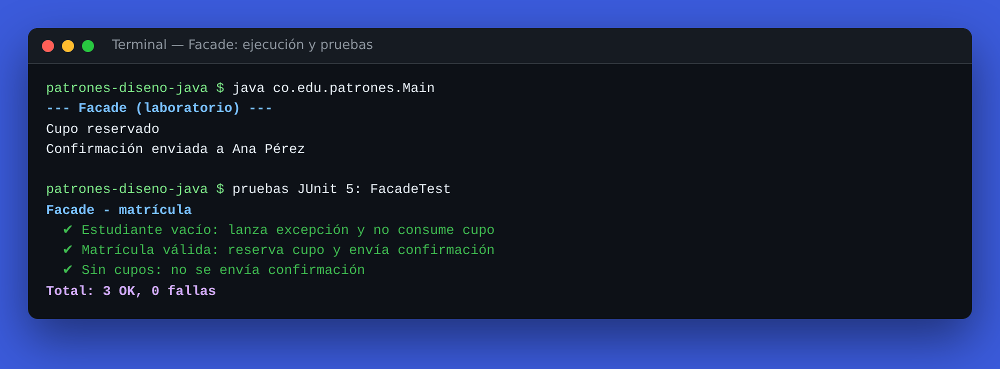

### 9.3 Decorator · _Trabajo autónomo_

🔗 [Probar Decorator en la página interactiva](https://srdiego18.github.io/Patrones-dise-o-java/#decorator) · 📁 [Ver carpeta en el repositorio](../src/main/java/co/edu/patrones/estructurales/decorator)

**Código fuente**

<details open><summary><code>CifradoDecorator.java</code></summary>

```java
package co.edu.patrones.estructurales.decorator;

import java.nio.charset.StandardCharsets;
import java.util.Base64;

/**
 * Decorador concreto: transforma el mensaje antes de delegar.
 * NOTA DIDÁCTICA: Base64 es una codificación, no un cifrado seguro.
 * En producción se usaría AES/GCM con una clave administrada (javax.crypto).
 */
public class CifradoDecorator extends NotificadorDecorator {

    public CifradoDecorator(Notificador envuelto) {
        super(envuelto);
    }

    @Override
    public String enviar(String mensaje) {
        String cifrado = Base64.getEncoder()
                .encodeToString(mensaje.getBytes(StandardCharsets.UTF_8));
        return super.enviar(cifrado);
    }

    public static String descifrar(String cifrado) {
        return new String(Base64.getDecoder().decode(cifrado), StandardCharsets.UTF_8);
    }
}
```

</details>

<details open><summary><code>NotificacionPrestamo.java</code></summary>

```java
package co.edu.patrones.estructurales.decorator;

/** Componente concreto: notificación básica de préstamo para un usuario. */
public class NotificacionPrestamo implements Notificador {
    private final String destinatario;

    public NotificacionPrestamo(String destinatario) {
        this.destinatario = destinatario;
    }

    @Override
    public String enviar(String mensaje) {
        String entregado = "Para " + destinatario + ": " + mensaje;
        System.out.println(entregado);
        return entregado;
    }
}
```

</details>

<details open><summary><code>Notificador.java</code></summary>

```java
package co.edu.patrones.estructurales.decorator;

/** Componente: contrato común de cualquier notificación de la biblioteca. */
public interface Notificador {
    /** Envía el mensaje y devuelve el contenido final que se entregó. */
    String enviar(String mensaje);
}
```

</details>

<details open><summary><code>NotificadorDecorator.java</code></summary>

```java
package co.edu.patrones.estructurales.decorator;

/**
 * Decorador base: implementa la misma interfaz y guarda una referencia al objeto envuelto.
 * Por defecto solo delega; las subclases añaden comportamiento antes o después.
 */
public abstract class NotificadorDecorator implements Notificador {
    protected final Notificador envuelto;

    protected NotificadorDecorator(Notificador envuelto) {
        this.envuelto = envuelto;
    }

    @Override
    public String enviar(String mensaje) {
        return envuelto.enviar(mensaje);
    }
}
```

</details>

<details open><summary><code>RegistroDecorator.java</code></summary>

```java
package co.edu.patrones.estructurales.decorator;

import java.util.ArrayList;
import java.util.List;

/** Decorador concreto: registra (auditoría) cada mensaje antes de delegar. */
public class RegistroDecorator extends NotificadorDecorator {
    private final List<String> bitacora = new ArrayList<>();

    public RegistroDecorator(Notificador envuelto) {
        super(envuelto);
    }

    @Override
    public String enviar(String mensaje) {
        bitacora.add("[LOG] " + mensaje);
        return super.enviar(mensaje);
    }

    public List<String> getBitacora() {
        return bitacora;
    }
}
```

</details>

<details><summary><code>DecoratorTest.java</code> (pruebas)</summary>

```java
package co.edu.patrones.estructurales;

import co.edu.patrones.estructurales.decorator.*;
import org.junit.jupiter.api.DisplayName;
import org.junit.jupiter.api.Test;

import static org.junit.jupiter.api.Assertions.*;

@DisplayName("Decorator - notificaciones de la biblioteca (trabajo autónomo)")
class DecoratorTest {

    @Test
    @DisplayName("Escenario 1: notificación base sin decorar")
    void notificacionBase() {
        Notificador n = new NotificacionPrestamo("ana");
        assertEquals("Para ana: Libro listo", n.enviar("Libro listo"));
    }

    @Test
    @DisplayName("Escenario 2: el registro guarda el mensaje y no altera el contenido")
    void registroAgregaBitacora() {
        RegistroDecorator conRegistro = new RegistroDecorator(new NotificacionPrestamo("ana"));
        String entregado = conRegistro.enviar("Libro listo");

        assertEquals("Para ana: Libro listo", entregado);
        assertEquals(1, conRegistro.getBitacora().size());
        assertEquals("[LOG] Libro listo", conRegistro.getBitacora().get(0));
    }

    @Test
    @DisplayName("Escenario 3: registro + cifrado combinados; el mensaje llega cifrado y es reversible")
    void combinacionDeDecoradores() {
        RegistroDecorator n = new RegistroDecorator(
                new CifradoDecorator(new NotificacionPrestamo("ana")));
        String entregado = n.enviar("Vence mañana");

        assertFalse(entregado.contains("Vence mañana"), "El texto plano no debe viajar");
        String cifrado = entregado.substring("Para ana: ".length());
        assertEquals("Vence mañana", CifradoDecorator.descifrar(cifrado));
        assertEquals("[LOG] Vence mañana", n.getBitacora().get(0)); // se registra antes de cifrar
    }
}
```

</details>

**Captura del código**

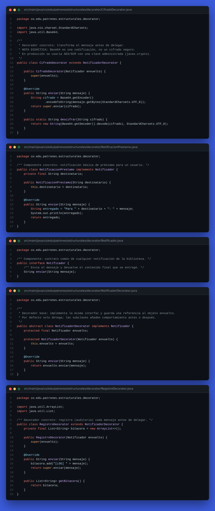

**Captura del funcionamiento (ejecución + pruebas)**

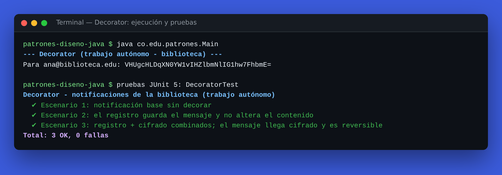

### 9.4 Proxy · _Trabajo autónomo_

🔗 [Probar Proxy en la página interactiva](https://srdiego18.github.io/Patrones-dise-o-java/#proxy) · 📁 [Ver carpeta en el repositorio](../src/main/java/co/edu/patrones/estructurales/proxy)

**Código fuente**

<details open><summary><code>LibroDigital.java</code></summary>

```java
package co.edu.patrones.estructurales.proxy;

/** Sujeto: contrato común del libro real y de su proxy. */
public interface LibroDigital {
    String leer(Usuario usuario);
}
```

</details>

<details open><summary><code>LibroDigitalProxy.java</code></summary>

```java
package co.edu.patrones.estructurales.proxy;

/**
 * Proxy de protección + virtual:
 *  1) verifica que el usuario tenga préstamo activo (autorización);
 *  2) crea/descarga el libro real solo la primera vez que alguien autorizado lo abre (carga diferida);
 *  3) reutiliza la instancia descargada en lecturas siguientes (caché).
 */
public class LibroDigitalProxy implements LibroDigital {
    private final String titulo;
    private LibroDigitalReal libroReal; // null hasta que se necesite

    public LibroDigitalProxy(String titulo) {
        this.titulo = titulo;
    }

    @Override
    public String leer(Usuario usuario) {
        if (usuario == null || !usuario.tienePrestamoActivo()) {
            throw new SecurityException("Acceso denegado: el usuario no tiene préstamo activo");
        }
        if (libroReal == null) {
            libroReal = new LibroDigitalReal(titulo);
        }
        return libroReal.leer(usuario);
    }

    public boolean estaCargado() {
        return libroReal != null;
    }
}
```

</details>

<details open><summary><code>LibroDigitalReal.java</code></summary>

```java
package co.edu.patrones.estructurales.proxy;

/**
 * Sujeto real: descargar el libro es costoso (simula descarga remota en el constructor).
 */
public class LibroDigitalReal implements LibroDigital {
    private static int descargasRealizadas = 0;
    private final String titulo;
    private final String contenido;

    public LibroDigitalReal(String titulo) {
        this.titulo = titulo;
        System.out.println("Descargando '" + titulo + "' del servidor remoto...");
        this.contenido = "Contenido completo de " + titulo;
        descargasRealizadas++;
    }

    @Override
    public String leer(Usuario usuario) {
        return contenido;
    }

    public String getTitulo() {
        return titulo;
    }

    public static int getDescargasRealizadas() {
        return descargasRealizadas;
    }

    public static void reiniciarContador() {
        descargasRealizadas = 0;
    }
}
```

</details>

<details open><summary><code>Usuario.java</code></summary>

```java
package co.edu.patrones.estructurales.proxy;

/** Usuario de la biblioteca. Solo quien tiene préstamo activo puede leer. */
public record Usuario(String nombre, boolean tienePrestamoActivo) {
}
```

</details>

<details><summary><code>ProxyTest.java</code> (pruebas)</summary>

```java
package co.edu.patrones.estructurales;

import co.edu.patrones.estructurales.proxy.*;
import org.junit.jupiter.api.BeforeEach;
import org.junit.jupiter.api.DisplayName;
import org.junit.jupiter.api.Test;

import static org.junit.jupiter.api.Assertions.*;

@DisplayName("Proxy - libro digital de la biblioteca (trabajo autónomo)")
class ProxyTest {

    @BeforeEach
    void reiniciar() {
        LibroDigitalReal.reiniciarContador();
    }

    @Test
    @DisplayName("Escenario 1: usuario sin préstamo es rechazado y el libro NO se descarga")
    void accesoDenegado() {
        LibroDigitalProxy proxy = new LibroDigitalProxy("Clean Code");
        assertThrows(SecurityException.class, () -> proxy.leer(new Usuario("Invitado", false)));
        assertFalse(proxy.estaCargado());
        assertEquals(0, LibroDigitalReal.getDescargasRealizadas());
    }

    @Test
    @DisplayName("Escenario 2: carga diferida, solo descarga al abrir")
    void cargaDiferida() {
        LibroDigitalProxy proxy = new LibroDigitalProxy("Clean Code");
        assertFalse(proxy.estaCargado(), "Crear el proxy no debe descargar el libro");

        String contenido = proxy.leer(new Usuario("Ana", true));
        assertTrue(proxy.estaCargado());
        assertEquals("Contenido completo de Clean Code", contenido);
    }

    @Test
    @DisplayName("Escenario 3: lecturas repetidas reutilizan la descarga (caché)")
    void cache() {
        LibroDigitalProxy proxy = new LibroDigitalProxy("Clean Code");
        Usuario ana = new Usuario("Ana", true);
        proxy.leer(ana);
        proxy.leer(ana);
        proxy.leer(ana);
        assertEquals(1, LibroDigitalReal.getDescargasRealizadas());
    }
}
```

</details>

**Captura del código**

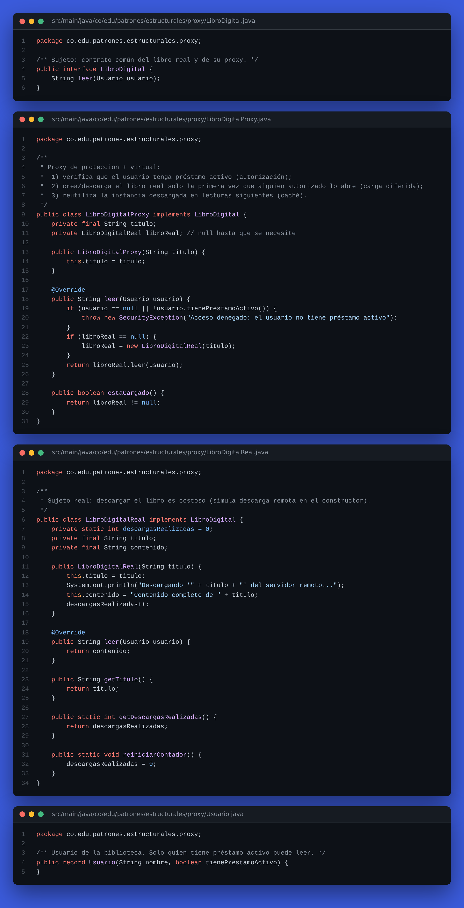

**Captura del funcionamiento (ejecución + pruebas)**

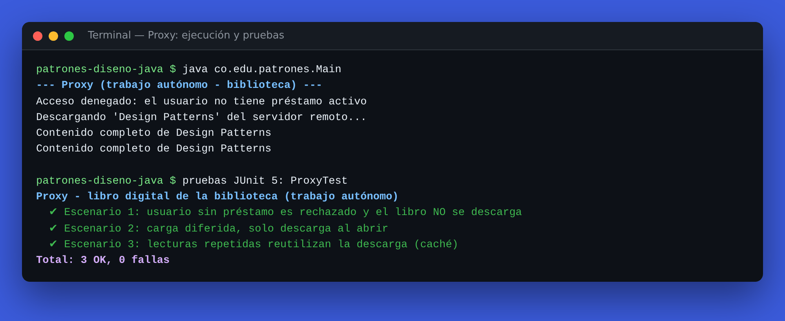

### 9.5 Composite · _Extra_

🔗 [Probar Composite en la página interactiva](https://srdiego18.github.io/Patrones-dise-o-java/#composite) · 📁 [Ver carpeta en el repositorio](../src/main/java/co/edu/patrones/estructurales/composite)

**Código fuente**

<details open><summary><code>Archivo.java</code></summary>

```java
package co.edu.patrones.estructurales.composite;

import java.util.Objects;

/** Hoja: no tiene hijos; su tamaño es propio. */
public class Archivo implements ElementoArchivo {
    private final String nombre;
    private final long tamanoKb;

    public Archivo(String nombre, long tamanoKb) {
        if (tamanoKb < 0) throw new IllegalArgumentException("El tamaño no puede ser negativo");
        this.nombre = Objects.requireNonNull(nombre, "nombre");
        this.tamanoKb = tamanoKb;
    }

    @Override public String getNombre() { return nombre; }
    @Override public long tamano() { return tamanoKb; }

    @Override
    public String mostrar(int nivel) {
        return "  ".repeat(nivel) + "- " + nombre + " (" + tamanoKb + " KB)\n";
    }
}
```

</details>

<details open><summary><code>Carpeta.java</code></summary>

```java
package co.edu.patrones.estructurales.composite;

import java.util.ArrayList;
import java.util.Collections;
import java.util.List;
import java.util.Objects;

/** Compuesto: contiene elementos (archivos o carpetas) y delega en ellos. */
public class Carpeta implements ElementoArchivo {
    private final String nombre;
    private final List<ElementoArchivo> hijos = new ArrayList<>();

    public Carpeta(String nombre) {
        this.nombre = Objects.requireNonNull(nombre, "nombre");
    }

    public Carpeta agregar(ElementoArchivo elemento) {
        Objects.requireNonNull(elemento, "elemento");
        if (elemento == this) throw new IllegalArgumentException("Una carpeta no puede contenerse a sí misma");
        hijos.add(elemento);
        return this; // interfaz fluida
    }

    public void eliminar(ElementoArchivo elemento) {
        hijos.remove(elemento);
    }

    public List<ElementoArchivo> getHijos() {
        return Collections.unmodifiableList(hijos);
    }

    @Override public String getNombre() { return nombre; }

    @Override
    public long tamano() {
        // Recursión polimórfica: no importa si el hijo es Archivo o Carpeta.
        return hijos.stream().mapToLong(ElementoArchivo::tamano).sum();
    }

    @Override
    public String mostrar(int nivel) {
        StringBuilder sb = new StringBuilder("  ".repeat(nivel))
                .append("+ ").append(nombre).append("/ (").append(tamano()).append(" KB)\n");
        hijos.forEach(h -> sb.append(h.mostrar(nivel + 1)));
        return sb.toString();
    }
}
```

</details>

<details open><summary><code>ElementoArchivo.java</code></summary>

```java
package co.edu.patrones.estructurales.composite;

/** Componente: abstracción común para hojas (Archivo) y contenedores (Carpeta). */
public interface ElementoArchivo {
    String getNombre();

    /** Tamaño en KB. En una carpeta es la suma recursiva de sus hijos. */
    long tamano();

    /** Representación en árbol con sangría según la profundidad. */
    String mostrar(int nivel);
}
```

</details>

<details><summary><code>CompositeTest.java</code> (pruebas)</summary>

```java
package co.edu.patrones.estructurales;

import co.edu.patrones.estructurales.composite.*;
import org.junit.jupiter.api.DisplayName;
import org.junit.jupiter.api.Test;

import static org.junit.jupiter.api.Assertions.*;

@DisplayName("Composite - archivos y carpetas (extra)")
class CompositeTest {

    @Test
    @DisplayName("Un archivo devuelve su propio tamaño y una carpeta vacía pesa 0")
    void hojaYCarpetaVacia() {
        assertEquals(120, new Archivo("a.txt", 120).tamano());
        assertEquals(0, new Carpeta("vacia").tamano());
    }

    @Test
    @DisplayName("Carpetas anidadas suman recursivamente el tamaño de sus hijos")
    void sumaRecursiva() {
        Carpeta raiz = new Carpeta("biblioteca")
                .agregar(new Archivo("catalogo.pdf", 300))
                .agregar(new Carpeta("libros")
                        .agregar(new Archivo("java.epub", 500))
                        .agregar(new Carpeta("patrones").agregar(new Archivo("gof.pdf", 200))));
        assertEquals(1000, raiz.tamano());
    }

    @Test
    @DisplayName("Reglas de integridad: no tamaños negativos ni carpeta dentro de sí misma")
    void integridad() {
        Carpeta c = new Carpeta("c");
        assertThrows(IllegalArgumentException.class, () -> new Archivo("x", -1));
        assertThrows(IllegalArgumentException.class, () -> c.agregar(c));
    }
}
```

</details>

**Captura del código**

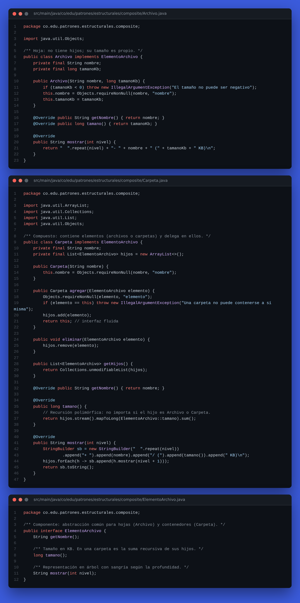

**Captura del funcionamiento (ejecución + pruebas)**

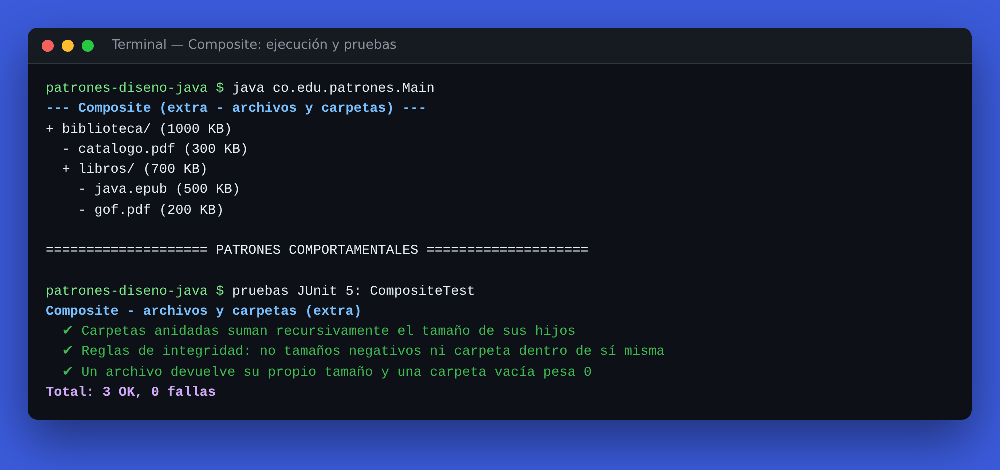

### Ejecución completa y resumen de pruebas

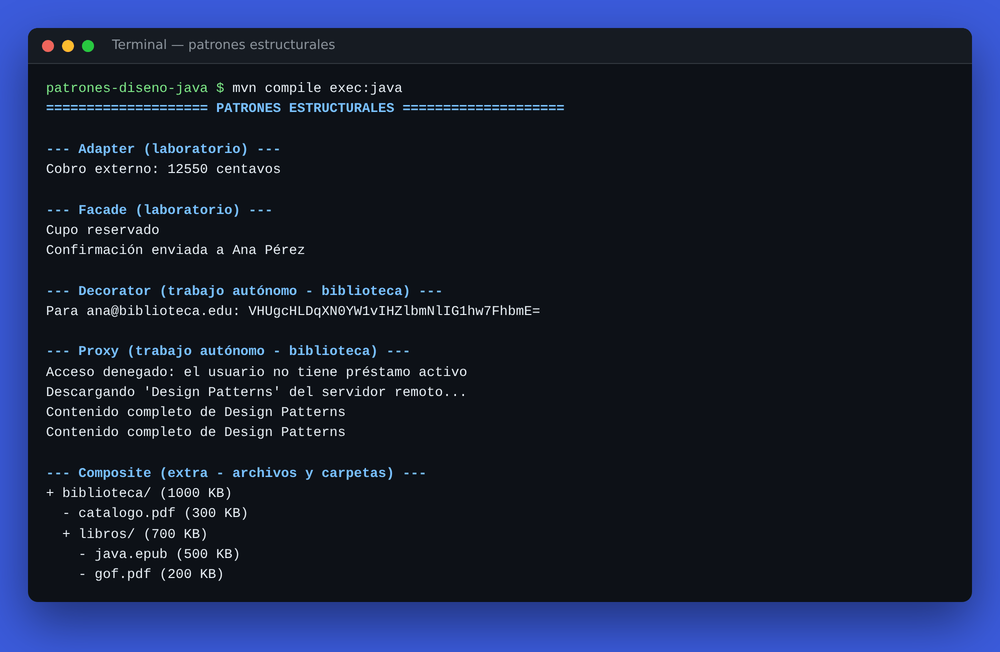

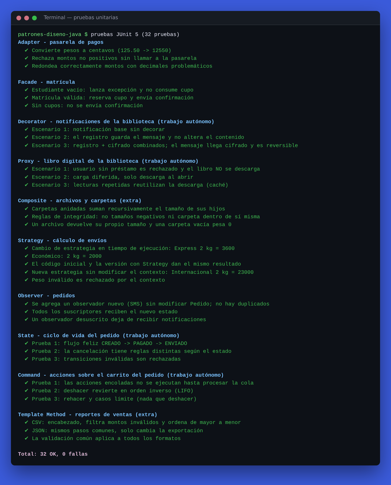

---
## 10. Autoevaluación frente a la rúbrica

| Criterio | Peso | Evidencia en el repositorio |
|---|---|---|
| Análisis y selección | 25 % | §5 (5 situaciones resueltas y justificadas), §6, problema y alternativa de cada patrón en §7 |
| Implementación | 30 % | Adapter, Facade, Decorator, Proxy **y Composite (extra)** compilando y ejecutándose desde [`Main`](../src/main/java/co/edu/patrones/Main.java) — ver §9 |
| Diseño | 20 % | Diagramas de clases y de secuencia (Mermaid), interfaces, inyección de dependencias, responsabilidad única |
| Pruebas | 15 % | 15 pruebas JUnit 5 (3 por patrón) ejecutadas automáticamente con GitHub Actions, en [`src/test/.../estructurales`](../src/test/java/co/edu/patrones/estructurales) |
| Reflexión | 10 % | Justificación, alternativa y limitación de cada patrón (§7) y costos de mantenimiento (§6.5) |

## Referencias

- Gamma, E., Helm, R., Johnson, R., & Vlissides, J. (1994). *Design Patterns: Elements of Reusable Object-Oriented Software*. Addison-Wesley.
- Freeman, E., Robson, E., Bates, B., & Sierra, K. (2004). *Head First Design Patterns*. O'Reilly Media.
