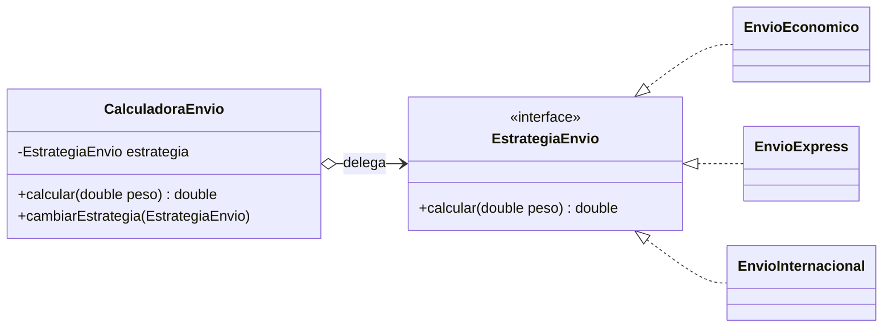
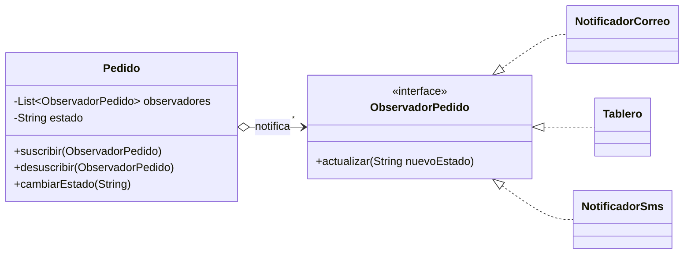
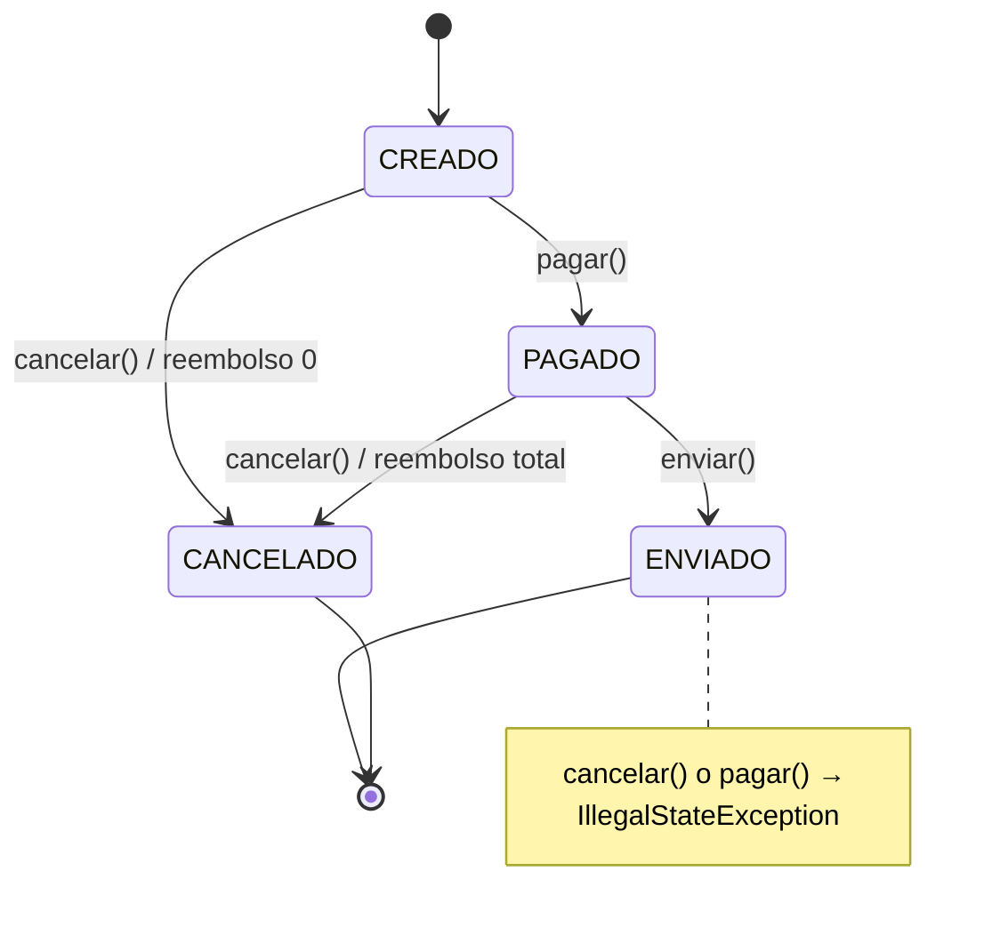
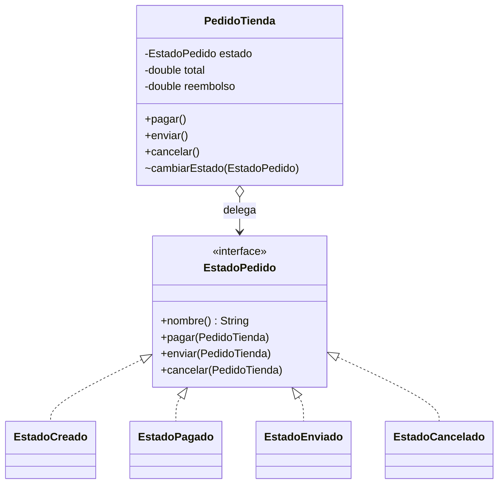
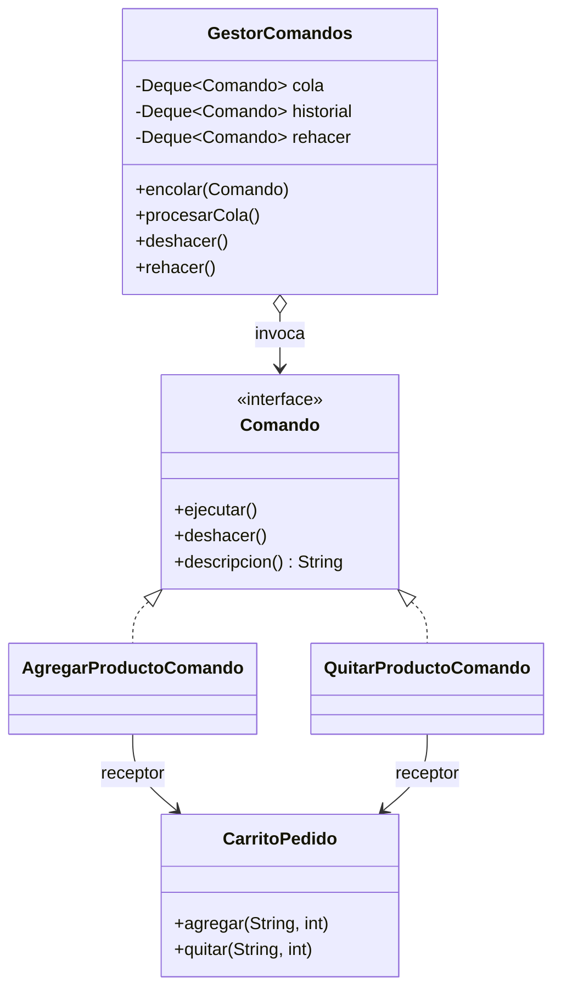

# Guía resuelta — Patrones comportamentales

> Patrones y metodologías de desarrollo · Java
> **Resultado de aprendizaje:** reconocer problemas de comunicación y distribución de responsabilidades entre objetos, y aplicar Strategy y Observer mediante una implementación Java guiada.

[⬅ Volver al README](../README.md)

---

## Contenido

1. [Concepto central](#1-concepto-central)
2. [Los cinco patrones comportamentales](#2-los-cinco-patrones-comportamentales)
3. [Laboratorio: Strategy para calcular envíos](#3-laboratorio-strategy-para-calcular-envíos)
4. [Segundo ejemplo: Observer para pedidos](#4-segundo-ejemplo-observer-para-pedidos)
5. [Actividad de análisis (resuelta)](#5-actividad-de-análisis-resuelta)
6. [Verificación (resuelta)](#6-verificación-resuelta)
7. [Trabajo autónomo: Sistema de pedidos con State y Command](#7-trabajo-autónomo-sistema-de-pedidos-con-state-y-command)
8. [Autoevaluación frente a la rúbrica](#8-autoevaluación-frente-a-la-rúbrica)

---

## 1. Concepto central

Los patrones comportamentales organizan **algoritmos, responsabilidades y comunicación entre objetos**. Ayudan a reducir dependencias rígidas y a definir con claridad **quién conoce, quién notifica y quién ejecuta** una acción.

## 2. Los cinco patrones comportamentales

| Patrón | Propósito | Ejemplo | ¿Dónde está en el repo? |
|---|---|---|---|
| **Strategy** | Encapsula algoritmos intercambiables | Cálculo de envío | [`strategy/`](../src/main/java/co/edu/patrones/comportamentales/strategy) — laboratorio |
| **Observer** | Notifica a suscriptores cuando cambia un objeto | Alertas de cambio de estado del pedido | [`observer/`](../src/main/java/co/edu/patrones/comportamentales/observer) — laboratorio |
| **Command** | Convierte una solicitud en objeto ejecutable | Acciones encoladas y deshacer/rehacer | [`command/`](../src/main/java/co/edu/patrones/comportamentales/command) — trabajo autónomo |
| **State** | Cambia el comportamiento según el estado interno | Pedido creado, pagado, enviado | [`state/`](../src/main/java/co/edu/patrones/comportamentales/state) — trabajo autónomo |
| **Template Method** | Define el esqueleto de un algoritmo y deja pasos a subclases | Reportes con distintos exportadores | Explicado en §5 y §6 |

---

## 3. Laboratorio: Strategy para calcular envíos

**Problema.** La versión inicial concentra las reglas en condicionales. Cada proveedor nuevo o cambio de fórmula obliga a **modificar** `CalculadoraEnvio`, que acumula decisiones y crece sin control.

**Paso 1 — Análisis del código inicial** ([`CalculadoraEnvioInicial.java`](../src/main/java/co/edu/patrones/comportamentales/strategy/CalculadoraEnvioInicial.java), conservado para comparar):
- Viola el principio **abierto/cerrado**: para agregar "INTERNACIONAL" hay que editar la clase.
- Usa *strings mágicos* (`"ECONOMICO"`), así que un error tipográfico solo se detecta en ejecución.
- Todas las fórmulas viven juntas: probar una implica cargar todas.

| Paso | Qué se hizo | Archivo |
|---|---|---|
| 2 | Interfaz de la estrategia | [`EstrategiaEnvio.java`](../src/main/java/co/edu/patrones/comportamentales/strategy/EstrategiaEnvio.java) |
| 3 | Estrategias concretas | [`EnvioEconomico`](../src/main/java/co/edu/patrones/comportamentales/strategy/EnvioEconomico.java), [`EnvioExpress`](../src/main/java/co/edu/patrones/comportamentales/strategy/EnvioExpress.java) |
| 4 | Contexto que valida y delega | [`CalculadoraEnvio.java`](../src/main/java/co/edu/patrones/comportamentales/strategy/CalculadoraEnvio.java) |
| 5 | Ejecución | [`Main.java`](../src/main/java/co/edu/patrones/Main.java) → `2000.0` y `3600.0` ✅ |
| Extra | **Nuevo proveedor sin tocar el contexto** | [`EnvioInternacional.java`](../src/main/java/co/edu/patrones/comportamentales/strategy/EnvioInternacional.java) |

**Pruebas** ([`StrategyTest`](../src/test/java/co/edu/patrones/comportamentales/StrategyTest.java)): económico 2 kg = 2000 · cambio a express en ejecución = 3600 · internacional (estrategia nueva) = 23000 · peso inválido rechazado · el código inicial y el refactorizado dan el mismo resultado (la refactorización no cambió el comportamiento).

---

## 4. Segundo ejemplo: Observer para pedidos

**Problema.** Cuando cambia el estado de un pedido deben reaccionar el correo y el tablero, pero `Pedido` no debería depender de cada componente concreto.

| Paso de la guía | Implementación |
|---|---|
| 1. Definir el contrato | [`ObservadorPedido`](../src/main/java/co/edu/patrones/comportamentales/observer/ObservadorPedido.java) |
| 2. Lista de suscriptores en `Pedido` | `List<ObservadorPedido> observadores` en [`Pedido`](../src/main/java/co/edu/patrones/comportamentales/observer/Pedido.java) |
| 3. Método `suscribir()` | Implementado, **ignora duplicados** |
| 4. Notificar al cambiar el estado | `cambiarEstado()` recorre la lista y llama `actualizar()` |
| 5. Otro observador sin modificar `Pedido` | [`NotificadorSms`](../src/main/java/co/edu/patrones/comportamentales/observer/NotificadorSms.java) ✅ |

**Mejoras de las que habla la guía ("en producción conviene…")** que se implementaron: `desuscribir()` y control de duplicados. Quedan fuera del alcance: manejo de errores de un observador (hoy una excepción interrumpe a los siguientes) y concurrencia (se usaría `CopyOnWriteArrayList`).

**Pruebas** ([`ObserverTest`](../src/test/java/co/edu/patrones/comportamentales/ObserverTest.java)): todos los suscriptores reciben el estado · observador nuevo sin duplicados · un observador desuscrito deja de recibir.

---

## 5. Actividad de análisis (resuelta)

| # | Situación | Patrón | Justificación |
|---|---|---|---|
| 1 | Elegir diferentes reglas de descuento en tiempo de ejecución. | **Strategy** | Son algoritmos intercambiables de la misma familia; el contexto delega en una interfaz `EstrategiaDescuento` y la regla se cambia sin `if/else`. |
| 2 | Cuando una cuenta cambia su saldo, varias vistas se actualizan sin que la cuenta conozca cada vista. | **Observer** | Relación uno-a-muchos: la cuenta (*subject*) notifica a una lista de observadores a través de una interfaz, sin acoplarse a las vistas concretas. |
| 3 | Almacenar una acción de usuario para ejecutarla después en una cola. | **Command** | La solicitud se convierte en un objeto con `ejecutar()` que puede guardarse, encolarse, registrarse o deshacerse. Implementado en el trabajo autónomo. |
| 4 | Un pedido tiene reglas distintas para cancelar según esté creado, pagado o enviado. | **State** | El comportamiento depende del estado interno; cada estado es una clase que decide qué hacer al cancelar. Implementado en el trabajo autónomo. |
| 5 | Los reportes comparten validar, consultar y transformar, pero cambia la exportación. | **Template Method** | Una clase abstracta `GeneradorReporte` define `generar()` como método `final` que llama `validar() → consultar() → transformar() → exportar()`; las subclases (`ReportePdf`, `ReporteExcel`) solo implementan `exportar()`. |

---

## 6. Verificación (resuelta)

**1. ¿Qué problema resuelve Strategy frente a muchos if/else?**
Elimina la clase que concentra todas las variantes de un algoritmo. Cada variante queda en su propia clase, el contexto solo conoce la interfaz y se pueden **agregar fórmulas sin modificar código existente** (abierto/cerrado). Además, cada estrategia se prueba de forma aislada y puede cambiarse en tiempo de ejecución (`cambiarEstrategia`).

**2. ¿Qué relación existe entre Subject y Observer?**
Es una relación **uno-a-muchos con bajo acoplamiento**. El *Subject* (`Pedido`) mantiene una lista de observadores y los notifica cuando cambia; solo depende de la **interfaz** `ObservadorPedido`, no de las clases concretas. Los *Observers* se suscriben y desuscriben en tiempo de ejecución y reaccionan a la notificación. Es la base del modelo publicador/suscriptor y de los eventos en interfaces gráficas.

**3. ¿Qué ventaja aporta Command frente a invocar directamente un método?**
Desacopla **quién pide** la acción (invocador) de **quién la ejecuta** (receptor). Como la acción es un objeto, puede **encolarse** para ejecutarse después, **registrarse** en una bitácora, **deshacerse/rehacerse** si se define la operación inversa, reintentarse o combinarse en macros. Una invocación directa ocurre en el momento y no deja rastro.

**4. ¿Cuándo State es preferible a condicionales por estado?**
Cuando hay **varios estados**, **varias operaciones** cuyo comportamiento cambia según el estado y **reglas de transición**. Con condicionales, cada método repite un `switch (estado)` y agregar un estado obliga a modificar todos los métodos. Con State, cada estado encapsula sus reglas en una clase y agregar uno no toca los demás. Con dos estados triviales, un `if` sigue siendo suficiente.

**5. ¿Qué define Template Method y qué deja variar?**
Define, en una clase base, el **esqueleto fijo del algoritmo**: el orden de los pasos (normalmente en un método `final` para que no se altere). Deja variar los **pasos concretos** que las subclases implementan (métodos abstractos) y, opcionalmente, *hooks* con comportamiento por defecto. Se basa en herencia, a diferencia de Strategy, que se basa en composición.

---

## 7. Trabajo autónomo: Sistema de pedidos con State y Command

> Dominio elegido: **sistema de pedidos**. Se implementan dos patrones distintos a los del laboratorio para ampliar la práctica.

### 7.1 State — ciclo de vida del pedido

**Problema.** Un pedido pasa por `CREADO → PAGADO → ENVIADO` y puede `CANCELARSE`. Las reglas cambian según el estado: un pedido creado se cancela sin costo, uno pagado se cancela con reembolso total, uno enviado no puede cancelarse, y no se puede enviar sin pagar. Con condicionales, `pagar()`, `enviar()` y `cancelar()` tendrían cada uno un `switch` sobre el estado que habría que editar al añadir un estado nuevo (por ejemplo, `ENTREGADO`).

**Diagrama de estados.**

**Diagrama de clases.**

**Código:** [`state/`](../src/main/java/co/edu/patrones/comportamentales/state). `PedidoTienda` **no contiene ningún `if` sobre el estado**; la interfaz usa métodos `default` que lanzan `IllegalStateException`, de modo que cada estado solo sobrescribe las transiciones que permite.

**Pruebas** ([`StateTest`](../src/test/java/co/edu/patrones/comportamentales/StateTest.java)):

| # | Prueba | Resultado esperado |
|---|---|---|
| 1 | Flujo feliz | `CREADO → PAGADO → ENVIADO` |
| 2 | Cancelar según el estado | Creado: reembolso 0 · Pagado: reembolso = total |
| 3 | Transiciones inválidas | Enviar sin pagar y cancelar un pedido enviado lanzan `IllegalStateException`; el estado no cambia |

**Justificación.** Cada regla de negocio vive en la clase del estado al que pertenece; agregar `ENTREGADO` o `DEVUELTO` implica crear una clase y modificar solo el estado que transiciona hacia él. Las transiciones inválidas se rechazan por diseño.

**Alternativa considerada.** Un `enum EstadoPedido` con `switch` en cada método del pedido. Es más compacto y aceptable con pocos estados y reglas simples, pero dispersa la lógica de un mismo estado en varios métodos y crece mal.

**Limitación.** Aumenta el número de clases, y las transiciones quedan **repartidas** entre los estados (no hay un único lugar donde ver la máquina completa; por eso se documenta con el diagrama). Los estados necesitan acceso a métodos internos del pedido (`cambiarEstado`, `registrarReembolso`), resuelto aquí con visibilidad de paquete. La persistencia en base de datos requiere mapear las clases de estado a un valor almacenable.

### 7.2 Command — acciones encolables con deshacer/rehacer

**Problema.** El usuario arma su pedido agregando y quitando productos. El sistema debe **encolar** estas acciones para procesarlas después (por ejemplo, al sincronizar con el servidor), **registrar** cada una y permitir **deshacer y rehacer**. Si la interfaz llamara directamente a `carrito.agregar(...)`, no habría forma de guardar, retrasar ni revertir la acción.

**Diagrama.**

| Rol del patrón | Clase |
|---|---|
| Comando | [`Comando`](../src/main/java/co/edu/patrones/comportamentales/command/Comando.java) |
| Comandos concretos | [`AgregarProductoComando`](../src/main/java/co/edu/patrones/comportamentales/command/AgregarProductoComando.java), [`QuitarProductoComando`](../src/main/java/co/edu/patrones/comportamentales/command/QuitarProductoComando.java) (cada uno con su **operación inversa**) |
| Receptor | [`CarritoPedido`](../src/main/java/co/edu/patrones/comportamentales/command/CarritoPedido.java) |
| Invocador | [`GestorComandos`](../src/main/java/co/edu/patrones/comportamentales/command/GestorComandos.java): cola FIFO, historial LIFO, pila de rehacer y bitácora |

**Pruebas** ([`CommandTest`](../src/test/java/co/edu/patrones/comportamentales/CommandTest.java)):

| # | Prueba | Resultado esperado |
|---|---|---|
| 1 | Encolar sin procesar | El carrito no cambia hasta `procesarCola()` |
| 2 | Deshacer dos veces | Se revierte en orden inverso (LIFO): 3 → 5 → 0 |
| 3 | Rehacer y casos límite | Deshacer sin historial lanza excepción; deshacer + rehacer deja el producto; la bitácora tiene 3 entradas |

**Justificación.** El invocador no sabe qué hace cada comando; agregar `CambiarCantidadComando` o `AplicarCuponComando` no modifica `GestorComandos`. Encolar, registrar y deshacer salen "gratis" del hecho de que la acción sea un objeto.

**Alternativa considerada.** Guardar *snapshots* del carrito completo (patrón **Memento**) para deshacer. Es más simple de implementar, pero consume más memoria y no sirve para encolar acciones pendientes ni para registrar qué hizo el usuario.

**Limitación.** Cada acción nueva exige una clase y una operación inversa **correcta**; algunas acciones no son reversibles (enviar un correo, cobrar una tarjeta) y requieren compensaciones. El historial crece sin límite si no se acota, y no se maneja el fallo de un comando a mitad de la cola (no hay transacción).

---

## 8. Autoevaluación frente a la rúbrica

| Criterio | Peso | Evidencia en el repositorio |
|---|---|---|
| Análisis y selección | 25 % | §5 (5 situaciones resueltas), §6, problema y alternativa de cada patrón en §7 |
| Implementación | 30 % | Strategy, Observer, State y Command compilando y ejecutándose desde [`Main`](../src/main/java/co/edu/patrones/Main.java) |
| Diseño | 20 % | Diagramas de clases y de estados (Mermaid), interfaces, métodos `default`, visibilidad de paquete |
| Pruebas | 15 % | 14 pruebas JUnit 5 (≥ 3 por patrón) en [`src/test/.../comportamentales`](../src/test/java/co/edu/patrones/comportamentales) |
| Reflexión | 10 % | Justificación, alternativa y limitación de cada patrón (§7) |

## Referencias

- Gamma, E., Helm, R., Johnson, R., & Vlissides, J. (1994). *Design Patterns: Elements of Reusable Object-Oriented Software*. Addison-Wesley.
- Freeman, E., Robson, E., Bates, B., & Sierra, K. (2004). *Head First Design Patterns*. O'Reilly Media.
