# Guía resuelta — Patrones comportamentales

> Patrones y metodologías de desarrollo · Java
> **Resultado de aprendizaje:** reconocer problemas de comunicación y distribución de responsabilidades entre objetos, y aplicar Strategy y Observer mediante una implementación Java guiada.

[⬅ Volver al README](../README.md)

---

## Contenido

1. [Concepto central](#1-concepto-central)
2. [Los cinco patrones comportamentales](#2-los-cinco-patrones-comportamentales)
3. [Laboratorio: Strategy para calcular envíos](#3-laboratorio-strategy-para-calcular-envíos)
4. [Segundo ejemplo: Observer para pedidos](#4-segundo-ejemplo-observer-para-pedidos)
5. [Actividad de análisis (resuelta)](#5-actividad-de-análisis-resuelta)
6. [Verificación (resuelta)](#6-verificación-resuelta)
7. [Trabajo autónomo: Sistema de pedidos con State y Command](#7-trabajo-autónomo-sistema-de-pedidos-con-state-y-command)
8. [Extra: Template Method implementado](#8-extra-template-method-implementado)
9. [Código completo, capturas y funcionamiento](#9-código-completo-capturas-y-funcionamiento)
10. [Autoevaluación frente a la rúbrica](#10-autoevaluación-frente-a-la-rúbrica)

---

## 1. Concepto central

Los patrones comportamentales organizan **algoritmos, responsabilidades y comunicación entre objetos**. Ayudan a reducir dependencias rígidas y a definir con claridad **quién conoce, quién notifica y quién ejecuta** una acción.

## 2. Los cinco patrones comportamentales

| Patrón | Propósito | Ejemplo | ¿Dónde está en el repo? |
|---|---|---|---|
| **Strategy** | Encapsula algoritmos intercambiables | Cálculo de envío | [`strategy/`](../src/main/java/co/edu/patrones/comportamentales/strategy) — laboratorio |
| **Observer** | Notifica a suscriptores cuando cambia un objeto | Alertas de cambio de estado del pedido | [`observer/`](../src/main/java/co/edu/patrones/comportamentales/observer) — laboratorio |
| **Command** | Convierte una solicitud en objeto ejecutable | Acciones encoladas y deshacer/rehacer | [`command/`](../src/main/java/co/edu/patrones/comportamentales/command) — trabajo autónomo |
| **State** | Cambia el comportamiento según el estado interno | Pedido creado, pagado, enviado | [`state/`](../src/main/java/co/edu/patrones/comportamentales/state) — trabajo autónomo |
| **Template Method** | Define el esqueleto de un algoritmo y deja pasos a subclases | Reportes con distintos exportadores | [`templatemethod/`](../src/main/java/co/edu/patrones/comportamentales/templatemethod) — **extra** |

---

## 3. Laboratorio: Strategy para calcular envíos

**Problema.** La versión inicial concentra las reglas en condicionales. Cada proveedor nuevo o cambio de fórmula obliga a **modificar** `CalculadoraEnvio`, que acumula decisiones y crece sin control.

**Paso 1 — Análisis del código inicial** ([`CalculadoraEnvioInicial.java`](../src/main/java/co/edu/patrones/comportamentales/strategy/CalculadoraEnvioInicial.java), conservado para comparar):
- Viola el principio **abierto/cerrado**: para agregar "INTERNACIONAL" hay que editar la clase.
- Usa *strings mágicos* (`"ECONOMICO"`), así que un error tipográfico solo se detecta en ejecución.
- Todas las fórmulas viven juntas: probar una implica cargar todas.

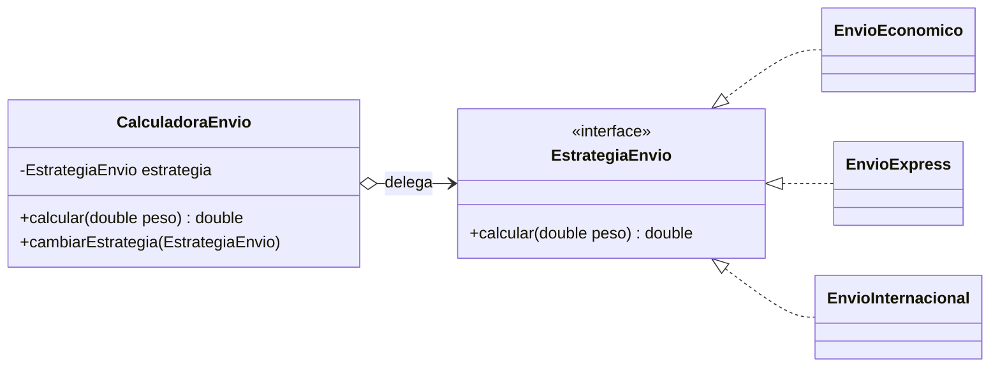

| Paso | Qué se hizo | Archivo |
|---|---|---|
| 2 | Interfaz de la estrategia | [`EstrategiaEnvio.java`](../src/main/java/co/edu/patrones/comportamentales/strategy/EstrategiaEnvio.java) |
| 3 | Estrategias concretas | [`EnvioEconomico`](../src/main/java/co/edu/patrones/comportamentales/strategy/EnvioEconomico.java), [`EnvioExpress`](../src/main/java/co/edu/patrones/comportamentales/strategy/EnvioExpress.java) |
| 4 | Contexto que valida y delega | [`CalculadoraEnvio.java`](../src/main/java/co/edu/patrones/comportamentales/strategy/CalculadoraEnvio.java) |
| 5 | Ejecución | [`Main.java`](../src/main/java/co/edu/patrones/Main.java) → `2000.0` y `3600.0` ✅ |
| Extra | **Nuevo proveedor sin tocar el contexto** | [`EnvioInternacional.java`](../src/main/java/co/edu/patrones/comportamentales/strategy/EnvioInternacional.java) |

**Pruebas** ([`StrategyTest`](../src/test/java/co/edu/patrones/comportamentales/StrategyTest.java)): económico 2 kg = 2000 · cambio a express en ejecución = 3600 · internacional (estrategia nueva) = 23000 · peso inválido rechazado · el código inicial y el refactorizado dan el mismo resultado (la refactorización no cambió el comportamiento).

---

## 4. Segundo ejemplo: Observer para pedidos

**Problema.** Cuando cambia el estado de un pedido deben reaccionar el correo y el tablero, pero `Pedido` no debería depender de cada componente concreto.

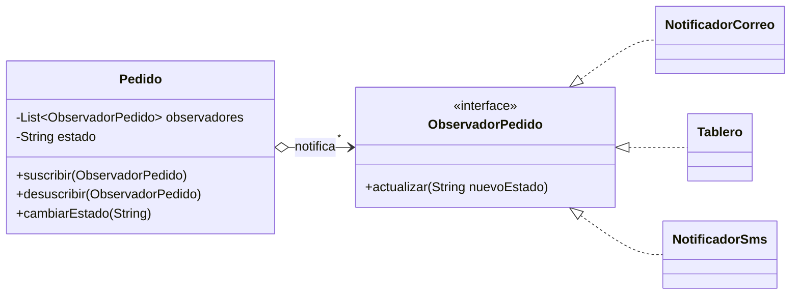

| Paso de la guía | Implementación |
|---|---|
| 1. Definir el contrato | [`ObservadorPedido`](../src/main/java/co/edu/patrones/comportamentales/observer/ObservadorPedido.java) |
| 2. Lista de suscriptores en `Pedido` | `List<ObservadorPedido> observadores` en [`Pedido`](../src/main/java/co/edu/patrones/comportamentales/observer/Pedido.java) |
| 3. Método `suscribir()` | Implementado, **ignora duplicados** |
| 4. Notificar al cambiar el estado | `cambiarEstado()` recorre la lista y llama `actualizar()` |
| 5. Otro observador sin modificar `Pedido` | [`NotificadorSms`](../src/main/java/co/edu/patrones/comportamentales/observer/NotificadorSms.java) ✅ |

**Mejoras de las que habla la guía ("en producción conviene…")** que se implementaron: `desuscribir()` y control de duplicados. Quedan fuera del alcance: manejo de errores de un observador (hoy una excepción interrumpe a los siguientes) y concurrencia (se usaría `CopyOnWriteArrayList`).

**Pruebas** ([`ObserverTest`](../src/test/java/co/edu/patrones/comportamentales/ObserverTest.java)): todos los suscriptores reciben el estado · observador nuevo sin duplicados · un observador desuscrito deja de recibir.

---

## 5. Actividad de análisis (resuelta)

| # | Situación | Patrón | Justificación |
|---|---|---|---|
| 1 | Elegir diferentes reglas de descuento en tiempo de ejecución. | **Strategy** | Son algoritmos intercambiables de la misma familia; el contexto delega en una interfaz `EstrategiaDescuento` y la regla se cambia sin `if/else`. |
| 2 | Cuando una cuenta cambia su saldo, varias vistas se actualizan sin que la cuenta conozca cada vista. | **Observer** | Relación uno-a-muchos: la cuenta (*subject*) notifica a una lista de observadores a través de una interfaz, sin acoplarse a las vistas concretas. |
| 3 | Almacenar una acción de usuario para ejecutarla después en una cola. | **Command** | La solicitud se convierte en un objeto con `ejecutar()` que puede guardarse, encolarse, registrarse o deshacerse. Implementado en el trabajo autónomo. |
| 4 | Un pedido tiene reglas distintas para cancelar según esté creado, pagado o enviado. | **State** | El comportamiento depende del estado interno; cada estado es una clase que decide qué hacer al cancelar. Implementado en el trabajo autónomo. |
| 5 | Los reportes comparten validar, consultar y transformar, pero cambia la exportación. | **Template Method** | Una clase abstracta `GeneradorReporte` define `generar()` como método `final` que llama `validar() → consultar() → transformar() → exportar()`; las subclases (`ReportePdf`, `ReporteExcel`) solo implementan `exportar()`. |

---

## 6. Verificación (resuelta)

**1. ¿Qué problema resuelve Strategy frente a muchos if/else?**
Elimina la clase que concentra todas las variantes de un algoritmo. Cada variante queda en su propia clase, el contexto solo conoce la interfaz y se pueden **agregar fórmulas sin modificar código existente** (abierto/cerrado). Además, cada estrategia se prueba de forma aislada y puede cambiarse en tiempo de ejecución (`cambiarEstrategia`).

**2. ¿Qué relación existe entre Subject y Observer?**
Es una relación **uno-a-muchos con bajo acoplamiento**. El *Subject* (`Pedido`) mantiene una lista de observadores y los notifica cuando cambia; solo depende de la **interfaz** `ObservadorPedido`, no de las clases concretas. Los *Observers* se suscriben y desuscriben en tiempo de ejecución y reaccionan a la notificación. Es la base del modelo publicador/suscriptor y de los eventos en interfaces gráficas.

**3. ¿Qué ventaja aporta Command frente a invocar directamente un método?**
Desacopla **quién pide** la acción (invocador) de **quién la ejecuta** (receptor). Como la acción es un objeto, puede **encolarse** para ejecutarse después, **registrarse** en una bitácora, **deshacerse/rehacerse** si se define la operación inversa, reintentarse o combinarse en macros. Una invocación directa ocurre en el momento y no deja rastro.

**4. ¿Cuándo State es preferible a condicionales por estado?**
Cuando hay **varios estados**, **varias operaciones** cuyo comportamiento cambia según el estado y **reglas de transición**. Con condicionales, cada método repite un `switch (estado)` y agregar un estado obliga a modificar todos los métodos. Con State, cada estado encapsula sus reglas en una clase y agregar uno no toca los demás. Con dos estados triviales, un `if` sigue siendo suficiente.

**5. ¿Qué define Template Method y qué deja variar?**
Define, en una clase base, el **esqueleto fijo del algoritmo**: el orden de los pasos (normalmente en un método `final` para que no se altere). Deja variar los **pasos concretos** que las subclases implementan (métodos abstractos) y, opcionalmente, *hooks* con comportamiento por defecto. Se basa en herencia, a diferencia de Strategy, que se basa en composición.

---

## 7. Trabajo autónomo: Sistema de pedidos con State y Command

> Dominio elegido: **sistema de pedidos**. Se implementan dos patrones distintos a los del laboratorio para ampliar la práctica.

### 7.1 State — ciclo de vida del pedido

**Problema.** Un pedido pasa por `CREADO → PAGADO → ENVIADO` y puede `CANCELARSE`. Las reglas cambian según el estado: un pedido creado se cancela sin costo, uno pagado se cancela con reembolso total, uno enviado no puede cancelarse, y no se puede enviar sin pagar. Con condicionales, `pagar()`, `enviar()` y `cancelar()` tendrían cada uno un `switch` sobre el estado que habría que editar al añadir un estado nuevo (por ejemplo, `ENTREGADO`).

**Diagrama de estados.**

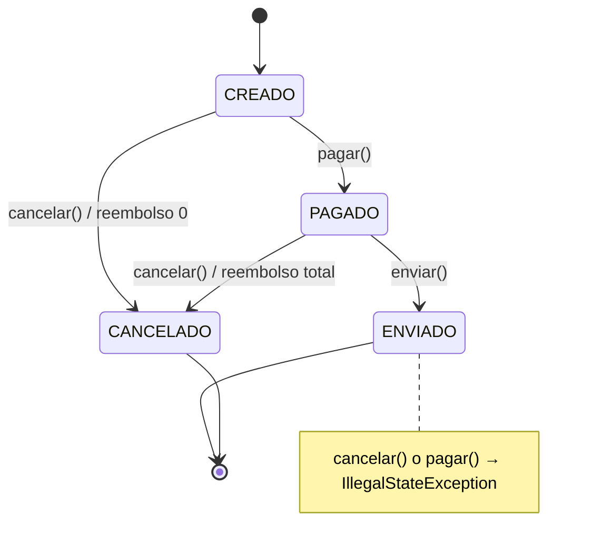

**Diagrama de clases.**

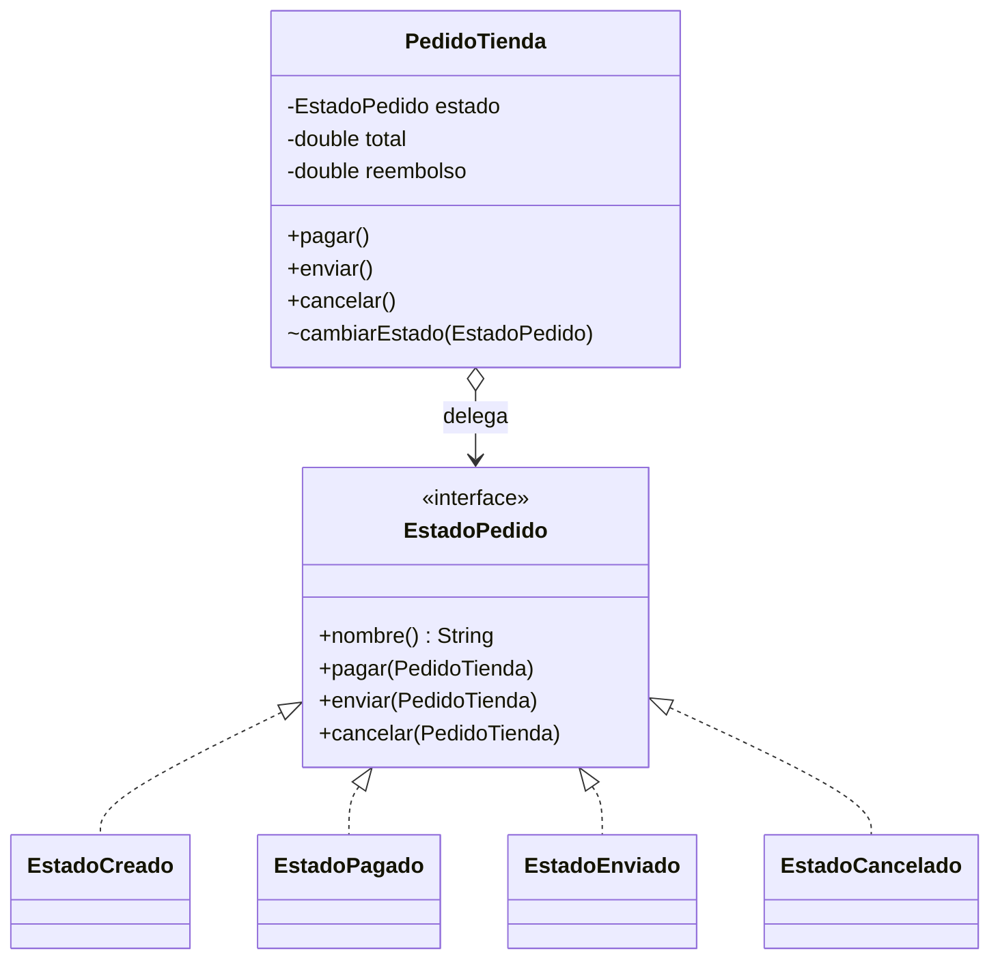

**Código:** [`state/`](../src/main/java/co/edu/patrones/comportamentales/state). `PedidoTienda` **no contiene ningún `if` sobre el estado**; la interfaz usa métodos `default` que lanzan `IllegalStateException`, de modo que cada estado solo sobrescribe las transiciones que permite.

**Pruebas** ([`StateTest`](../src/test/java/co/edu/patrones/comportamentales/StateTest.java)):

| # | Prueba | Resultado esperado |
|---|---|---|
| 1 | Flujo feliz | `CREADO → PAGADO → ENVIADO` |
| 2 | Cancelar según el estado | Creado: reembolso 0 · Pagado: reembolso = total |
| 3 | Transiciones inválidas | Enviar sin pagar y cancelar un pedido enviado lanzan `IllegalStateException`; el estado no cambia |

**Justificación.** Cada regla de negocio vive en la clase del estado al que pertenece; agregar `ENTREGADO` o `DEVUELTO` implica crear una clase y modificar solo el estado que transiciona hacia él. Las transiciones inválidas se rechazan por diseño.

**Alternativa considerada.** Un `enum EstadoPedido` con `switch` en cada método del pedido. Es más compacto y aceptable con pocos estados y reglas simples, pero dispersa la lógica de un mismo estado en varios métodos y crece mal.

**Limitación.** Aumenta el número de clases, y las transiciones quedan **repartidas** entre los estados (no hay un único lugar donde ver la máquina completa; por eso se documenta con el diagrama). Los estados necesitan acceso a métodos internos del pedido (`cambiarEstado`, `registrarReembolso`), resuelto aquí con visibilidad de paquete. La persistencia en base de datos requiere mapear las clases de estado a un valor almacenable.

### 7.2 Command — acciones encolables con deshacer/rehacer

**Problema.** El usuario arma su pedido agregando y quitando productos. El sistema debe **encolar** estas acciones para procesarlas después (por ejemplo, al sincronizar con el servidor), **registrar** cada una y permitir **deshacer y rehacer**. Si la interfaz llamara directamente a `carrito.agregar(...)`, no habría forma de guardar, retrasar ni revertir la acción.

**Diagrama.**

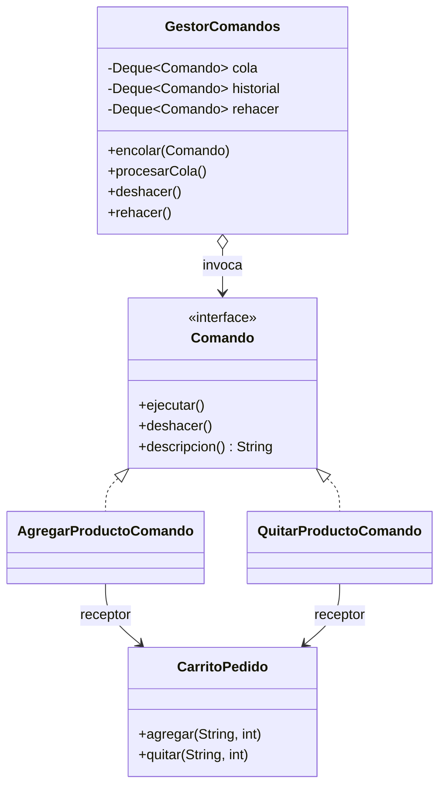

| Rol del patrón | Clase |
|---|---|
| Comando | [`Comando`](../src/main/java/co/edu/patrones/comportamentales/command/Comando.java) |
| Comandos concretos | [`AgregarProductoComando`](../src/main/java/co/edu/patrones/comportamentales/command/AgregarProductoComando.java), [`QuitarProductoComando`](../src/main/java/co/edu/patrones/comportamentales/command/QuitarProductoComando.java) (cada uno con su **operación inversa**) |
| Receptor | [`CarritoPedido`](../src/main/java/co/edu/patrones/comportamentales/command/CarritoPedido.java) |
| Invocador | [`GestorComandos`](../src/main/java/co/edu/patrones/comportamentales/command/GestorComandos.java): cola FIFO, historial LIFO, pila de rehacer y bitácora |

**Pruebas** ([`CommandTest`](../src/test/java/co/edu/patrones/comportamentales/CommandTest.java)):

| # | Prueba | Resultado esperado |
|---|---|---|
| 1 | Encolar sin procesar | El carrito no cambia hasta `procesarCola()` |
| 2 | Deshacer dos veces | Se revierte en orden inverso (LIFO): 3 → 5 → 0 |
| 3 | Rehacer y casos límite | Deshacer sin historial lanza excepción; deshacer + rehacer deja el producto; la bitácora tiene 3 entradas |

**Justificación.** El invocador no sabe qué hace cada comando; agregar `CambiarCantidadComando` o `AplicarCuponComando` no modifica `GestorComandos`. Encolar, registrar y deshacer salen "gratis" del hecho de que la acción sea un objeto.

**Alternativa considerada.** Guardar *snapshots* del carrito completo (patrón **Memento**) para deshacer. Es más simple de implementar, pero consume más memoria y no sirve para encolar acciones pendientes ni para registrar qué hizo el usuario.

**Limitación.** Cada acción nueva exige una clase y una operación inversa **correcta**; algunas acciones no son reversibles (enviar un correo, cobrar una tarjeta) y requieren compensaciones. El historial crece sin límite si no se acota, y no se maneja el fallo de un comando a mitad de la cola (no hay transacción).

---

## 8. Extra: Template Method implementado

La guía solo pide *reconocer* Template Method; aquí se implementa la situación 5 del análisis: reportes que comparten **validar → consultar → transformar** y solo cambian la **exportación**.

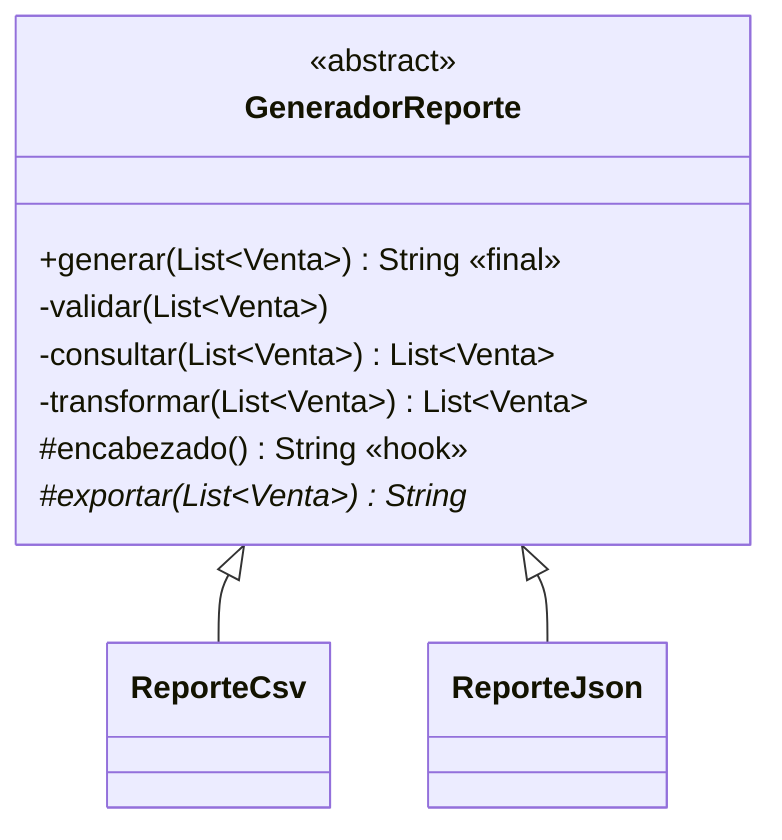

- `generar()` es **`final`**: ninguna subclase puede cambiar el orden de los pasos.
- `validar`, `consultar` y `transformar` son **privados**: comunes a todos los formatos.
- `exportar()` es **abstracto**: el único paso obligatorio de cada subclase.
- `encabezado()` es un **hook**: opcional (el CSV lo usa, el JSON no).

**Pruebas** ([`TemplateMethodTest`](../src/test/java/co/edu/patrones/comportamentales/TemplateMethodTest.java)): CSV filtra y ordena · JSON aplica los mismos pasos comunes · la validación común rechaza listas vacías en ambos formatos.

**Template Method vs. Strategy:** ambos hacen variar parte de un algoritmo, pero Template Method lo logra por **herencia** (la variación se fija al compilar) y Strategy por **composición** (se cambia en tiempo de ejecución).

## 9. Código completo, capturas y funcionamiento

> 🌐 **Pruébalo en vivo:** cada patrón tiene una demostración interactiva en la [página del proyecto](https://srdiego18.github.io/Patrones-dise-o-java/).
> El código de abajo es **exactamente** el que está en `src/` (se puede copiar). Debajo de cada bloque están la captura del código y la captura de la ejecución con sus pruebas.

### 9.1 Strategy · _Laboratorio_

🔗 [Probar Strategy en la página interactiva](https://srdiego18.github.io/Patrones-dise-o-java/#strategy) · 📁 [Ver carpeta en el repositorio](../src/main/java/co/edu/patrones/comportamentales/strategy)

**Código fuente**

<details open><summary><code>CalculadoraEnvio.java</code></summary>

```java
package co.edu.patrones.comportamentales.strategy;

/** Contexto: conoce la interfaz, no la fórmula concreta, y delega el cálculo. */
public class CalculadoraEnvio {
    private EstrategiaEnvio estrategia;

    public CalculadoraEnvio(EstrategiaEnvio estrategia) {
        this.estrategia = estrategia;
    }

    public double calcular(double peso) {
        if (peso <= 0) throw new IllegalArgumentException("Peso inválido");
        return estrategia.calcular(peso);
    }

    public void cambiarEstrategia(EstrategiaEnvio estrategia) {
        this.estrategia = estrategia;
    }
}
```

</details>

<details open><summary><code>CalculadoraEnvioInicial.java</code></summary>

```java
package co.edu.patrones.comportamentales.strategy;

/**
 * Paso 1 (código inicial, ANTES del patrón). Se conserva solo para comparar:
 * cada proveedor nuevo obliga a modificar esta clase (viola abierto/cerrado).
 */
public class CalculadoraEnvioInicial {
    public double calcular(String tipo, double peso) {
        if (tipo.equals("ECONOMICO")) return peso * 1000;
        if (tipo.equals("EXPRESS")) return peso * 1800;
        throw new IllegalArgumentException("Tipo no soportado");
    }
}
```

</details>

<details open><summary><code>EnvioEconomico.java</code></summary>

```java
package co.edu.patrones.comportamentales.strategy;

public class EnvioEconomico implements EstrategiaEnvio {
    @Override
    public double calcular(double peso) {
        return peso * 1000;
    }
}
```

</details>

<details open><summary><code>EnvioExpress.java</code></summary>

```java
package co.edu.patrones.comportamentales.strategy;

public class EnvioExpress implements EstrategiaEnvio {
    @Override
    public double calcular(double peso) {
        return peso * 1800;
    }
}
```

</details>

<details open><summary><code>EnvioInternacional.java</code></summary>

```java
package co.edu.patrones.comportamentales.strategy;

/**
 * Estrategia agregada para demostrar el principio abierto/cerrado:
 * se incorpora un proveedor nuevo SIN modificar CalculadoraEnvio.
 */
public class EnvioInternacional implements EstrategiaEnvio {
    private static final double TARIFA_FIJA = 15000;

    @Override
    public double calcular(double peso) {
        return TARIFA_FIJA + peso * 4000;
    }
}
```

</details>

<details open><summary><code>EstrategiaEnvio.java</code></summary>

```java
package co.edu.patrones.comportamentales.strategy;

/** Strategy: contrato común de las fórmulas de envío. */
public interface EstrategiaEnvio {
    double calcular(double peso);
}
```

</details>

<details><summary><code>StrategyTest.java</code> (pruebas)</summary>

```java
package co.edu.patrones.comportamentales;

import co.edu.patrones.comportamentales.strategy.*;
import org.junit.jupiter.api.DisplayName;
import org.junit.jupiter.api.Test;

import static org.junit.jupiter.api.Assertions.*;

@DisplayName("Strategy - cálculo de envíos")
class StrategyTest {

    @Test
    @DisplayName("Económico: 2 kg = 2000")
    void economico() {
        assertEquals(2000.0, new CalculadoraEnvio(new EnvioEconomico()).calcular(2.0), 0.001);
    }

    @Test
    @DisplayName("Cambio de estrategia en tiempo de ejecución: Express 2 kg = 3600")
    void cambioDeEstrategia() {
        CalculadoraEnvio c = new CalculadoraEnvio(new EnvioEconomico());
        c.cambiarEstrategia(new EnvioExpress());
        assertEquals(3600.0, c.calcular(2.0), 0.001);
    }

    @Test
    @DisplayName("Nueva estrategia sin modificar el contexto: Internacional 2 kg = 23000")
    void estrategiaNuevaSinModificarContexto() {
        assertEquals(23000.0, new CalculadoraEnvio(new EnvioInternacional()).calcular(2.0), 0.001);
    }

    @Test
    @DisplayName("Peso inválido es rechazado por el contexto")
    void pesoInvalido() {
        CalculadoraEnvio c = new CalculadoraEnvio(new EnvioExpress());
        assertThrows(IllegalArgumentException.class, () -> c.calcular(0));
    }

    @Test
    @DisplayName("El código inicial y la versión con Strategy dan el mismo resultado")
    void equivalenciaConCodigoInicial() {
        CalculadoraEnvioInicial antes = new CalculadoraEnvioInicial();
        assertEquals(antes.calcular("EXPRESS", 3), new CalculadoraEnvio(new EnvioExpress()).calcular(3), 0.001);
    }
}
```

</details>

**Captura del código**

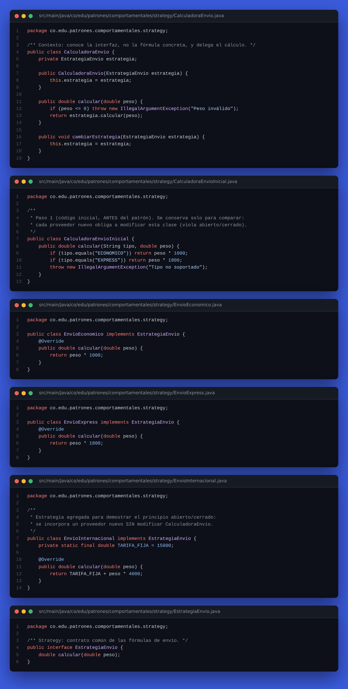

**Captura del funcionamiento (ejecución + pruebas)**

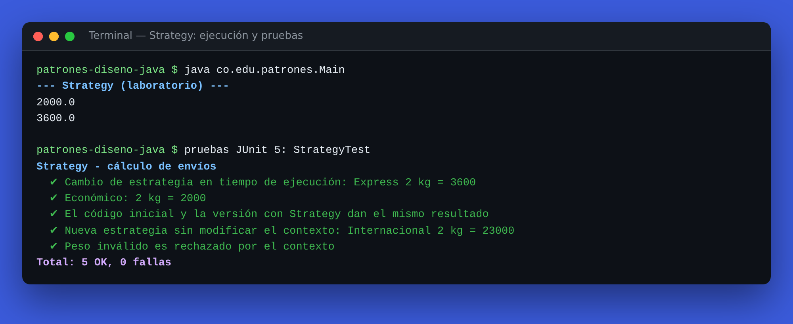

### 9.2 Observer · _Laboratorio_

🔗 [Probar Observer en la página interactiva](https://srdiego18.github.io/Patrones-dise-o-java/#observer) · 📁 [Ver carpeta en el repositorio](../src/main/java/co/edu/patrones/comportamentales/observer)

**Código fuente**

<details open><summary><code>NotificadorCorreo.java</code></summary>

```java
package co.edu.patrones.comportamentales.observer;

import java.util.ArrayList;
import java.util.List;

public class NotificadorCorreo implements ObservadorPedido {
    private final List<String> recibidos = new ArrayList<>();

    @Override
    public void actualizar(String estado) {
        recibidos.add(estado);
        System.out.println("Correo: pedido " + estado);
    }

    public List<String> getRecibidos() {
        return recibidos;
    }
}
```

</details>

<details open><summary><code>NotificadorSms.java</code></summary>

```java
package co.edu.patrones.comportamentales.observer;

/** Paso 5: observador nuevo agregado SIN modificar la clase Pedido. */
public class NotificadorSms implements ObservadorPedido {
    private int mensajesEnviados = 0;

    @Override
    public void actualizar(String estado) {
        mensajesEnviados++;
        System.out.println("SMS: tu pedido está " + estado);
    }

    public int getMensajesEnviados() {
        return mensajesEnviados;
    }
}
```

</details>

<details open><summary><code>ObservadorPedido.java</code></summary>

```java
package co.edu.patrones.comportamentales.observer;

/** Observer: contrato de quien quiere enterarse de los cambios del pedido. */
public interface ObservadorPedido {
    void actualizar(String nuevoEstado);
}
```

</details>

<details open><summary><code>Pedido.java</code></summary>

```java
package co.edu.patrones.comportamentales.observer;

import java.util.ArrayList;
import java.util.List;

/** Subject: mantiene la lista de suscriptores y los notifica cuando cambia su estado. */
public class Pedido {
    private final List<ObservadorPedido> observadores = new ArrayList<>();
    private String estado = "CREADO";

    public void suscribir(ObservadorPedido observador) {
        if (!observadores.contains(observador)) { // evita duplicados
            observadores.add(observador);
        }
    }

    public void desuscribir(ObservadorPedido observador) {
        observadores.remove(observador);
    }

    public void cambiarEstado(String nuevoEstado) {
        this.estado = nuevoEstado;
        for (ObservadorPedido o : observadores) {
            o.actualizar(estado);
        }
    }

    public String getEstado() {
        return estado;
    }
}
```

</details>

<details open><summary><code>Tablero.java</code></summary>

```java
package co.edu.patrones.comportamentales.observer;

public class Tablero implements ObservadorPedido {
    private String ultimoEstado;

    @Override
    public void actualizar(String estado) {
        ultimoEstado = estado;
        System.out.println("Tablero actualizado: " + estado);
    }

    public String getUltimoEstado() {
        return ultimoEstado;
    }
}
```

</details>

<details><summary><code>ObserverTest.java</code> (pruebas)</summary>

```java
package co.edu.patrones.comportamentales;

import co.edu.patrones.comportamentales.observer.*;
import org.junit.jupiter.api.DisplayName;
import org.junit.jupiter.api.Test;

import static org.junit.jupiter.api.Assertions.*;

@DisplayName("Observer - pedidos")
class ObserverTest {

    @Test
    @DisplayName("Todos los suscriptores reciben el nuevo estado")
    void notificaATodos() {
        Pedido pedido = new Pedido();
        NotificadorCorreo correo = new NotificadorCorreo();
        Tablero tablero = new Tablero();
        pedido.suscribir(correo);
        pedido.suscribir(tablero);

        pedido.cambiarEstado("PAGADO");

        assertEquals("PAGADO", correo.getRecibidos().get(0));
        assertEquals("PAGADO", tablero.getUltimoEstado());
    }

    @Test
    @DisplayName("Se agrega un observador nuevo (SMS) sin modificar Pedido; no hay duplicados")
    void nuevoObservadorSinDuplicados() {
        Pedido pedido = new Pedido();
        NotificadorSms sms = new NotificadorSms();
        pedido.suscribir(sms);
        pedido.suscribir(sms); // duplicado ignorado

        pedido.cambiarEstado("ENVIADO");
        assertEquals(1, sms.getMensajesEnviados());
    }

    @Test
    @DisplayName("Un observador desuscrito deja de recibir notificaciones")
    void desuscribir() {
        Pedido pedido = new Pedido();
        NotificadorCorreo correo = new NotificadorCorreo();
        pedido.suscribir(correo);
        pedido.cambiarEstado("PAGADO");
        pedido.desuscribir(correo);
        pedido.cambiarEstado("ENVIADO");

        assertEquals(1, correo.getRecibidos().size());
    }
}
```

</details>

**Captura del código**

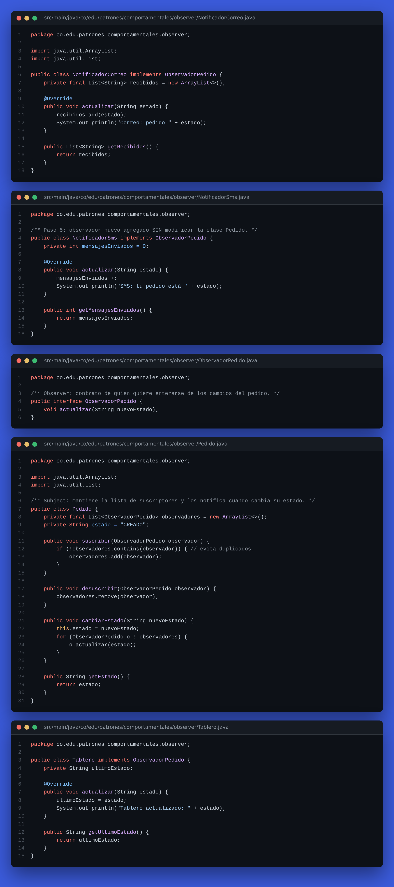

**Captura del funcionamiento (ejecución + pruebas)**

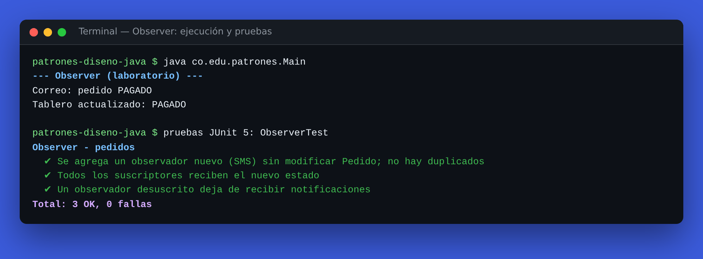

### 9.3 State · _Trabajo autónomo_

🔗 [Probar State en la página interactiva](https://srdiego18.github.io/Patrones-dise-o-java/#state) · 📁 [Ver carpeta en el repositorio](../src/main/java/co/edu/patrones/comportamentales/state)

**Código fuente**

<details open><summary><code>EstadoCancelado.java</code></summary>

```java
package co.edu.patrones.comportamentales.state;

/** Estado final: ninguna operación es válida. */
public class EstadoCancelado implements EstadoPedido {
    @Override
    public String nombre() { return "CANCELADO"; }
}
```

</details>

<details open><summary><code>EstadoCreado.java</code></summary>

```java
package co.edu.patrones.comportamentales.state;

public class EstadoCreado implements EstadoPedido {
    @Override
    public String nombre() { return "CREADO"; }

    @Override
    public void pagar(PedidoTienda pedido) {
        pedido.cambiarEstado(new EstadoPagado());
    }

    @Override
    public void cancelar(PedidoTienda pedido) {
        // Regla: un pedido creado se cancela sin costo.
        pedido.registrarReembolso(0);
        pedido.cambiarEstado(new EstadoCancelado());
    }
}
```

</details>

<details open><summary><code>EstadoEnviado.java</code></summary>

```java
package co.edu.patrones.comportamentales.state;

/** Un pedido enviado no admite pago, reenvío ni cancelación (hereda los métodos por defecto). */
public class EstadoEnviado implements EstadoPedido {
    @Override
    public String nombre() { return "ENVIADO"; }
}
```

</details>

<details open><summary><code>EstadoPagado.java</code></summary>

```java
package co.edu.patrones.comportamentales.state;

public class EstadoPagado implements EstadoPedido {
    @Override
    public String nombre() { return "PAGADO"; }

    @Override
    public void enviar(PedidoTienda pedido) {
        pedido.cambiarEstado(new EstadoEnviado());
    }

    @Override
    public void cancelar(PedidoTienda pedido) {
        // Regla: un pedido pagado se cancela con reembolso total.
        pedido.registrarReembolso(pedido.getTotal());
        pedido.cambiarEstado(new EstadoCancelado());
    }
}
```

</details>

<details open><summary><code>EstadoPedido.java</code></summary>

```java
package co.edu.patrones.comportamentales.state;

/**
 * State: cada estado decide qué hacer ante cada operación.
 * Por defecto toda operación es inválida; cada estado concreto habilita solo sus transiciones.
 */
public interface EstadoPedido {
    String nombre();

    default void pagar(PedidoTienda pedido) {
        throw new IllegalStateException("No se puede pagar un pedido " + nombre());
    }

    default void enviar(PedidoTienda pedido) {
        throw new IllegalStateException("No se puede enviar un pedido " + nombre());
    }

    default void cancelar(PedidoTienda pedido) {
        throw new IllegalStateException("No se puede cancelar un pedido " + nombre());
    }
}
```

</details>

<details open><summary><code>PedidoTienda.java</code></summary>

```java
package co.edu.patrones.comportamentales.state;

/**
 * Contexto: delega cada operación en su estado actual.
 * No contiene ningún if/switch sobre el estado.
 */
public class PedidoTienda {
    private final String codigo;
    private final double total;
    private EstadoPedido estado = new EstadoCreado();
    private double reembolso = 0;

    public PedidoTienda(String codigo, double total) {
        if (total <= 0) throw new IllegalArgumentException("Total inválido");
        this.codigo = codigo;
        this.total = total;
    }

    public void pagar()    { estado.pagar(this); }
    public void enviar()   { estado.enviar(this); }
    public void cancelar() { estado.cancelar(this); }

    // Visibilidad de paquete: solo los estados cambian el estado.
    void cambiarEstado(EstadoPedido nuevo) {
        System.out.println("Pedido " + codigo + ": " + estado.nombre() + " -> " + nuevo.nombre());
        this.estado = nuevo;
    }

    void registrarReembolso(double monto) {
        this.reembolso = monto;
    }

    public String getEstado()    { return estado.nombre(); }
    public double getTotal()     { return total; }
    public double getReembolso() { return reembolso; }
    public String getCodigo()    { return codigo; }
}
```

</details>

<details><summary><code>StateTest.java</code> (pruebas)</summary>

```java
package co.edu.patrones.comportamentales;

import co.edu.patrones.comportamentales.state.PedidoTienda;
import org.junit.jupiter.api.DisplayName;
import org.junit.jupiter.api.Test;

import static org.junit.jupiter.api.Assertions.*;

@DisplayName("State - ciclo de vida del pedido (trabajo autónomo)")
class StateTest {

    @Test
    @DisplayName("Prueba 1: flujo feliz CREADO -> PAGADO -> ENVIADO")
    void flujoFeliz() {
        PedidoTienda p = new PedidoTienda("P-1", 50000);
        assertEquals("CREADO", p.getEstado());
        p.pagar();
        assertEquals("PAGADO", p.getEstado());
        p.enviar();
        assertEquals("ENVIADO", p.getEstado());
    }

    @Test
    @DisplayName("Prueba 2: la cancelación tiene reglas distintas según el estado")
    void cancelacionSegunEstado() {
        PedidoTienda creado = new PedidoTienda("P-2", 50000);
        creado.cancelar();
        assertEquals("CANCELADO", creado.getEstado());
        assertEquals(0, creado.getReembolso(), 0.001);

        PedidoTienda pagado = new PedidoTienda("P-3", 50000);
        pagado.pagar();
        pagado.cancelar();
        assertEquals("CANCELADO", pagado.getEstado());
        assertEquals(50000, pagado.getReembolso(), 0.001);
    }

    @Test
    @DisplayName("Prueba 3: transiciones inválidas son rechazadas")
    void transicionesInvalidas() {
        PedidoTienda p = new PedidoTienda("P-4", 50000);
        assertThrows(IllegalStateException.class, p::enviar);   // no se envía sin pagar
        p.pagar();
        p.enviar();
        assertThrows(IllegalStateException.class, p::cancelar); // enviado no se cancela
        assertEquals("ENVIADO", p.getEstado());
    }
}
```

</details>

**Captura del código**

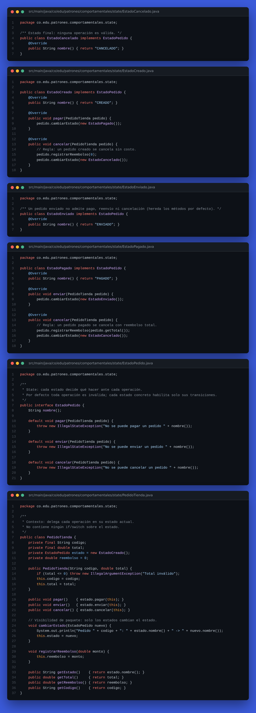

**Captura del funcionamiento (ejecución + pruebas)**

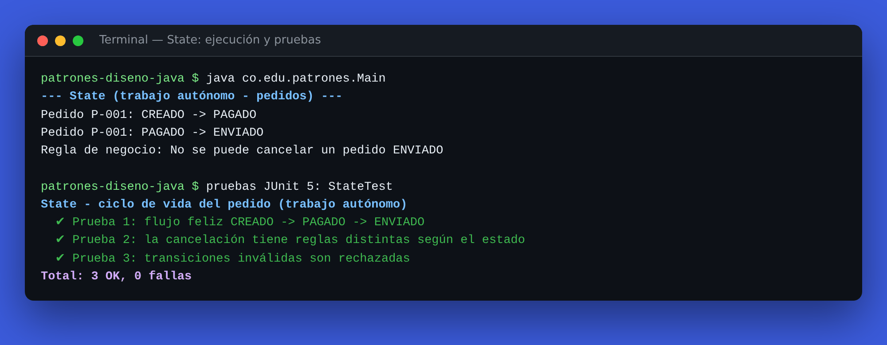

### 9.4 Command · _Trabajo autónomo_

🔗 [Probar Command en la página interactiva](https://srdiego18.github.io/Patrones-dise-o-java/#command) · 📁 [Ver carpeta en el repositorio](../src/main/java/co/edu/patrones/comportamentales/command)

**Código fuente**

<details open><summary><code>AgregarProductoComando.java</code></summary>

```java
package co.edu.patrones.comportamentales.command;

public class AgregarProductoComando implements Comando {
    private final CarritoPedido carrito;
    private final String producto;
    private final int cantidad;

    public AgregarProductoComando(CarritoPedido carrito, String producto, int cantidad) {
        this.carrito = carrito;
        this.producto = producto;
        this.cantidad = cantidad;
    }

    @Override public void ejecutar() { carrito.agregar(producto, cantidad); }
    @Override public void deshacer() { carrito.quitar(producto, cantidad); }   // operación inversa
    @Override public String descripcion() { return "Agregar " + cantidad + " x " + producto; }
}
```

</details>

<details open><summary><code>CarritoPedido.java</code></summary>

```java
package co.edu.patrones.comportamentales.command;

import java.util.LinkedHashMap;
import java.util.Map;
import java.util.Collections;

/** Receptor: sabe cómo agregar y quitar productos del pedido. */
public class CarritoPedido {
    private final Map<String, Integer> items = new LinkedHashMap<>();

    public void agregar(String producto, int cantidad) {
        if (cantidad <= 0) throw new IllegalArgumentException("Cantidad inválida");
        items.merge(producto, cantidad, Integer::sum);
    }

    public void quitar(String producto, int cantidad) {
        int actual = items.getOrDefault(producto, 0);
        if (cantidad > actual) throw new IllegalArgumentException("No hay suficientes unidades de " + producto);
        if (actual == cantidad) items.remove(producto);
        else items.put(producto, actual - cantidad);
    }

    public int cantidadDe(String producto) {
        return items.getOrDefault(producto, 0);
    }

    public Map<String, Integer> getItems() {
        return Collections.unmodifiableMap(new LinkedHashMap<>(items));
    }
}
```

</details>

<details open><summary><code>Comando.java</code></summary>

```java
package co.edu.patrones.comportamentales.command;

/** Command: una solicitud convertida en objeto que se puede ejecutar y deshacer. */
public interface Comando {
    void ejecutar();
    void deshacer();
    String descripcion();
}
```

</details>

<details open><summary><code>GestorComandos.java</code></summary>

```java
package co.edu.patrones.comportamentales.command;

import java.util.ArrayDeque;
import java.util.Deque;
import java.util.List;
import java.util.ArrayList;

/**
 * Invocador: encola acciones del usuario para ejecutarlas después,
 * mantiene un historial y permite deshacer/rehacer.
 * No sabe QUÉ hace cada comando; solo llama a ejecutar()/deshacer().
 */
public class GestorComandos {
    private final Deque<Comando> cola = new ArrayDeque<>();
    private final Deque<Comando> historial = new ArrayDeque<>();
    private final Deque<Comando> rehacer = new ArrayDeque<>();
    private final List<String> bitacora = new ArrayList<>();

    public void encolar(Comando c) {
        cola.addLast(c);
    }

    /** Ejecuta todos los comandos pendientes en orden FIFO. */
    public void procesarCola() {
        while (!cola.isEmpty()) {
            Comando c = cola.pollFirst();
            c.ejecutar();
            historial.push(c);
            rehacer.clear();
            bitacora.add("EJECUTADO: " + c.descripcion());
        }
    }

    public void deshacer() {
        if (historial.isEmpty()) throw new IllegalStateException("No hay acciones para deshacer");
        Comando c = historial.pop();
        c.deshacer();
        rehacer.push(c);
        bitacora.add("DESHECHO: " + c.descripcion());
    }

    public void rehacer() {
        if (rehacer.isEmpty()) throw new IllegalStateException("No hay acciones para rehacer");
        Comando c = rehacer.pop();
        c.ejecutar();
        historial.push(c);
        bitacora.add("REHECHO: " + c.descripcion());
    }

    public int pendientes() { return cola.size(); }
    public List<String> getBitacora() { return bitacora; }
}
```

</details>

<details open><summary><code>QuitarProductoComando.java</code></summary>

```java
package co.edu.patrones.comportamentales.command;

public class QuitarProductoComando implements Comando {
    private final CarritoPedido carrito;
    private final String producto;
    private final int cantidad;

    public QuitarProductoComando(CarritoPedido carrito, String producto, int cantidad) {
        this.carrito = carrito;
        this.producto = producto;
        this.cantidad = cantidad;
    }

    @Override public void ejecutar() { carrito.quitar(producto, cantidad); }
    @Override public void deshacer() { carrito.agregar(producto, cantidad); }  // operación inversa
    @Override public String descripcion() { return "Quitar " + cantidad + " x " + producto; }
}
```

</details>

<details><summary><code>CommandTest.java</code> (pruebas)</summary>

```java
package co.edu.patrones.comportamentales;

import co.edu.patrones.comportamentales.command.*;
import org.junit.jupiter.api.DisplayName;
import org.junit.jupiter.api.Test;

import static org.junit.jupiter.api.Assertions.*;

@DisplayName("Command - acciones sobre el carrito del pedido (trabajo autónomo)")
class CommandTest {

    @Test
    @DisplayName("Prueba 1: las acciones encoladas no se ejecutan hasta procesar la cola")
    void colaDiferida() {
        CarritoPedido carrito = new CarritoPedido();
        GestorComandos gestor = new GestorComandos();
        gestor.encolar(new AgregarProductoComando(carrito, "Cuaderno", 2));

        assertEquals(1, gestor.pendientes());
        assertEquals(0, carrito.cantidadDe("Cuaderno"));

        gestor.procesarCola();
        assertEquals(0, gestor.pendientes());
        assertEquals(2, carrito.cantidadDe("Cuaderno"));
    }

    @Test
    @DisplayName("Prueba 2: deshacer revierte en orden inverso (LIFO)")
    void deshacerEnOrdenInverso() {
        CarritoPedido carrito = new CarritoPedido();
        GestorComandos gestor = new GestorComandos();
        gestor.encolar(new AgregarProductoComando(carrito, "Lápiz", 5));
        gestor.encolar(new QuitarProductoComando(carrito, "Lápiz", 2));
        gestor.procesarCola();
        assertEquals(3, carrito.cantidadDe("Lápiz"));

        gestor.deshacer(); // revierte "quitar 2"
        assertEquals(5, carrito.cantidadDe("Lápiz"));
        gestor.deshacer(); // revierte "agregar 5"
        assertEquals(0, carrito.cantidadDe("Lápiz"));
    }

    @Test
    @DisplayName("Prueba 3: rehacer y casos límite (nada que deshacer)")
    void rehacerYCasosLimite() {
        CarritoPedido carrito = new CarritoPedido();
        GestorComandos gestor = new GestorComandos();
        assertThrows(IllegalStateException.class, gestor::deshacer);

        gestor.encolar(new AgregarProductoComando(carrito, "Borrador", 1));
        gestor.procesarCola();
        gestor.deshacer();
        gestor.rehacer();
        assertEquals(1, carrito.cantidadDe("Borrador"));
        assertEquals(3, gestor.getBitacora().size());
    }
}
```

</details>

**Captura del código**

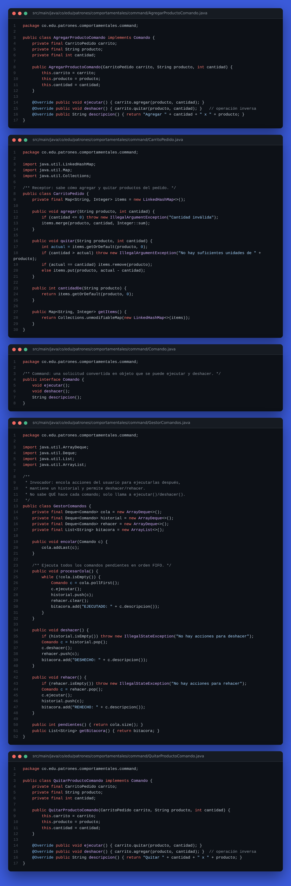

**Captura del funcionamiento (ejecución + pruebas)**

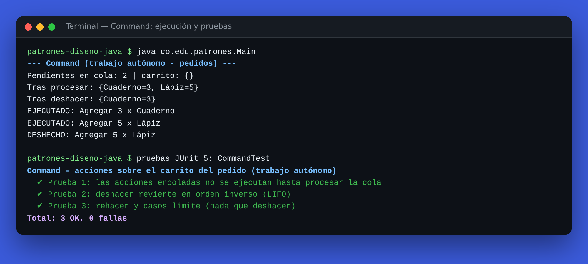

### 9.5 Template Method · _Extra_

🔗 [Probar Template Method en la página interactiva](https://srdiego18.github.io/Patrones-dise-o-java/#templatemethod) · 📁 [Ver carpeta en el repositorio](../src/main/java/co/edu/patrones/comportamentales/templatemethod)

**Código fuente**

<details open><summary><code>GeneradorReporte.java</code></summary>

```java
package co.edu.patrones.comportamentales.templatemethod;

import java.util.List;
import java.util.Objects;

/**
 * Template Method: generar() fija el esqueleto validar -> consultar -> transformar -> exportar.
 * Es final para que ninguna subclase altere el orden. Solo exportar() varía.
 */
public abstract class GeneradorReporte {

    public final String generar(List<Venta> ventas) {
        validar(ventas);
        List<Venta> datos = consultar(ventas);
        List<Venta> transformados = transformar(datos);
        return encabezado() + exportar(transformados);
    }

    /** Paso común: los datos deben existir. */
    private void validar(List<Venta> ventas) {
        Objects.requireNonNull(ventas, "ventas");
        if (ventas.isEmpty()) throw new IllegalArgumentException("No hay ventas para reportar");
    }

    /** Paso común: descarta ventas con monto no positivo. */
    private List<Venta> consultar(List<Venta> ventas) {
        return ventas.stream().filter(v -> v.monto() > 0).toList();
    }

    /** Paso común: ordena de mayor a menor monto. */
    private List<Venta> transformar(List<Venta> ventas) {
        return ventas.stream()
                .sorted((a, b) -> Double.compare(b.monto(), a.monto()))
                .toList();
    }

    /** Hook: opcional, por defecto vacío. */
    protected String encabezado() {
        return "";
    }

    /** Paso variable: cada formato lo implementa. */
    protected abstract String exportar(List<Venta> ventas);
}
```

</details>

<details open><summary><code>ReporteCsv.java</code></summary>

```java
package co.edu.patrones.comportamentales.templatemethod;

import java.util.List;
import java.util.Locale;
import java.util.stream.Collectors;

public class ReporteCsv extends GeneradorReporte {
    @Override
    protected String encabezado() {
        return "producto,monto\n";
    }

    @Override
    protected String exportar(List<Venta> ventas) {
        return ventas.stream()
                .map(v -> v.producto() + "," + String.format(Locale.US, "%.2f", v.monto()))
                .collect(Collectors.joining("\n"));
    }
}
```

</details>

<details open><summary><code>ReporteJson.java</code></summary>

```java
package co.edu.patrones.comportamentales.templatemethod;

import java.util.List;
import java.util.Locale;
import java.util.stream.Collectors;

public class ReporteJson extends GeneradorReporte {
    @Override
    protected String exportar(List<Venta> ventas) {
        return ventas.stream()
                .map(v -> String.format(Locale.US, "{\"producto\":\"%s\",\"monto\":%.2f}", v.producto(), v.monto()))
                .collect(Collectors.joining(",", "[", "]"));
    }
}
```

</details>

<details open><summary><code>Venta.java</code></summary>

```java
package co.edu.patrones.comportamentales.templatemethod;

/** Dato de entrada del reporte. */
public record Venta(String producto, double monto) {
}
```

</details>

<details><summary><code>TemplateMethodTest.java</code> (pruebas)</summary>

```java
package co.edu.patrones.comportamentales;

import co.edu.patrones.comportamentales.templatemethod.*;
import org.junit.jupiter.api.DisplayName;
import org.junit.jupiter.api.Test;

import java.util.List;

import static org.junit.jupiter.api.Assertions.*;

@DisplayName("Template Method - reportes de ventas (extra)")
class TemplateMethodTest {

    private final List<Venta> ventas = List.of(
            new Venta("Cuaderno", 5000), new Venta("Anulada", 0), new Venta("Libro", 42000.5));

    @Test
    @DisplayName("CSV: encabezado, filtra montos inválidos y ordena de mayor a menor")
    void csv() {
        assertEquals("producto,monto\nLibro,42000.50\nCuaderno,5000.00", new ReporteCsv().generar(ventas));
    }

    @Test
    @DisplayName("JSON: mismos pasos comunes, solo cambia la exportación")
    void json() {
        assertEquals("[{\"producto\":\"Libro\",\"monto\":42000.50},{\"producto\":\"Cuaderno\",\"monto\":5000.00}]",
                new ReporteJson().generar(ventas));
    }

    @Test
    @DisplayName("La validación común aplica a todos los formatos")
    void validacionComun() {
        assertThrows(IllegalArgumentException.class, () -> new ReporteCsv().generar(List.of()));
        assertThrows(IllegalArgumentException.class, () -> new ReporteJson().generar(List.of()));
    }
}
```

</details>

**Captura del código**

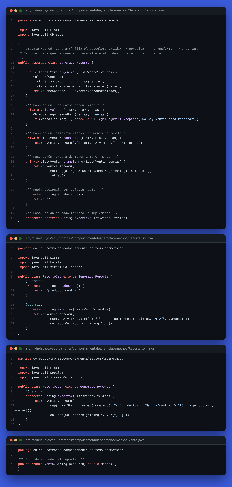

**Captura del funcionamiento (ejecución + pruebas)**

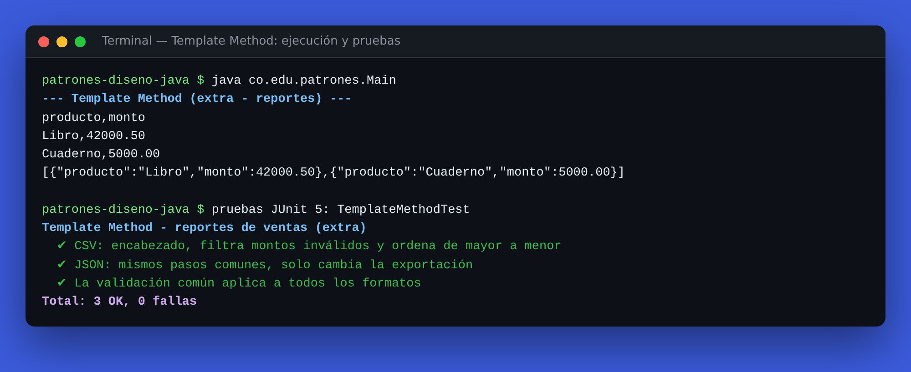

### Ejecución completa y resumen de pruebas

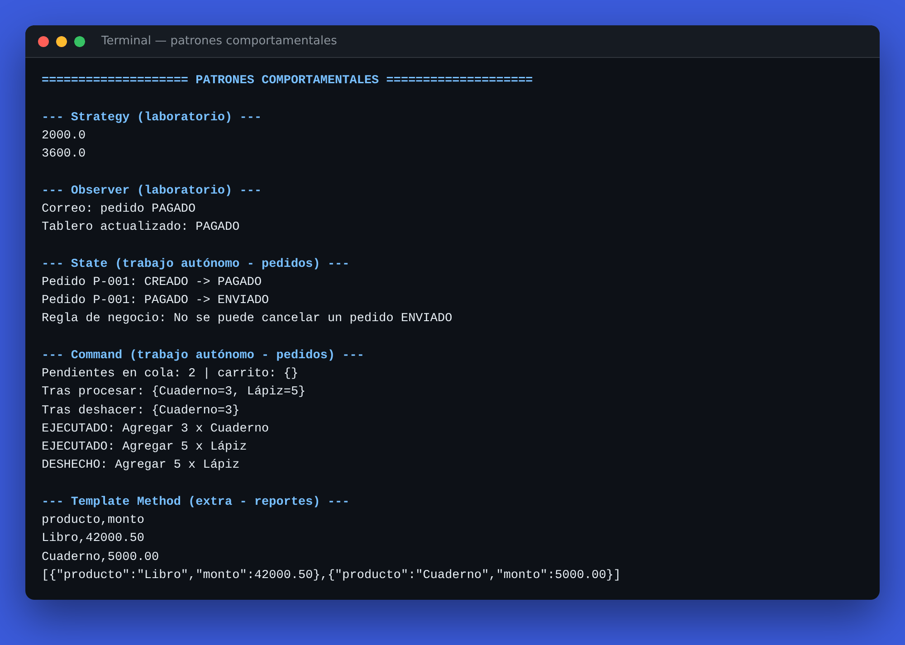

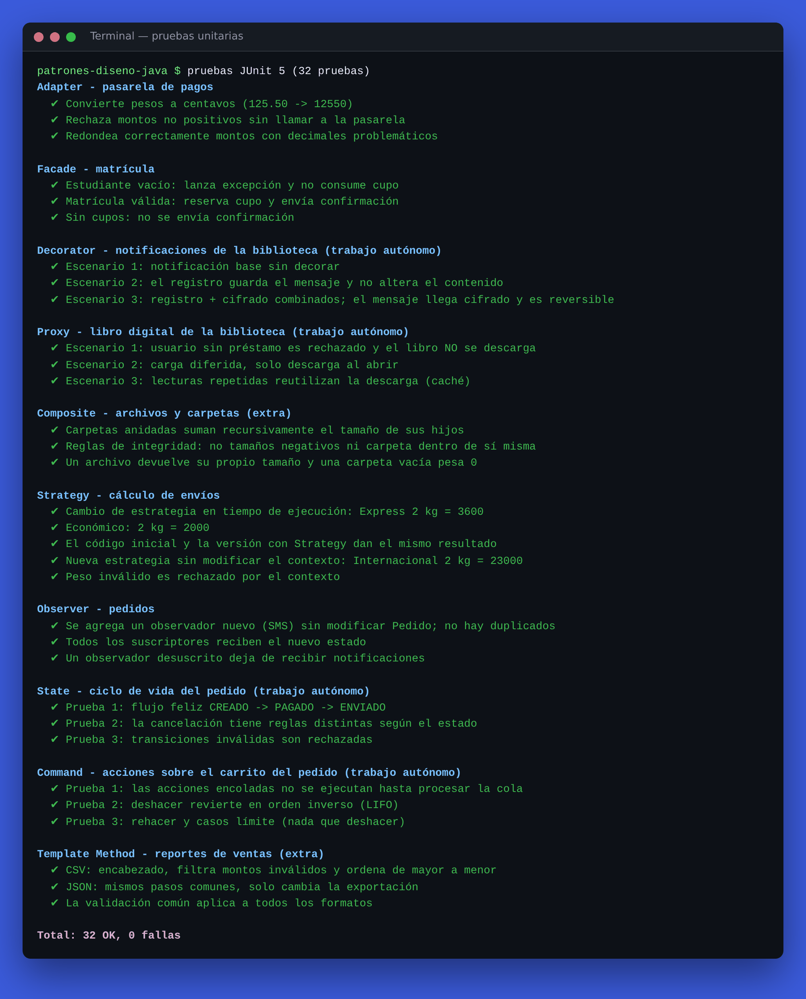

---
## 10. Autoevaluación frente a la rúbrica

| Criterio | Peso | Evidencia en el repositorio |
|---|---|---|
| Análisis y selección | 25 % | §5 (5 situaciones resueltas), §6, problema y alternativa de cada patrón en §7 |
| Implementación | 30 % | Strategy, Observer, State, Command **y Template Method (extra)** compilando y ejecutándose desde [`Main`](../src/main/java/co/edu/patrones/Main.java) — ver §9 |
| Diseño | 20 % | Diagramas de clases y de estados (Mermaid), interfaces, métodos `default`, visibilidad de paquete |
| Pruebas | 15 % | 17 pruebas JUnit 5 (≥ 3 por patrón) ejecutadas automáticamente con GitHub Actions, en [`src/test/.../comportamentales`](../src/test/java/co/edu/patrones/comportamentales) |
| Reflexión | 10 % | Justificación, alternativa y limitación de cada patrón (§7) |

## Referencias

- Gamma, E., Helm, R., Johnson, R., & Vlissides, J. (1994). *Design Patterns: Elements of Reusable Object-Oriented Software*. Addison-Wesley.
- Freeman, E., Robson, E., Bates, B., & Sierra, K. (2004). *Head First Design Patterns*. O'Reilly Media.
