# Guía final — Patrones de diseño en Java

**Asignatura:** Patrones y metodologías de desarrollo · **Lenguaje:** Java 17 · **Fecha:** 10 de noviembre de 2026

| Integrantes |
|---|
| Diego Romero |
| Maicol Rubiano |
| Camilo Bastidas |
| Santiago Solano |

> ### 🎮 Página interactiva: [https://srdiego18.github.io/Patrones-dise-o-java/](https://srdiego18.github.io/Patrones-dise-o-java/)
> Allí se puede probar cada patrón en vivo, ver su código Java, su diagrama UML y sus capturas. La Guía 1 aparece en morado y la Guía 2 en azul.

| Acceso | Enlace |
|---|---|
| 🎮 Página interactiva (probar cada patrón en vivo) | [https://srdiego18.github.io/Patrones-dise-o-java/](https://srdiego18.github.io/Patrones-dise-o-java/) |
| 📦 Repositorio con el código fuente | [https://github.com/SrDiego18/Patrones-dise-o-java](https://github.com/SrDiego18/Patrones-dise-o-java) |
| ▶️ Ejecutar el Java real en el navegador | [Abrir en GitHub Codespaces](https://codespaces.new/SrDiego18/Patrones-dise-o-java?quickstart=1) |

[⬅ Volver al README](../README.md)

---

## Cómo está organizada esta entrega

Este documento une las **dos guías del estudiante** en una sola entrega. Cada guía conserva su propia numeración y su propio color, igual que en la página interactiva y en las carpetas del código:

| | Guía 1 — Patrones estructurales 🟣 | Guía 2 — Patrones comportamentales 🔵 |
|---|---|---|
| **Secciones de este documento** | 1.1 a 1.10 | 2.1 a 2.10 |
| **Laboratorio** | Adapter (pagos) · Facade (matrícula) | Strategy (envíos) · Observer (pedidos) |
| **Trabajo autónomo** | Decorator + Proxy — *biblioteca digital* | State + Command — *sistema de pedidos* |
| **Extra (no solicitado)** | Composite | Template Method |
| **Código fuente** | `src/main/java/co/edu/patrones/estructurales/` | `src/main/java/co/edu/patrones/comportamentales/` |
| **Pruebas** | 15 pruebas JUnit 5 | 17 pruebas JUnit 5 |

Cada guía incluye: laboratorio paso a paso, actividad de análisis y verificación resueltas, trabajo autónomo (problema, diagrama, código, pruebas, justificación, alternativa y limitación), el **código completo** con **capturas del código y de su ejecución**, y la autoevaluación frente a la rúbrica.

## Contenido

- [Guía 1 — Patrones estructurales](#guía-1--patrones-estructurales)
   - [1.1 Concepto central](#11-concepto-central)
   - [1.2 Los cinco patrones estructurales](#12-los-cinco-patrones-estructurales)
   - [1.3 Laboratorio: Adapter para integrar pagos](#13-laboratorio-adapter-para-integrar-pagos)
   - [1.4 Segundo ejemplo: Facade para matrícula](#14-segundo-ejemplo-facade-para-matrícula)
   - [1.5 Actividad de análisis (resuelta)](#15-actividad-de-análisis-resuelta)
   - [1.6 Verificación (resuelta)](#16-verificación-resuelta)
   - [1.7 Trabajo autónomo: Biblioteca digital con Decorator y Proxy](#17-trabajo-autónomo-biblioteca-digital-con-decorator-y-proxy)
   - [1.8 Extra: Composite implementado](#18-extra-composite-implementado)
   - [1.9 Código completo, capturas y funcionamiento](#19-código-completo-capturas-y-funcionamiento)
   - [1.10 Autoevaluación frente a la rúbrica](#110-autoevaluación-frente-a-la-rúbrica)
- [Guía 2 — Patrones comportamentales](#guía-2--patrones-comportamentales)
   - [2.1 Concepto central](#21-concepto-central)
   - [2.2 Los cinco patrones comportamentales](#22-los-cinco-patrones-comportamentales)
   - [2.3 Laboratorio: Strategy para calcular envíos](#23-laboratorio-strategy-para-calcular-envíos)
   - [2.4 Segundo ejemplo: Observer para pedidos](#24-segundo-ejemplo-observer-para-pedidos)
   - [2.5 Actividad de análisis (resuelta)](#25-actividad-de-análisis-resuelta)
   - [2.6 Verificación (resuelta)](#26-verificación-resuelta)
   - [2.7 Trabajo autónomo: Sistema de pedidos con State y Command](#27-trabajo-autónomo-sistema-de-pedidos-con-state-y-command)
   - [2.8 Extra: Template Method implementado](#28-extra-template-method-implementado)
   - [2.9 Código completo, capturas y funcionamiento](#29-código-completo-capturas-y-funcionamiento)
   - [2.10 Autoevaluación frente a la rúbrica](#210-autoevaluación-frente-a-la-rúbrica)
- [Referencias](#referencias)

---

## Guía 1 — Patrones estructurales


> **Resultado de aprendizaje:** reconocer problemas de integración, composición y acceso entre objetos, y seleccionar un patrón estructural justificando beneficios y costos.
>
> **Patrones:** Adapter · Facade · Decorator · Proxy · Composite

> 🎮 **Probar la Guía 1 en vivo:** [https://srdiego18.github.io/Patrones-dise-o-java/#guia1](https://srdiego18.github.io/Patrones-dise-o-java/#guia1)

### 1.1 Concepto central

Los patrones estructurales describen **cómo se relacionan clases y objetos para formar estructuras mayores**. A diferencia de los creacionales (que deciden *cómo se crea* un objeto), los estructurales se ocupan de *cómo se conectan y colaboran* los objetos ya creados: traducir interfaces, simplificar subsistemas, añadir comportamiento envolviendo, tratar jerarquías de forma uniforme o controlar el acceso.

### 1.2 Los cinco patrones estructurales

| Patrón | Problema que resuelve | Ejemplo | ¿Dónde está en el repo? |
|---|---|---|---|
| **Adapter** | Interfaces incompatibles | Pasarela externa → contrato interno de pagos | [`adapter/`](../src/main/java/co/edu/patrones/estructurales/adapter) — laboratorio |
| **Facade** | Subsistema complejo | Proceso de matrícula | [`facade/`](../src/main/java/co/edu/patrones/estructurales/facade) — laboratorio |
| **Decorator** | Añadir responsabilidades sin explosión de subclases | Registro y cifrado de notificaciones | [`decorator/`](../src/main/java/co/edu/patrones/estructurales/decorator) — trabajo autónomo |
| **Composite** | Tratar elementos y grupos de forma uniforme | Archivos y carpetas | [`composite/`](../src/main/java/co/edu/patrones/estructurales/composite) — **extra** |
| **Proxy** | Controlar el acceso a un objeto real | Carga diferida, autorización, caché | [`proxy/`](../src/main/java/co/edu/patrones/estructurales/proxy) — trabajo autónomo |

---

### 1.3 Laboratorio: Adapter para integrar pagos

**Situación.** El sistema espera `ProcesadorPago.pagar(double)`, pero la librería externa ofrece `PasarelaExterna.realizarCobroEnCentavos(int)`. No podemos modificar la librería.

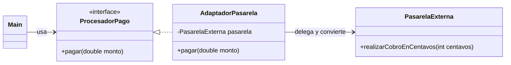

| Paso | Qué se hizo | Archivo |
|---|---|---|
| 1 | Interfaz que espera el sistema (*Target*) | [`ProcesadorPago.java`](../src/main/java/co/edu/patrones/estructurales/adapter/ProcesadorPago.java) |
| 2 | Clase externa incompatible (*Adaptee*) | [`PasarelaExterna.java`](../src/main/java/co/edu/patrones/estructurales/adapter/PasarelaExterna.java) |
| 3 | Incompatibilidad: **nombre de método** distinto y **unidad** distinta (pesos `double` vs. centavos `int`) | — |
| 4 | Adaptador: implementa `ProcesadorPago`, convierte con `Math.round(monto * 100)` y delega | [`AdaptadorPasarela.java`](../src/main/java/co/edu/patrones/estructurales/adapter/AdaptadorPasarela.java) |
| 5 | Cliente invoca solo la interfaz interna | [`Main.java`](../src/main/java/co/edu/patrones/Main.java) |

**Salida obtenida:** `Cobro externo: 12550 centavos` ✅

**Mejora añadida:** el adaptador rechaza montos `<= 0` antes de llamar a la pasarela.

**Pruebas** ([`AdapterTest`](../src/test/java/co/edu/patrones/estructurales/AdapterTest.java)):
1. `125.50` → `12550` centavos.
2. `0.29` → `29` (en `double`, `0.29 * 100 = 28.999…`; `Math.round` evita perder un centavo, mientras que un simple `(int)` daría `28`).
3. Monto `0` → `IllegalArgumentException` y la pasarela **no** es invocada.

> **Nota de diseño:** como indica la guía, en un sistema financiero real el dinero se representa con `BigDecimal` (con moneda, escala y modo de redondeo definidos). Aquí se usa `double` solo para simplificar el ejemplo.

---

### 1.4 Segundo ejemplo: Facade para matrícula

**Problema.** Matricular requiere validar datos, reservar cupo y enviar confirmación. El controlador no debería coordinar manualmente cada subsistema.

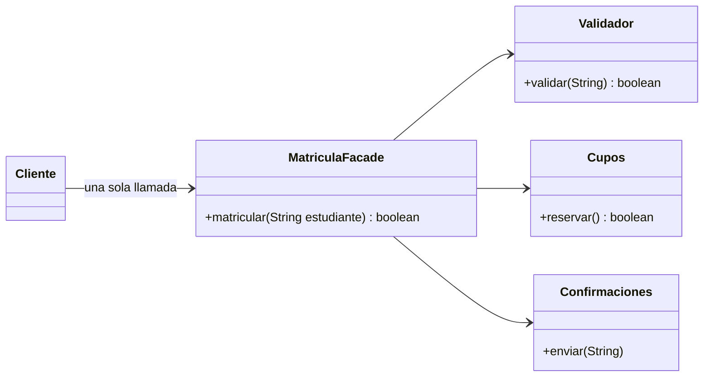

1. **Subsistemas identificados**, cada uno con una única responsabilidad: `Validador`, `Cupos`, `Confirmaciones`.
2. **`MatriculaFacade`** es el punto de entrada simplificado.
3. El **cliente** llama `matricular(estudiante)` sin conocer la secuencia interna.

**Mejoras añadidas:** `Cupos` tiene capacidad real (antes siempre devolvía `true`), `matricular` devuelve `boolean`, y existe un constructor con **inyección de dependencias** para poder probar la fachada con subsistemas controlados.

**Pruebas** ([`FacadeTest`](../src/test/java/co/edu/patrones/estructurales/FacadeTest.java)): matrícula válida descuenta cupo y confirma · estudiante vacío lanza excepción sin consumir cupo · sin cupos no se envía confirmación.

---

### 1.5 Actividad de análisis (resuelta)

| # | Situación | Patrón | Justificación |
|---|---|---|---|
| 1 | Una aplicación integra una API externa cuya interfaz no coincide con la interna. | **Adapter** | Hay dos interfaces que ya existen y no podemos cambiar la externa; el adaptador traduce llamadas y datos sin tocar ninguno de los dos lados. |
| 2 | Una compra coordina inventario, pago, envío y notificación, pero el controlador necesita una operación sencilla. | **Facade** | Hay un subsistema con varios componentes y un orden de invocación; la fachada expone `comprar()` y oculta la coordinación, reduciendo el acoplamiento del controlador. |
| 3 | Se requiere añadir registro y cifrado a una notificación sin modificar su clase. | **Decorator** | Se agregan responsabilidades dinámicamente envolviendo el objeto con la misma interfaz. Evita subclases combinatorias (`NotifConLog`, `NotifCifrada`, `NotifConLogYCifrada`…). |
| 4 | Una aplicación calcula el tamaño de archivos y carpetas anidadas. | **Composite** | Hay una jerarquía en árbol; `Archivo` (hoja) y `Carpeta` (contenedor) implementan `ElementoArchivo.tamano()`, y la carpeta suma recursivamente el tamaño de sus hijos. El cliente no distingue entre ambos. |
| 5 | Un archivo remoto solo debe descargarse al abrirlo y requiere autorización. | **Proxy** (virtual + de protección) | Un objeto con la misma interfaz se interpone, verifica permisos y crea el objeto real solo cuando se necesita. Implementado en el trabajo autónomo. |

---

### 1.6 Verificación (resuelta)

**1. ¿Qué diferencia existe entre Adapter y Facade?**
Ambos envuelven código existente, pero con intenciones distintas. **Adapter** *convierte* una interfaz en otra que el cliente ya espera; normalmente envuelve **un** objeto y la interfaz destino ya está definida. **Facade** *simplifica*: define una interfaz **nueva y más sencilla** sobre **varios** objetos de un subsistema. Adapter resuelve incompatibilidad; Facade resuelve complejidad.

**2. ¿Por qué Decorator y Proxy implementan normalmente la misma interfaz del objeto envuelto?**
Para ser **sustituibles de forma transparente** (principio de sustitución de Liskov): el cliente programa contra la interfaz y no sabe si habla con el objeto real, con un decorador o con un proxy. Esto permite apilar decoradores (`new Registro(new Cifrado(base))`) o interponer un proxy sin cambiar el código cliente. La diferencia está en la intención: el Decorator **añade** comportamiento; el Proxy **controla** el acceso.

**3. ¿Qué ventaja aporta Composite al recorrer jerarquías?**
El cliente trata **igual a hojas y contenedores**, por lo que no necesita `if (esCarpeta) … else …` ni `instanceof`. Las operaciones (tamaño, búsqueda, impresión) se resuelven por **recursión polimórfica**: cada nodo sabe calcular su parte y delega en sus hijos. Agregar un nuevo tipo de nodo no obliga a cambiar el código de recorrido.

**4. ¿Qué responsabilidad adicional asume un Proxy?**
Decidir **si, cuándo y cómo** se delega al objeto real: control de acceso/autorización (proxy de protección), creación diferida de objetos costosos (proxy virtual), caché de resultados, registro/auditoría, o representación de un objeto remoto (proxy remoto). En este repositorio, `LibroDigitalProxy` asume autorización, carga diferida y caché.

**5. ¿Qué costo de mantenimiento puede introducir un patrón?**
Más clases e indirecciones (el flujo es más difícil de seguir y depurar), mayor curva de aprendizaje para el equipo, posible impacto en rendimiento por capas adicionales y el riesgo de **sobreingeniería** si el patrón se aplica sin que exista el problema que resuelve. Ejemplos concretos: una Facade que crece hasta convertirse en un "objeto dios"; decoradores cuyo **orden** altera el resultado (ver prueba 3 del Decorator); un Proxy que oculta latencia o errores de red.

---

### 1.7 Trabajo autónomo: Biblioteca digital con Decorator y Proxy

> Dominio elegido: **biblioteca**. Se implementan dos patrones distintos a los del laboratorio para ampliar la práctica.

#### 1.7.1 Decorator — notificaciones de préstamo

**Problema.** La biblioteca envía notificaciones de préstamo. Algunas deben quedar **registradas** (auditoría), otras deben viajar **cifradas** (datos personales) y otras ambas cosas. Crear una subclase por combinación generaría `2ⁿ` clases y obligaría a modificar la clase de notificación cada vez que aparezca un requisito nuevo.

**Diagrama.**

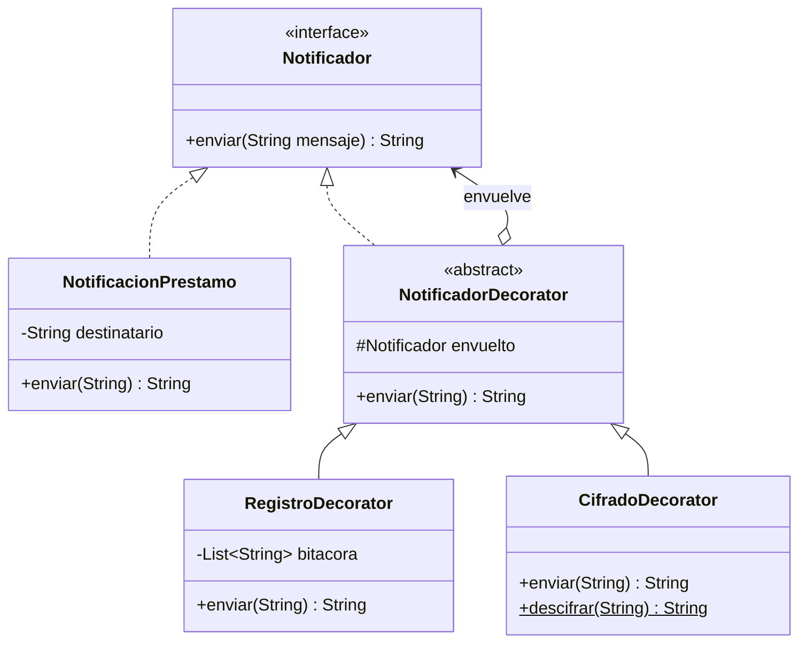

**Código:** [`decorator/`](../src/main/java/co/edu/patrones/estructurales/decorator)

```java
Notificador n = new RegistroDecorator(
                    new CifradoDecorator(
                        new NotificacionPrestamo("ana@biblioteca.edu")));
n.enviar("Tu préstamo vence mañana");
```

**Escenarios de prueba** ([`DecoratorTest`](../src/test/java/co/edu/patrones/estructurales/DecoratorTest.java)):

| # | Escenario | Resultado esperado |
|---|---|---|
| 1 | Notificación sin decorar | `"Para ana: Libro listo"` |
| 2 | Solo registro | Mismo contenido + 1 entrada en la bitácora |
| 3 | Registro + cifrado | El texto plano **no** viaja; se puede descifrar; la bitácora guarda el original (porque el registro está por fuera del cifrado) |

**Justificación.** Las responsabilidades se combinan en tiempo de ejecución y cada una vive en su propia clase (responsabilidad única). `NotificacionPrestamo` no se modificó nunca (abierto/cerrado).

**Alternativa considerada.** *Herencia* (`NotificacionCifrada extends NotificacionPrestamo`): es más simple con un solo requisito, pero con dos o más requisitos combinables produce explosión de subclases y las combinaciones quedan fijas en compilación.

**Limitación.** El **orden** de los decoradores cambia el resultado (registrar antes o después de cifrar), lo que puede causar errores sutiles; además hay muchos objetos pequeños que dificultan la depuración. Por último, `CifradoDecorator` usa Base64, que es una **codificación**, no un cifrado seguro: en producción se usaría AES-GCM (`javax.crypto`) con gestión de claves.

#### 1.7.2 Proxy — acceso a libros digitales

**Problema.** Los libros digitales están en un servidor remoto: descargarlos es **costoso** y solo los usuarios con **préstamo activo** pueden leerlos. Si el catálogo creara todos los `LibroDigitalReal` al cargar, se descargarían libros que nadie abre y sin control de permisos.

**Diagrama.**

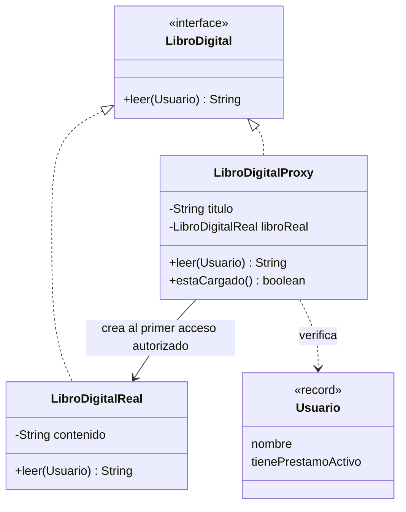

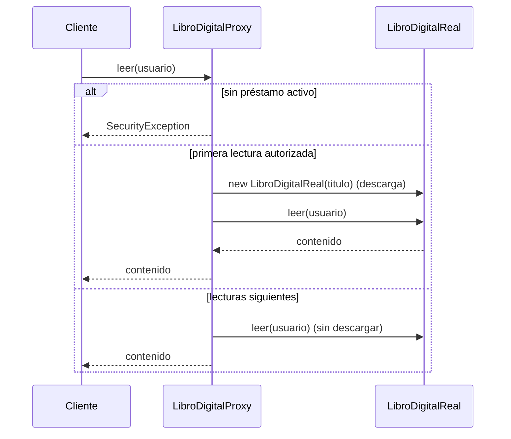

**Código:** [`proxy/`](../src/main/java/co/edu/patrones/estructurales/proxy)

**Escenarios de prueba** ([`ProxyTest`](../src/test/java/co/edu/patrones/estructurales/ProxyTest.java)):

| # | Escenario | Resultado esperado |
|---|---|---|
| 1 | Usuario sin préstamo | `SecurityException` y **0** descargas |
| 2 | Crear el proxy y luego leer | No se descarga al crear; sí al primer `leer()` |
| 3 | Tres lecturas seguidas | Solo **1** descarga (caché) |

**Justificación.** El proxy agrega autorización, carga diferida y caché **sin tocar** `LibroDigitalReal` y sin que el cliente cambie: ambos implementan `LibroDigital`.

**Alternativa considerada.** Poner la validación de permisos y el `if (contenido == null)` dentro de `LibroDigitalReal`: funciona, pero mezcla la responsabilidad de *representar el libro* con *seguridad* y *rendimiento*, y obliga a modificar la clase real cada vez que cambie la política de acceso.

**Limitación.** El proxy agrega una indirección y puede **ocultar latencia**: la primera lectura es lenta y el cliente no lo sabe. La implementación no es segura para hilos (dos lecturas simultáneas podrían descargar dos veces; se resolvería con `synchronized` o *double-checked locking*). Además, el libro descargado permanece en memoria indefinidamente: con un catálogo grande haría falta una política de expiración de la caché.

---

### 1.8 Extra: Composite implementado

La guía solo pide *reconocer* Composite; aquí además se implementa con el ejemplo de la propia guía (`ElementoArchivo`, `Archivo`, `Carpeta`).

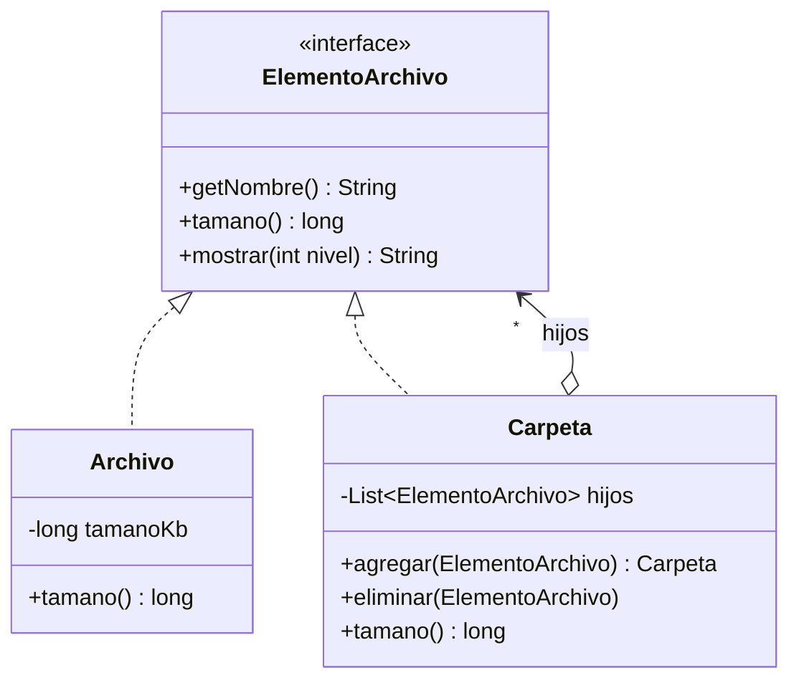

```java
Carpeta raiz = new Carpeta("biblioteca")
        .agregar(new Archivo("catalogo.pdf", 300))
        .agregar(new Carpeta("libros")
                .agregar(new Archivo("java.epub", 500))
                .agregar(new Archivo("gof.pdf", 200)));
raiz.tamano(); // 1000 — suma recursiva sin un solo instanceof
```

**Pruebas** ([`CompositeTest`](../src/test/java/co/edu/patrones/estructurales/CompositeTest.java)): hoja y carpeta vacía · suma recursiva en tres niveles · integridad (sin tamaños negativos ni carpeta dentro de sí misma).

### 1.9 Código completo, capturas y funcionamiento

> 🌐 **Pruébalo en vivo:** cada patrón tiene una demostración interactiva en la [página del proyecto](https://srdiego18.github.io/Patrones-dise-o-java/).
> El código de abajo es **exactamente** el que está en `src/` (se puede copiar). Debajo de cada bloque están la captura del código y la captura de la ejecución con sus pruebas.

#### 1.9.1 Adapter · _Laboratorio_

🔗 [Probar Adapter en la página interactiva](https://srdiego18.github.io/Patrones-dise-o-java/#adapter) · 📁 [Ver carpeta en el repositorio](../src/main/java/co/edu/patrones/estructurales/adapter)

**Código fuente**

<details open><summary><code>AdaptadorPasarela.java</code></summary>

```java
package co.edu.patrones.estructurales.adapter;

/**
 * Adapter: implementa la interfaz interna y traduce la llamada a la pasarela externa,
 * convirtiendo unidades (pesos -> centavos).
 */
public class AdaptadorPasarela implements ProcesadorPago {
    private final PasarelaExterna pasarela;

    public AdaptadorPasarela(PasarelaExterna pasarela) {
        this.pasarela = pasarela;
    }

    @Override
    public void pagar(double monto) {
        if (monto <= 0) {
            throw new IllegalArgumentException("El monto debe ser positivo");
        }
        int centavos = (int) Math.round(monto * 100);
        pasarela.realizarCobroEnCentavos(centavos);
    }
}
```

</details>

<details open><summary><code>PasarelaExterna.java</code></summary>

```java
package co.edu.patrones.estructurales.adapter;

/**
 * Clase de una librería externa (Adaptee). No podemos modificar su firma:
 * cobra en centavos enteros y con otro nombre de método.
 */
public class PasarelaExterna {
    private int ultimoCobroEnCentavos = -1;

    public void realizarCobroEnCentavos(int centavos) {
        this.ultimoCobroEnCentavos = centavos;
        System.out.println("Cobro externo: " + centavos + " centavos");
    }

    /** Solo para verificar el comportamiento en las pruebas. */
    public int getUltimoCobroEnCentavos() {
        return ultimoCobroEnCentavos;
    }
}
```

</details>

<details open><summary><code>ProcesadorPago.java</code></summary>

```java
package co.edu.patrones.estructurales.adapter;

/** Interfaz que espera nuestro sistema (Target). */
public interface ProcesadorPago {
    void pagar(double monto);
}
```

</details>

<details><summary><code>AdapterTest.java</code> (pruebas)</summary>

```java
package co.edu.patrones.estructurales;

import co.edu.patrones.estructurales.adapter.*;
import org.junit.jupiter.api.DisplayName;
import org.junit.jupiter.api.Test;

import static org.junit.jupiter.api.Assertions.*;

@DisplayName("Adapter - pasarela de pagos")
class AdapterTest {

    @Test
    @DisplayName("Convierte pesos a centavos (125.50 -> 12550)")
    void convierteMontoACentavos() {
        PasarelaExterna pasarela = new PasarelaExterna();
        ProcesadorPago procesador = new AdaptadorPasarela(pasarela);
        procesador.pagar(125.50);
        assertEquals(12550, pasarela.getUltimoCobroEnCentavos());
    }

    @Test
    @DisplayName("Redondea correctamente montos con decimales problemáticos")
    void redondeaCorrectamente() {
        PasarelaExterna pasarela = new PasarelaExterna();
        new AdaptadorPasarela(pasarela).pagar(0.29); // 0.29*100 = 28.999... en double
        assertEquals(29, pasarela.getUltimoCobroEnCentavos());
    }

    @Test
    @DisplayName("Rechaza montos no positivos sin llamar a la pasarela")
    void rechazaMontoInvalido() {
        PasarelaExterna pasarela = new PasarelaExterna();
        ProcesadorPago procesador = new AdaptadorPasarela(pasarela);
        assertThrows(IllegalArgumentException.class, () -> procesador.pagar(0));
        assertEquals(-1, pasarela.getUltimoCobroEnCentavos());
    }
}
```

</details>

**Captura del código**

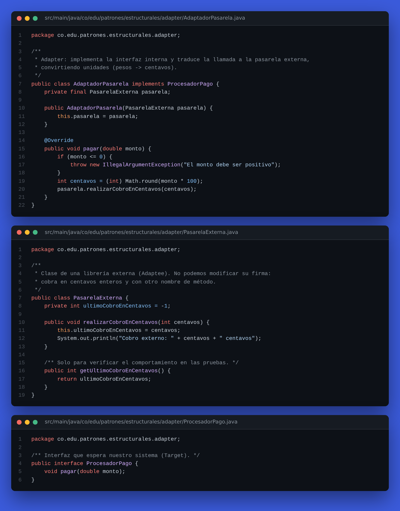

**Captura del funcionamiento (ejecución + pruebas)**

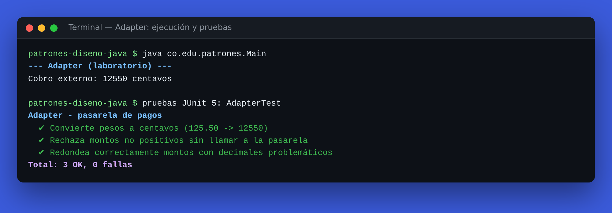

#### 1.9.2 Facade · _Laboratorio_

🔗 [Probar Facade en la página interactiva](https://srdiego18.github.io/Patrones-dise-o-java/#facade) · 📁 [Ver carpeta en el repositorio](../src/main/java/co/edu/patrones/estructurales/facade)

**Código fuente**

<details open><summary><code>Confirmaciones.java</code></summary>

```java
package co.edu.patrones.estructurales.facade;

import java.util.ArrayList;
import java.util.List;

/** Subsistema: envía la confirmación de matrícula. */
public class Confirmaciones {
    private final List<String> enviadas = new ArrayList<>();

    public void enviar(String estudiante) {
        enviadas.add(estudiante);
        System.out.println("Confirmación enviada a " + estudiante);
    }

    public List<String> getEnviadas() {
        return enviadas;
    }
}
```

</details>

<details open><summary><code>Cupos.java</code></summary>

```java
package co.edu.patrones.estructurales.facade;

/** Subsistema: administra los cupos disponibles. */
public class Cupos {
    private int disponibles;

    public Cupos() {
        this(30);
    }

    public Cupos(int disponibles) {
        this.disponibles = disponibles;
    }

    public boolean reservar() {
        if (disponibles <= 0) {
            System.out.println("Sin cupos disponibles");
            return false;
        }
        disponibles--;
        System.out.println("Cupo reservado");
        return true;
    }

    public int getDisponibles() {
        return disponibles;
    }
}
```

</details>

<details open><summary><code>MatriculaFacade.java</code></summary>

```java
package co.edu.patrones.estructurales.facade;

/**
 * Facade: ofrece un único punto de entrada (matricular) y oculta al cliente
 * la secuencia validar -> reservar cupo -> confirmar.
 */
public class MatriculaFacade {
    private final Validador validador;
    private final Cupos cupos;
    private final Confirmaciones confirmaciones;

    public MatriculaFacade() {
        this(new Validador(), new Cupos(), new Confirmaciones());
    }

    /** Constructor con inyección de dependencias para facilitar las pruebas. */
    public MatriculaFacade(Validador validador, Cupos cupos, Confirmaciones confirmaciones) {
        this.validador = validador;
        this.cupos = cupos;
        this.confirmaciones = confirmaciones;
    }

    /** @return true si la matrícula quedó confirmada. */
    public boolean matricular(String estudiante) {
        if (!validador.validar(estudiante)) {
            throw new IllegalArgumentException("Estudiante inválido");
        }
        if (cupos.reservar()) {
            confirmaciones.enviar(estudiante);
            return true;
        }
        return false;
    }
}
```

</details>

<details open><summary><code>Validador.java</code></summary>

```java
package co.edu.patrones.estructurales.facade;

/** Subsistema: valida los datos del estudiante. */
public class Validador {
    public boolean validar(String estudiante) {
        return estudiante != null && !estudiante.isBlank();
    }
}
```

</details>

<details><summary><code>FacadeTest.java</code> (pruebas)</summary>

```java
package co.edu.patrones.estructurales;

import co.edu.patrones.estructurales.facade.*;
import org.junit.jupiter.api.DisplayName;
import org.junit.jupiter.api.Test;

import static org.junit.jupiter.api.Assertions.*;

@DisplayName("Facade - matrícula")
class FacadeTest {

    @Test
    @DisplayName("Matrícula válida: reserva cupo y envía confirmación")
    void matriculaExitosa() {
        Cupos cupos = new Cupos(2);
        Confirmaciones conf = new Confirmaciones();
        MatriculaFacade facade = new MatriculaFacade(new Validador(), cupos, conf);

        assertTrue(facade.matricular("Ana"));
        assertEquals(1, cupos.getDisponibles());
        assertEquals(1, conf.getEnviadas().size());
    }

    @Test
    @DisplayName("Estudiante vacío: lanza excepción y no consume cupo")
    void estudianteInvalido() {
        Cupos cupos = new Cupos(2);
        MatriculaFacade facade = new MatriculaFacade(new Validador(), cupos, new Confirmaciones());

        assertThrows(IllegalArgumentException.class, () -> facade.matricular("  "));
        assertEquals(2, cupos.getDisponibles());
    }

    @Test
    @DisplayName("Sin cupos: no se envía confirmación")
    void sinCupos() {
        Confirmaciones conf = new Confirmaciones();
        MatriculaFacade facade = new MatriculaFacade(new Validador(), new Cupos(0), conf);

        assertFalse(facade.matricular("Luis"));
        assertTrue(conf.getEnviadas().isEmpty());
    }
}
```

</details>

**Captura del código**

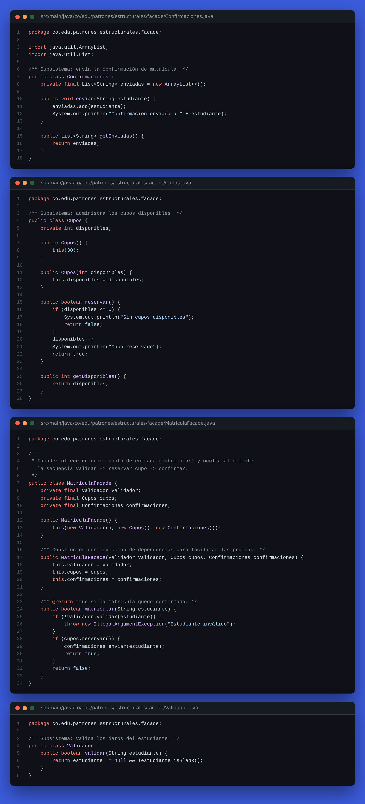

**Captura del funcionamiento (ejecución + pruebas)**

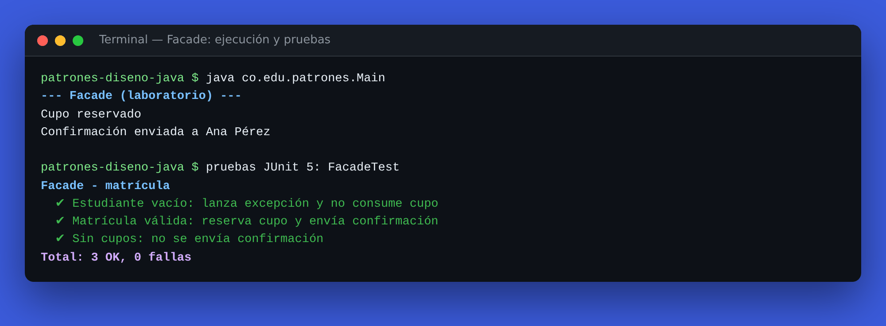

#### 1.9.3 Decorator · _Trabajo autónomo_

🔗 [Probar Decorator en la página interactiva](https://srdiego18.github.io/Patrones-dise-o-java/#decorator) · 📁 [Ver carpeta en el repositorio](../src/main/java/co/edu/patrones/estructurales/decorator)

**Código fuente**

<details open><summary><code>CifradoDecorator.java</code></summary>

```java
package co.edu.patrones.estructurales.decorator;

import java.nio.charset.StandardCharsets;
import java.util.Base64;

/**
 * Decorador concreto: transforma el mensaje antes de delegar.
 * NOTA DIDÁCTICA: Base64 es una codificación, no un cifrado seguro.
 * En producción se usaría AES/GCM con una clave administrada (javax.crypto).
 */
public class CifradoDecorator extends NotificadorDecorator {

    public CifradoDecorator(Notificador envuelto) {
        super(envuelto);
    }

    @Override
    public String enviar(String mensaje) {
        String cifrado = Base64.getEncoder()
                .encodeToString(mensaje.getBytes(StandardCharsets.UTF_8));
        return super.enviar(cifrado);
    }

    public static String descifrar(String cifrado) {
        return new String(Base64.getDecoder().decode(cifrado), StandardCharsets.UTF_8);
    }
}
```

</details>

<details open><summary><code>NotificacionPrestamo.java</code></summary>

```java
package co.edu.patrones.estructurales.decorator;

/** Componente concreto: notificación básica de préstamo para un usuario. */
public class NotificacionPrestamo implements Notificador {
    private final String destinatario;

    public NotificacionPrestamo(String destinatario) {
        this.destinatario = destinatario;
    }

    @Override
    public String enviar(String mensaje) {
        String entregado = "Para " + destinatario + ": " + mensaje;
        System.out.println(entregado);
        return entregado;
    }
}
```

</details>

<details open><summary><code>Notificador.java</code></summary>

```java
package co.edu.patrones.estructurales.decorator;

/** Componente: contrato común de cualquier notificación de la biblioteca. */
public interface Notificador {
    /** Envía el mensaje y devuelve el contenido final que se entregó. */
    String enviar(String mensaje);
}
```

</details>

<details open><summary><code>NotificadorDecorator.java</code></summary>

```java
package co.edu.patrones.estructurales.decorator;

/**
 * Decorador base: implementa la misma interfaz y guarda una referencia al objeto envuelto.
 * Por defecto solo delega; las subclases añaden comportamiento antes o después.
 */
public abstract class NotificadorDecorator implements Notificador {
    protected final Notificador envuelto;

    protected NotificadorDecorator(Notificador envuelto) {
        this.envuelto = envuelto;
    }

    @Override
    public String enviar(String mensaje) {
        return envuelto.enviar(mensaje);
    }
}
```

</details>

<details open><summary><code>RegistroDecorator.java</code></summary>

```java
package co.edu.patrones.estructurales.decorator;

import java.util.ArrayList;
import java.util.List;

/** Decorador concreto: registra (auditoría) cada mensaje antes de delegar. */
public class RegistroDecorator extends NotificadorDecorator {
    private final List<String> bitacora = new ArrayList<>();

    public RegistroDecorator(Notificador envuelto) {
        super(envuelto);
    }

    @Override
    public String enviar(String mensaje) {
        bitacora.add("[LOG] " + mensaje);
        return super.enviar(mensaje);
    }

    public List<String> getBitacora() {
        return bitacora;
    }
}
```

</details>

<details><summary><code>DecoratorTest.java</code> (pruebas)</summary>

```java
package co.edu.patrones.estructurales;

import co.edu.patrones.estructurales.decorator.*;
import org.junit.jupiter.api.DisplayName;
import org.junit.jupiter.api.Test;

import static org.junit.jupiter.api.Assertions.*;

@DisplayName("Decorator - notificaciones de la biblioteca (trabajo autónomo)")
class DecoratorTest {

    @Test
    @DisplayName("Escenario 1: notificación base sin decorar")
    void notificacionBase() {
        Notificador n = new NotificacionPrestamo("ana");
        assertEquals("Para ana: Libro listo", n.enviar("Libro listo"));
    }

    @Test
    @DisplayName("Escenario 2: el registro guarda el mensaje y no altera el contenido")
    void registroAgregaBitacora() {
        RegistroDecorator conRegistro = new RegistroDecorator(new NotificacionPrestamo("ana"));
        String entregado = conRegistro.enviar("Libro listo");

        assertEquals("Para ana: Libro listo", entregado);
        assertEquals(1, conRegistro.getBitacora().size());
        assertEquals("[LOG] Libro listo", conRegistro.getBitacora().get(0));
    }

    @Test
    @DisplayName("Escenario 3: registro + cifrado combinados; el mensaje llega cifrado y es reversible")
    void combinacionDeDecoradores() {
        RegistroDecorator n = new RegistroDecorator(
                new CifradoDecorator(new NotificacionPrestamo("ana")));
        String entregado = n.enviar("Vence mañana");

        assertFalse(entregado.contains("Vence mañana"), "El texto plano no debe viajar");
        String cifrado = entregado.substring("Para ana: ".length());
        assertEquals("Vence mañana", CifradoDecorator.descifrar(cifrado));
        assertEquals("[LOG] Vence mañana", n.getBitacora().get(0)); // se registra antes de cifrar
    }
}
```

</details>

**Captura del código**

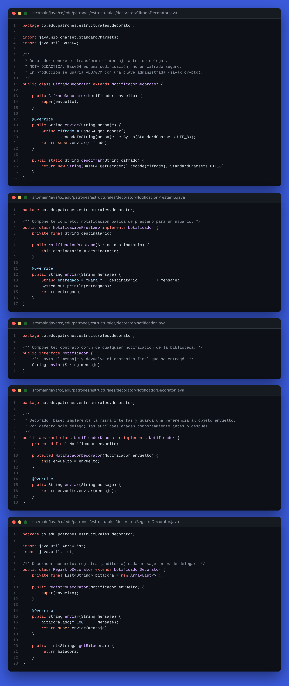

**Captura del funcionamiento (ejecución + pruebas)**

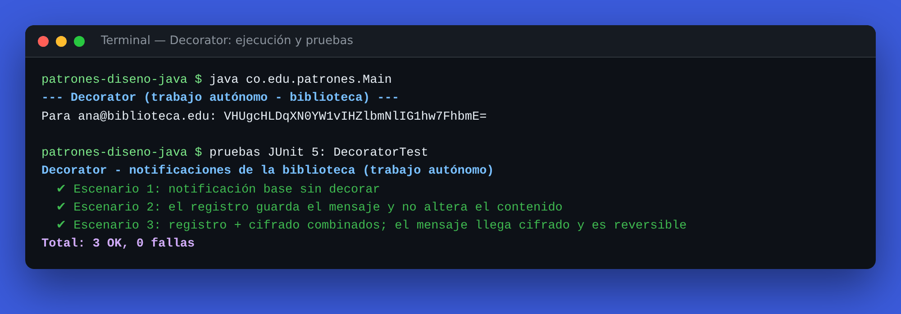

#### 1.9.4 Proxy · _Trabajo autónomo_

🔗 [Probar Proxy en la página interactiva](https://srdiego18.github.io/Patrones-dise-o-java/#proxy) · 📁 [Ver carpeta en el repositorio](../src/main/java/co/edu/patrones/estructurales/proxy)

**Código fuente**

<details open><summary><code>LibroDigital.java</code></summary>

```java
package co.edu.patrones.estructurales.proxy;

/** Sujeto: contrato común del libro real y de su proxy. */
public interface LibroDigital {
    String leer(Usuario usuario);
}
```

</details>

<details open><summary><code>LibroDigitalProxy.java</code></summary>

```java
package co.edu.patrones.estructurales.proxy;

/**
 * Proxy de protección + virtual:
 *  1) verifica que el usuario tenga préstamo activo (autorización);
 *  2) crea/descarga el libro real solo la primera vez que alguien autorizado lo abre (carga diferida);
 *  3) reutiliza la instancia descargada en lecturas siguientes (caché).
 */
public class LibroDigitalProxy implements LibroDigital {
    private final String titulo;
    private LibroDigitalReal libroReal; // null hasta que se necesite

    public LibroDigitalProxy(String titulo) {
        this.titulo = titulo;
    }

    @Override
    public String leer(Usuario usuario) {
        if (usuario == null || !usuario.tienePrestamoActivo()) {
            throw new SecurityException("Acceso denegado: el usuario no tiene préstamo activo");
        }
        if (libroReal == null) {
            libroReal = new LibroDigitalReal(titulo);
        }
        return libroReal.leer(usuario);
    }

    public boolean estaCargado() {
        return libroReal != null;
    }
}
```

</details>

<details open><summary><code>LibroDigitalReal.java</code></summary>

```java
package co.edu.patrones.estructurales.proxy;

/**
 * Sujeto real: descargar el libro es costoso (simula descarga remota en el constructor).
 */
public class LibroDigitalReal implements LibroDigital {
    private static int descargasRealizadas = 0;
    private final String titulo;
    private final String contenido;

    public LibroDigitalReal(String titulo) {
        this.titulo = titulo;
        System.out.println("Descargando '" + titulo + "' del servidor remoto...");
        this.contenido = "Contenido completo de " + titulo;
        descargasRealizadas++;
    }

    @Override
    public String leer(Usuario usuario) {
        return contenido;
    }

    public String getTitulo() {
        return titulo;
    }

    public static int getDescargasRealizadas() {
        return descargasRealizadas;
    }

    public static void reiniciarContador() {
        descargasRealizadas = 0;
    }
}
```

</details>

<details open><summary><code>Usuario.java</code></summary>

```java
package co.edu.patrones.estructurales.proxy;

/** Usuario de la biblioteca. Solo quien tiene préstamo activo puede leer. */
public record Usuario(String nombre, boolean tienePrestamoActivo) {
}
```

</details>

<details><summary><code>ProxyTest.java</code> (pruebas)</summary>

```java
package co.edu.patrones.estructurales;

import co.edu.patrones.estructurales.proxy.*;
import org.junit.jupiter.api.BeforeEach;
import org.junit.jupiter.api.DisplayName;
import org.junit.jupiter.api.Test;

import static org.junit.jupiter.api.Assertions.*;

@DisplayName("Proxy - libro digital de la biblioteca (trabajo autónomo)")
class ProxyTest {

    @BeforeEach
    void reiniciar() {
        LibroDigitalReal.reiniciarContador();
    }

    @Test
    @DisplayName("Escenario 1: usuario sin préstamo es rechazado y el libro NO se descarga")
    void accesoDenegado() {
        LibroDigitalProxy proxy = new LibroDigitalProxy("Clean Code");
        assertThrows(SecurityException.class, () -> proxy.leer(new Usuario("Invitado", false)));
        assertFalse(proxy.estaCargado());
        assertEquals(0, LibroDigitalReal.getDescargasRealizadas());
    }

    @Test
    @DisplayName("Escenario 2: carga diferida, solo descarga al abrir")
    void cargaDiferida() {
        LibroDigitalProxy proxy = new LibroDigitalProxy("Clean Code");
        assertFalse(proxy.estaCargado(), "Crear el proxy no debe descargar el libro");

        String contenido = proxy.leer(new Usuario("Ana", true));
        assertTrue(proxy.estaCargado());
        assertEquals("Contenido completo de Clean Code", contenido);
    }

    @Test
    @DisplayName("Escenario 3: lecturas repetidas reutilizan la descarga (caché)")
    void cache() {
        LibroDigitalProxy proxy = new LibroDigitalProxy("Clean Code");
        Usuario ana = new Usuario("Ana", true);
        proxy.leer(ana);
        proxy.leer(ana);
        proxy.leer(ana);
        assertEquals(1, LibroDigitalReal.getDescargasRealizadas());
    }
}
```

</details>

**Captura del código**

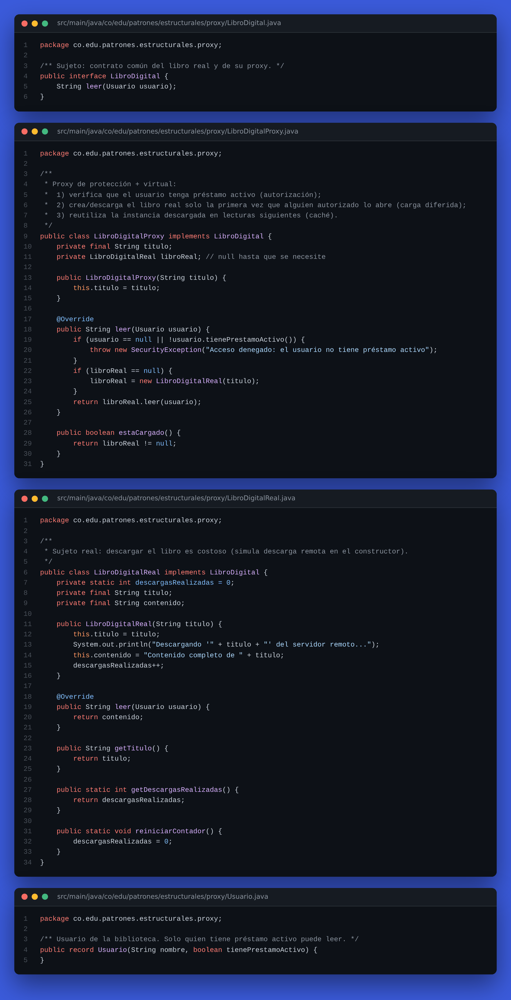

**Captura del funcionamiento (ejecución + pruebas)**

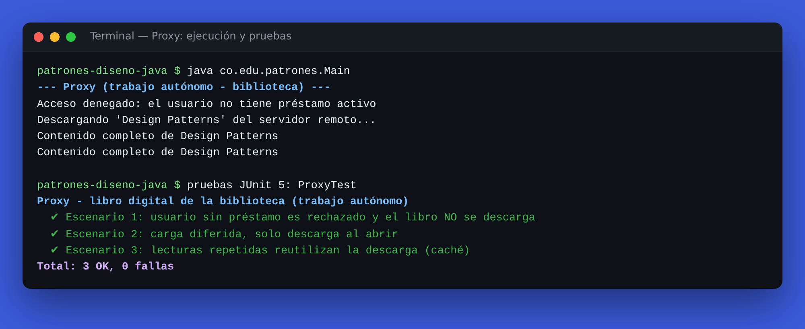

#### 1.9.5 Composite · _Extra_

🔗 [Probar Composite en la página interactiva](https://srdiego18.github.io/Patrones-dise-o-java/#composite) · 📁 [Ver carpeta en el repositorio](../src/main/java/co/edu/patrones/estructurales/composite)

**Código fuente**

<details open><summary><code>Archivo.java</code></summary>

```java
package co.edu.patrones.estructurales.composite;

import java.util.Objects;

/** Hoja: no tiene hijos; su tamaño es propio. */
public class Archivo implements ElementoArchivo {
    private final String nombre;
    private final long tamanoKb;

    public Archivo(String nombre, long tamanoKb) {
        if (tamanoKb < 0) throw new IllegalArgumentException("El tamaño no puede ser negativo");
        this.nombre = Objects.requireNonNull(nombre, "nombre");
        this.tamanoKb = tamanoKb;
    }

    @Override public String getNombre() { return nombre; }
    @Override public long tamano() { return tamanoKb; }

    @Override
    public String mostrar(int nivel) {
        return "  ".repeat(nivel) + "- " + nombre + " (" + tamanoKb + " KB)\n";
    }
}
```

</details>

<details open><summary><code>Carpeta.java</code></summary>

```java
package co.edu.patrones.estructurales.composite;

import java.util.ArrayList;
import java.util.Collections;
import java.util.List;
import java.util.Objects;

/** Compuesto: contiene elementos (archivos o carpetas) y delega en ellos. */
public class Carpeta implements ElementoArchivo {
    private final String nombre;
    private final List<ElementoArchivo> hijos = new ArrayList<>();

    public Carpeta(String nombre) {
        this.nombre = Objects.requireNonNull(nombre, "nombre");
    }

    public Carpeta agregar(ElementoArchivo elemento) {
        Objects.requireNonNull(elemento, "elemento");
        if (elemento == this) throw new IllegalArgumentException("Una carpeta no puede contenerse a sí misma");
        hijos.add(elemento);
        return this; // interfaz fluida
    }

    public void eliminar(ElementoArchivo elemento) {
        hijos.remove(elemento);
    }

    public List<ElementoArchivo> getHijos() {
        return Collections.unmodifiableList(hijos);
    }

    @Override public String getNombre() { return nombre; }

    @Override
    public long tamano() {
        // Recursión polimórfica: no importa si el hijo es Archivo o Carpeta.
        return hijos.stream().mapToLong(ElementoArchivo::tamano).sum();
    }

    @Override
    public String mostrar(int nivel) {
        StringBuilder sb = new StringBuilder("  ".repeat(nivel))
                .append("+ ").append(nombre).append("/ (").append(tamano()).append(" KB)\n");
        hijos.forEach(h -> sb.append(h.mostrar(nivel + 1)));
        return sb.toString();
    }
}
```

</details>

<details open><summary><code>ElementoArchivo.java</code></summary>

```java
package co.edu.patrones.estructurales.composite;

/** Componente: abstracción común para hojas (Archivo) y contenedores (Carpeta). */
public interface ElementoArchivo {
    String getNombre();

    /** Tamaño en KB. En una carpeta es la suma recursiva de sus hijos. */
    long tamano();

    /** Representación en árbol con sangría según la profundidad. */
    String mostrar(int nivel);
}
```

</details>

<details><summary><code>CompositeTest.java</code> (pruebas)</summary>

```java
package co.edu.patrones.estructurales;

import co.edu.patrones.estructurales.composite.*;
import org.junit.jupiter.api.DisplayName;
import org.junit.jupiter.api.Test;

import static org.junit.jupiter.api.Assertions.*;

@DisplayName("Composite - archivos y carpetas (extra)")
class CompositeTest {

    @Test
    @DisplayName("Un archivo devuelve su propio tamaño y una carpeta vacía pesa 0")
    void hojaYCarpetaVacia() {
        assertEquals(120, new Archivo("a.txt", 120).tamano());
        assertEquals(0, new Carpeta("vacia").tamano());
    }

    @Test
    @DisplayName("Carpetas anidadas suman recursivamente el tamaño de sus hijos")
    void sumaRecursiva() {
        Carpeta raiz = new Carpeta("biblioteca")
                .agregar(new Archivo("catalogo.pdf", 300))
                .agregar(new Carpeta("libros")
                        .agregar(new Archivo("java.epub", 500))
                        .agregar(new Carpeta("patrones").agregar(new Archivo("gof.pdf", 200))));
        assertEquals(1000, raiz.tamano());
    }

    @Test
    @DisplayName("Reglas de integridad: no tamaños negativos ni carpeta dentro de sí misma")
    void integridad() {
        Carpeta c = new Carpeta("c");
        assertThrows(IllegalArgumentException.class, () -> new Archivo("x", -1));
        assertThrows(IllegalArgumentException.class, () -> c.agregar(c));
    }
}
```

</details>

**Captura del código**

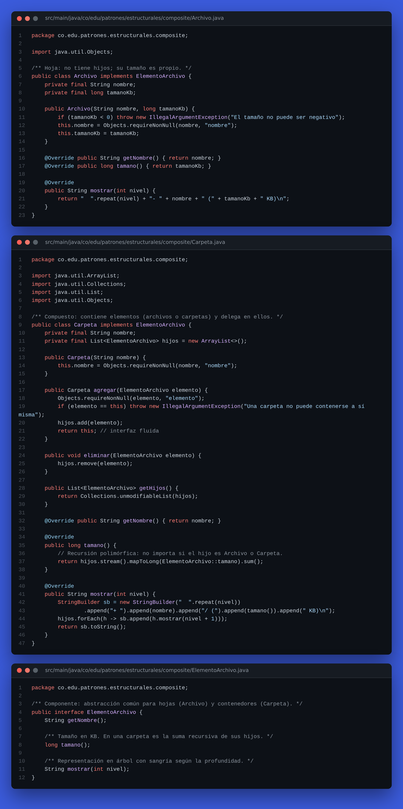

**Captura del funcionamiento (ejecución + pruebas)**

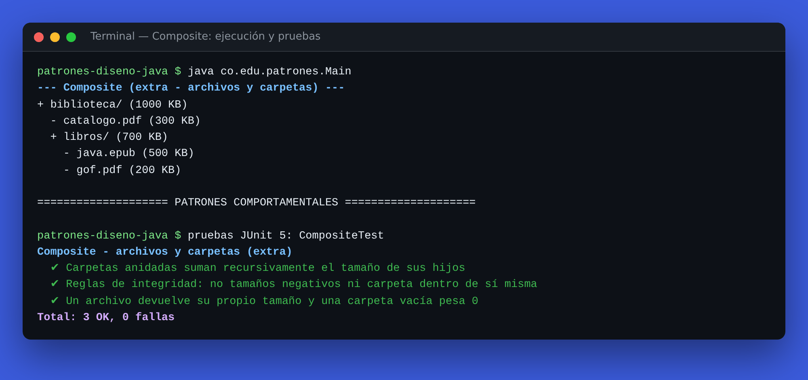

#### Ejecución completa y resumen de pruebas (Guía 1)

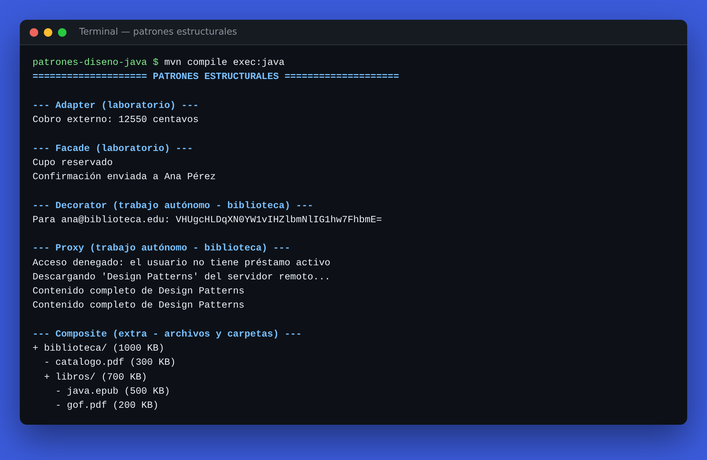

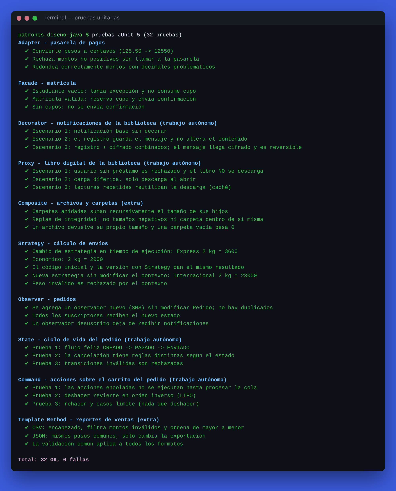

---
### 1.10 Autoevaluación frente a la rúbrica

| Criterio | Peso | Evidencia en el repositorio |
|---|---|---|
| Análisis y selección | 25 % | §1.5 (5 situaciones resueltas y justificadas), §1.6, problema y alternativa de cada patrón en §1.7 |
| Implementación | 30 % | Adapter, Facade, Decorator, Proxy **y Composite (extra)** compilando y ejecutándose desde [`Main`](../src/main/java/co/edu/patrones/Main.java) — ver §1.9 |
| Diseño | 20 % | Diagramas de clases y de secuencia (Mermaid), interfaces, inyección de dependencias, responsabilidad única |
| Pruebas | 15 % | 15 pruebas JUnit 5 (3 por patrón) ejecutadas automáticamente con GitHub Actions, en [`src/test/.../estructurales`](../src/test/java/co/edu/patrones/estructurales) |
| Reflexión | 10 % | Justificación, alternativa y limitación de cada patrón (§1.7) y costos de mantenimiento (§1.6.5) |

---

## Guía 2 — Patrones comportamentales


> **Resultado de aprendizaje:** reconocer problemas de comunicación y distribución de responsabilidades entre objetos, y aplicar Strategy y Observer mediante una implementación Java guiada.
>
> **Patrones:** Strategy · Observer · State · Command · Template Method

> 🎮 **Probar la Guía 2 en vivo:** [https://srdiego18.github.io/Patrones-dise-o-java/#guia2](https://srdiego18.github.io/Patrones-dise-o-java/#guia2)

### 2.1 Concepto central

Los patrones comportamentales organizan **algoritmos, responsabilidades y comunicación entre objetos**. Ayudan a reducir dependencias rígidas y a definir con claridad **quién conoce, quién notifica y quién ejecuta** una acción.

### 2.2 Los cinco patrones comportamentales

| Patrón | Propósito | Ejemplo | ¿Dónde está en el repo? |
|---|---|---|---|
| **Strategy** | Encapsula algoritmos intercambiables | Cálculo de envío | [`strategy/`](../src/main/java/co/edu/patrones/comportamentales/strategy) — laboratorio |
| **Observer** | Notifica a suscriptores cuando cambia un objeto | Alertas de cambio de estado del pedido | [`observer/`](../src/main/java/co/edu/patrones/comportamentales/observer) — laboratorio |
| **Command** | Convierte una solicitud en objeto ejecutable | Acciones encoladas y deshacer/rehacer | [`command/`](../src/main/java/co/edu/patrones/comportamentales/command) — trabajo autónomo |
| **State** | Cambia el comportamiento según el estado interno | Pedido creado, pagado, enviado | [`state/`](../src/main/java/co/edu/patrones/comportamentales/state) — trabajo autónomo |
| **Template Method** | Define el esqueleto de un algoritmo y deja pasos a subclases | Reportes con distintos exportadores | [`templatemethod/`](../src/main/java/co/edu/patrones/comportamentales/templatemethod) — **extra** |

---

### 2.3 Laboratorio: Strategy para calcular envíos

**Problema.** La versión inicial concentra las reglas en condicionales. Cada proveedor nuevo o cambio de fórmula obliga a **modificar** `CalculadoraEnvio`, que acumula decisiones y crece sin control.

**Paso 1 — Análisis del código inicial** ([`CalculadoraEnvioInicial.java`](../src/main/java/co/edu/patrones/comportamentales/strategy/CalculadoraEnvioInicial.java), conservado para comparar):
- Viola el principio **abierto/cerrado**: para agregar "INTERNACIONAL" hay que editar la clase.
- Usa *strings mágicos* (`"ECONOMICO"`), así que un error tipográfico solo se detecta en ejecución.
- Todas las fórmulas viven juntas: probar una implica cargar todas.

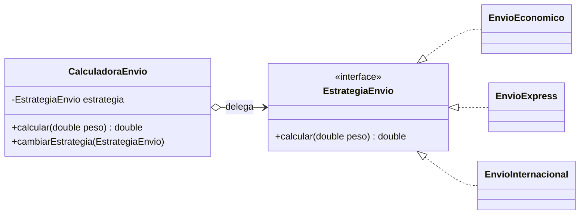

| Paso | Qué se hizo | Archivo |
|---|---|---|
| 2 | Interfaz de la estrategia | [`EstrategiaEnvio.java`](../src/main/java/co/edu/patrones/comportamentales/strategy/EstrategiaEnvio.java) |
| 3 | Estrategias concretas | [`EnvioEconomico`](../src/main/java/co/edu/patrones/comportamentales/strategy/EnvioEconomico.java), [`EnvioExpress`](../src/main/java/co/edu/patrones/comportamentales/strategy/EnvioExpress.java) |
| 4 | Contexto que valida y delega | [`CalculadoraEnvio.java`](../src/main/java/co/edu/patrones/comportamentales/strategy/CalculadoraEnvio.java) |
| 5 | Ejecución | [`Main.java`](../src/main/java/co/edu/patrones/Main.java) → `2000.0` y `3600.0` ✅ |
| Extra | **Nuevo proveedor sin tocar el contexto** | [`EnvioInternacional.java`](../src/main/java/co/edu/patrones/comportamentales/strategy/EnvioInternacional.java) |

**Pruebas** ([`StrategyTest`](../src/test/java/co/edu/patrones/comportamentales/StrategyTest.java)): económico 2 kg = 2000 · cambio a express en ejecución = 3600 · internacional (estrategia nueva) = 23000 · peso inválido rechazado · el código inicial y el refactorizado dan el mismo resultado (la refactorización no cambió el comportamiento).

---

### 2.4 Segundo ejemplo: Observer para pedidos

**Problema.** Cuando cambia el estado de un pedido deben reaccionar el correo y el tablero, pero `Pedido` no debería depender de cada componente concreto.

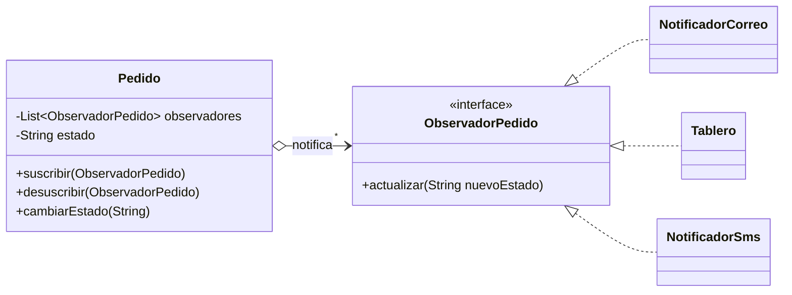

| Paso de la guía | Implementación |
|---|---|
| 1. Definir el contrato | [`ObservadorPedido`](../src/main/java/co/edu/patrones/comportamentales/observer/ObservadorPedido.java) |
| 2. Lista de suscriptores en `Pedido` | `List<ObservadorPedido> observadores` en [`Pedido`](../src/main/java/co/edu/patrones/comportamentales/observer/Pedido.java) |
| 3. Método `suscribir()` | Implementado, **ignora duplicados** |
| 4. Notificar al cambiar el estado | `cambiarEstado()` recorre la lista y llama `actualizar()` |
| 5. Otro observador sin modificar `Pedido` | [`NotificadorSms`](../src/main/java/co/edu/patrones/comportamentales/observer/NotificadorSms.java) ✅ |

**Mejoras de las que habla la guía ("en producción conviene…")** que se implementaron: `desuscribir()` y control de duplicados. Quedan fuera del alcance: manejo de errores de un observador (hoy una excepción interrumpe a los siguientes) y concurrencia (se usaría `CopyOnWriteArrayList`).

**Pruebas** ([`ObserverTest`](../src/test/java/co/edu/patrones/comportamentales/ObserverTest.java)): todos los suscriptores reciben el estado · observador nuevo sin duplicados · un observador desuscrito deja de recibir.

---

### 2.5 Actividad de análisis (resuelta)

| # | Situación | Patrón | Justificación |
|---|---|---|---|
| 1 | Elegir diferentes reglas de descuento en tiempo de ejecución. | **Strategy** | Son algoritmos intercambiables de la misma familia; el contexto delega en una interfaz `EstrategiaDescuento` y la regla se cambia sin `if/else`. |
| 2 | Cuando una cuenta cambia su saldo, varias vistas se actualizan sin que la cuenta conozca cada vista. | **Observer** | Relación uno-a-muchos: la cuenta (*subject*) notifica a una lista de observadores a través de una interfaz, sin acoplarse a las vistas concretas. |
| 3 | Almacenar una acción de usuario para ejecutarla después en una cola. | **Command** | La solicitud se convierte en un objeto con `ejecutar()` que puede guardarse, encolarse, registrarse o deshacerse. Implementado en el trabajo autónomo. |
| 4 | Un pedido tiene reglas distintas para cancelar según esté creado, pagado o enviado. | **State** | El comportamiento depende del estado interno; cada estado es una clase que decide qué hacer al cancelar. Implementado en el trabajo autónomo. |
| 5 | Los reportes comparten validar, consultar y transformar, pero cambia la exportación. | **Template Method** | Una clase abstracta `GeneradorReporte` define `generar()` como método `final` que llama `validar() → consultar() → transformar() → exportar()`; las subclases (`ReportePdf`, `ReporteExcel`) solo implementan `exportar()`. |

---

### 2.6 Verificación (resuelta)

**1. ¿Qué problema resuelve Strategy frente a muchos if/else?**
Elimina la clase que concentra todas las variantes de un algoritmo. Cada variante queda en su propia clase, el contexto solo conoce la interfaz y se pueden **agregar fórmulas sin modificar código existente** (abierto/cerrado). Además, cada estrategia se prueba de forma aislada y puede cambiarse en tiempo de ejecución (`cambiarEstrategia`).

**2. ¿Qué relación existe entre Subject y Observer?**
Es una relación **uno-a-muchos con bajo acoplamiento**. El *Subject* (`Pedido`) mantiene una lista de observadores y los notifica cuando cambia; solo depende de la **interfaz** `ObservadorPedido`, no de las clases concretas. Los *Observers* se suscriben y desuscriben en tiempo de ejecución y reaccionan a la notificación. Es la base del modelo publicador/suscriptor y de los eventos en interfaces gráficas.

**3. ¿Qué ventaja aporta Command frente a invocar directamente un método?**
Desacopla **quién pide** la acción (invocador) de **quién la ejecuta** (receptor). Como la acción es un objeto, puede **encolarse** para ejecutarse después, **registrarse** en una bitácora, **deshacerse/rehacerse** si se define la operación inversa, reintentarse o combinarse en macros. Una invocación directa ocurre en el momento y no deja rastro.

**4. ¿Cuándo State es preferible a condicionales por estado?**
Cuando hay **varios estados**, **varias operaciones** cuyo comportamiento cambia según el estado y **reglas de transición**. Con condicionales, cada método repite un `switch (estado)` y agregar un estado obliga a modificar todos los métodos. Con State, cada estado encapsula sus reglas en una clase y agregar uno no toca los demás. Con dos estados triviales, un `if` sigue siendo suficiente.

**5. ¿Qué define Template Method y qué deja variar?**
Define, en una clase base, el **esqueleto fijo del algoritmo**: el orden de los pasos (normalmente en un método `final` para que no se altere). Deja variar los **pasos concretos** que las subclases implementan (métodos abstractos) y, opcionalmente, *hooks* con comportamiento por defecto. Se basa en herencia, a diferencia de Strategy, que se basa en composición.

---

### 2.7 Trabajo autónomo: Sistema de pedidos con State y Command

> Dominio elegido: **sistema de pedidos**. Se implementan dos patrones distintos a los del laboratorio para ampliar la práctica.

#### 2.7.1 State — ciclo de vida del pedido

**Problema.** Un pedido pasa por `CREADO → PAGADO → ENVIADO` y puede `CANCELARSE`. Las reglas cambian según el estado: un pedido creado se cancela sin costo, uno pagado se cancela con reembolso total, uno enviado no puede cancelarse, y no se puede enviar sin pagar. Con condicionales, `pagar()`, `enviar()` y `cancelar()` tendrían cada uno un `switch` sobre el estado que habría que editar al añadir un estado nuevo (por ejemplo, `ENTREGADO`).

**Diagrama de estados.**

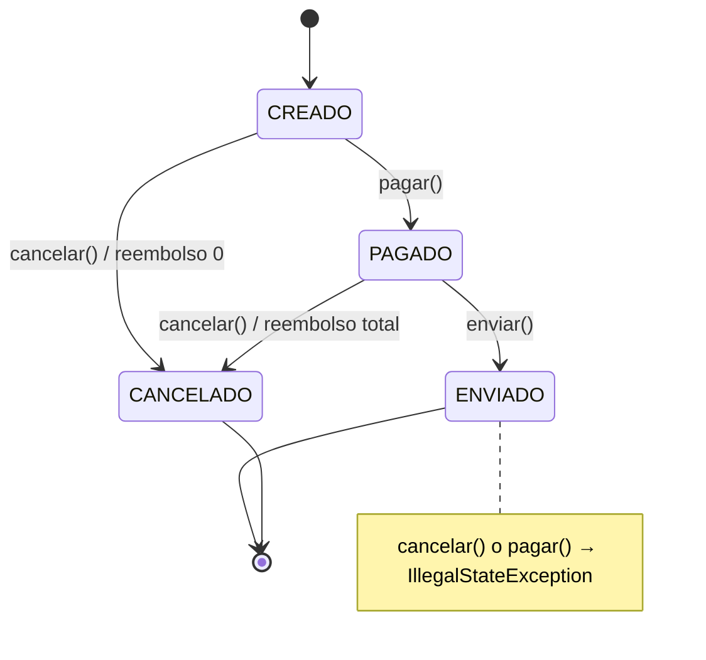

**Diagrama de clases.**

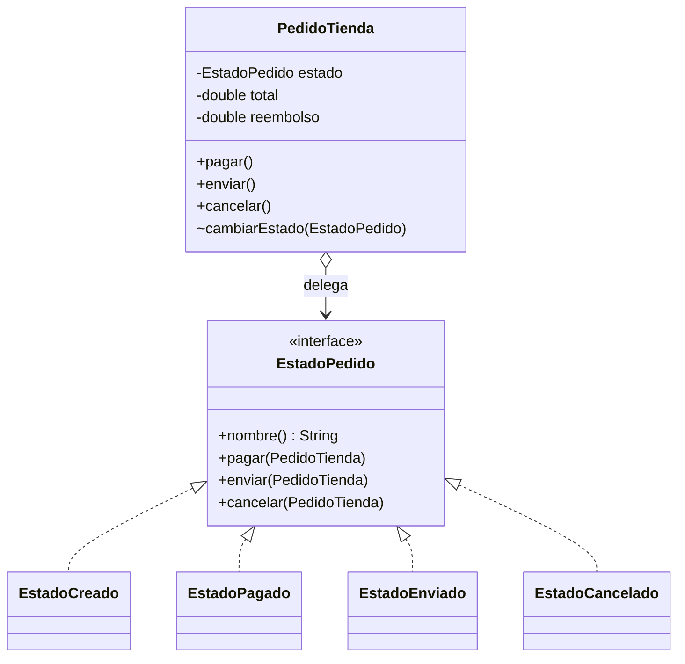

**Código:** [`state/`](../src/main/java/co/edu/patrones/comportamentales/state). `PedidoTienda` **no contiene ningún `if` sobre el estado**; la interfaz usa métodos `default` que lanzan `IllegalStateException`, de modo que cada estado solo sobrescribe las transiciones que permite.

**Pruebas** ([`StateTest`](../src/test/java/co/edu/patrones/comportamentales/StateTest.java)):

| # | Prueba | Resultado esperado |
|---|---|---|
| 1 | Flujo feliz | `CREADO → PAGADO → ENVIADO` |
| 2 | Cancelar según el estado | Creado: reembolso 0 · Pagado: reembolso = total |
| 3 | Transiciones inválidas | Enviar sin pagar y cancelar un pedido enviado lanzan `IllegalStateException`; el estado no cambia |

**Justificación.** Cada regla de negocio vive en la clase del estado al que pertenece; agregar `ENTREGADO` o `DEVUELTO` implica crear una clase y modificar solo el estado que transiciona hacia él. Las transiciones inválidas se rechazan por diseño.

**Alternativa considerada.** Un `enum EstadoPedido` con `switch` en cada método del pedido. Es más compacto y aceptable con pocos estados y reglas simples, pero dispersa la lógica de un mismo estado en varios métodos y crece mal.

**Limitación.** Aumenta el número de clases, y las transiciones quedan **repartidas** entre los estados (no hay un único lugar donde ver la máquina completa; por eso se documenta con el diagrama). Los estados necesitan acceso a métodos internos del pedido (`cambiarEstado`, `registrarReembolso`), resuelto aquí con visibilidad de paquete. La persistencia en base de datos requiere mapear las clases de estado a un valor almacenable.

#### 2.7.2 Command — acciones encolables con deshacer/rehacer

**Problema.** El usuario arma su pedido agregando y quitando productos. El sistema debe **encolar** estas acciones para procesarlas después (por ejemplo, al sincronizar con el servidor), **registrar** cada una y permitir **deshacer y rehacer**. Si la interfaz llamara directamente a `carrito.agregar(...)`, no habría forma de guardar, retrasar ni revertir la acción.

**Diagrama.**

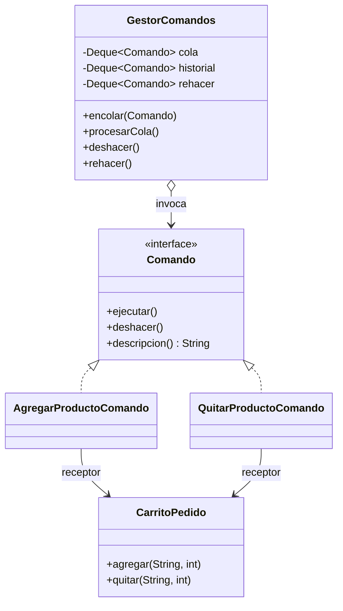

| Rol del patrón | Clase |
|---|---|
| Comando | [`Comando`](../src/main/java/co/edu/patrones/comportamentales/command/Comando.java) |
| Comandos concretos | [`AgregarProductoComando`](../src/main/java/co/edu/patrones/comportamentales/command/AgregarProductoComando.java), [`QuitarProductoComando`](../src/main/java/co/edu/patrones/comportamentales/command/QuitarProductoComando.java) (cada uno con su **operación inversa**) |
| Receptor | [`CarritoPedido`](../src/main/java/co/edu/patrones/comportamentales/command/CarritoPedido.java) |
| Invocador | [`GestorComandos`](../src/main/java/co/edu/patrones/comportamentales/command/GestorComandos.java): cola FIFO, historial LIFO, pila de rehacer y bitácora |

**Pruebas** ([`CommandTest`](../src/test/java/co/edu/patrones/comportamentales/CommandTest.java)):

| # | Prueba | Resultado esperado |
|---|---|---|
| 1 | Encolar sin procesar | El carrito no cambia hasta `procesarCola()` |
| 2 | Deshacer dos veces | Se revierte en orden inverso (LIFO): 3 → 5 → 0 |
| 3 | Rehacer y casos límite | Deshacer sin historial lanza excepción; deshacer + rehacer deja el producto; la bitácora tiene 3 entradas |

**Justificación.** El invocador no sabe qué hace cada comando; agregar `CambiarCantidadComando` o `AplicarCuponComando` no modifica `GestorComandos`. Encolar, registrar y deshacer salen "gratis" del hecho de que la acción sea un objeto.

**Alternativa considerada.** Guardar *snapshots* del carrito completo (patrón **Memento**) para deshacer. Es más simple de implementar, pero consume más memoria y no sirve para encolar acciones pendientes ni para registrar qué hizo el usuario.

**Limitación.** Cada acción nueva exige una clase y una operación inversa **correcta**; algunas acciones no son reversibles (enviar un correo, cobrar una tarjeta) y requieren compensaciones. El historial crece sin límite si no se acota, y no se maneja el fallo de un comando a mitad de la cola (no hay transacción).

---

### 2.8 Extra: Template Method implementado

La guía solo pide *reconocer* Template Method; aquí se implementa la situación 5 del análisis: reportes que comparten **validar → consultar → transformar** y solo cambian la **exportación**.

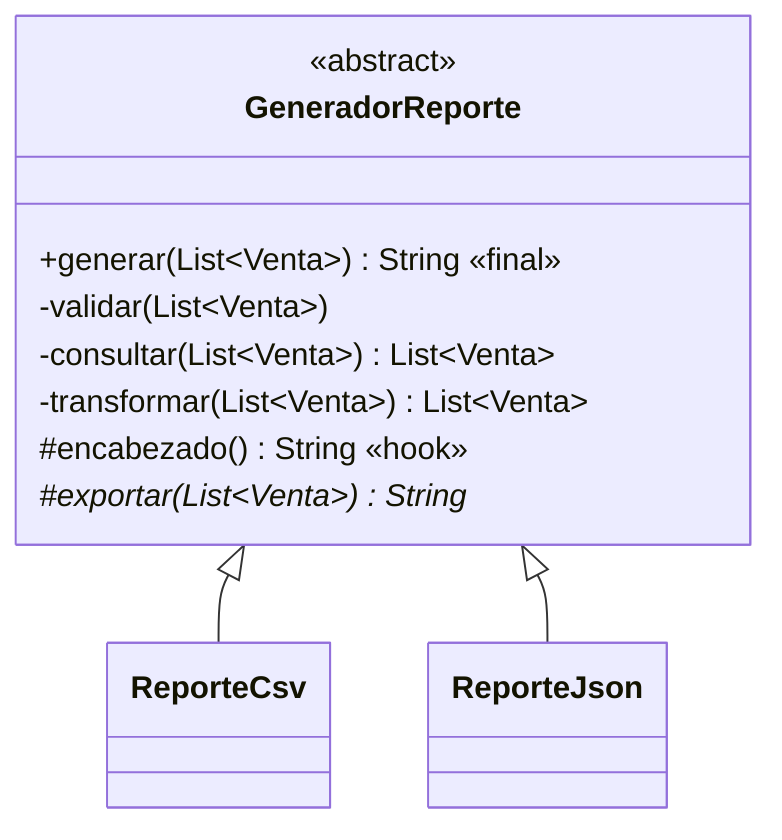

- `generar()` es **`final`**: ninguna subclase puede cambiar el orden de los pasos.
- `validar`, `consultar` y `transformar` son **privados**: comunes a todos los formatos.
- `exportar()` es **abstracto**: el único paso obligatorio de cada subclase.
- `encabezado()` es un **hook**: opcional (el CSV lo usa, el JSON no).

**Pruebas** ([`TemplateMethodTest`](../src/test/java/co/edu/patrones/comportamentales/TemplateMethodTest.java)): CSV filtra y ordena · JSON aplica los mismos pasos comunes · la validación común rechaza listas vacías en ambos formatos.

**Template Method vs. Strategy:** ambos hacen variar parte de un algoritmo, pero Template Method lo logra por **herencia** (la variación se fija al compilar) y Strategy por **composición** (se cambia en tiempo de ejecución).

### 2.9 Código completo, capturas y funcionamiento

> 🌐 **Pruébalo en vivo:** cada patrón tiene una demostración interactiva en la [página del proyecto](https://srdiego18.github.io/Patrones-dise-o-java/).
> El código de abajo es **exactamente** el que está en `src/` (se puede copiar). Debajo de cada bloque están la captura del código y la captura de la ejecución con sus pruebas.

#### 2.9.1 Strategy · _Laboratorio_

🔗 [Probar Strategy en la página interactiva](https://srdiego18.github.io/Patrones-dise-o-java/#strategy) · 📁 [Ver carpeta en el repositorio](../src/main/java/co/edu/patrones/comportamentales/strategy)

**Código fuente**

<details open><summary><code>CalculadoraEnvio.java</code></summary>

```java
package co.edu.patrones.comportamentales.strategy;

/** Contexto: conoce la interfaz, no la fórmula concreta, y delega el cálculo. */
public class CalculadoraEnvio {
    private EstrategiaEnvio estrategia;

    public CalculadoraEnvio(EstrategiaEnvio estrategia) {
        this.estrategia = estrategia;
    }

    public double calcular(double peso) {
        if (peso <= 0) throw new IllegalArgumentException("Peso inválido");
        return estrategia.calcular(peso);
    }

    public void cambiarEstrategia(EstrategiaEnvio estrategia) {
        this.estrategia = estrategia;
    }
}
```

</details>

<details open><summary><code>CalculadoraEnvioInicial.java</code></summary>

```java
package co.edu.patrones.comportamentales.strategy;

/**
 * Paso 1 (código inicial, ANTES del patrón). Se conserva solo para comparar:
 * cada proveedor nuevo obliga a modificar esta clase (viola abierto/cerrado).
 */
public class CalculadoraEnvioInicial {
    public double calcular(String tipo, double peso) {
        if (tipo.equals("ECONOMICO")) return peso * 1000;
        if (tipo.equals("EXPRESS")) return peso * 1800;
        throw new IllegalArgumentException("Tipo no soportado");
    }
}
```

</details>

<details open><summary><code>EnvioEconomico.java</code></summary>

```java
package co.edu.patrones.comportamentales.strategy;

public class EnvioEconomico implements EstrategiaEnvio {
    @Override
    public double calcular(double peso) {
        return peso * 1000;
    }
}
```

</details>

<details open><summary><code>EnvioExpress.java</code></summary>

```java
package co.edu.patrones.comportamentales.strategy;

public class EnvioExpress implements EstrategiaEnvio {
    @Override
    public double calcular(double peso) {
        return peso * 1800;
    }
}
```

</details>

<details open><summary><code>EnvioInternacional.java</code></summary>

```java
package co.edu.patrones.comportamentales.strategy;

/**
 * Estrategia agregada para demostrar el principio abierto/cerrado:
 * se incorpora un proveedor nuevo SIN modificar CalculadoraEnvio.
 */
public class EnvioInternacional implements EstrategiaEnvio {
    private static final double TARIFA_FIJA = 15000;

    @Override
    public double calcular(double peso) {
        return TARIFA_FIJA + peso * 4000;
    }
}
```

</details>

<details open><summary><code>EstrategiaEnvio.java</code></summary>

```java
package co.edu.patrones.comportamentales.strategy;

/** Strategy: contrato común de las fórmulas de envío. */
public interface EstrategiaEnvio {
    double calcular(double peso);
}
```

</details>

<details><summary><code>StrategyTest.java</code> (pruebas)</summary>

```java
package co.edu.patrones.comportamentales;

import co.edu.patrones.comportamentales.strategy.*;
import org.junit.jupiter.api.DisplayName;
import org.junit.jupiter.api.Test;

import static org.junit.jupiter.api.Assertions.*;

@DisplayName("Strategy - cálculo de envíos")
class StrategyTest {

    @Test
    @DisplayName("Económico: 2 kg = 2000")
    void economico() {
        assertEquals(2000.0, new CalculadoraEnvio(new EnvioEconomico()).calcular(2.0), 0.001);
    }

    @Test
    @DisplayName("Cambio de estrategia en tiempo de ejecución: Express 2 kg = 3600")
    void cambioDeEstrategia() {
        CalculadoraEnvio c = new CalculadoraEnvio(new EnvioEconomico());
        c.cambiarEstrategia(new EnvioExpress());
        assertEquals(3600.0, c.calcular(2.0), 0.001);
    }

    @Test
    @DisplayName("Nueva estrategia sin modificar el contexto: Internacional 2 kg = 23000")
    void estrategiaNuevaSinModificarContexto() {
        assertEquals(23000.0, new CalculadoraEnvio(new EnvioInternacional()).calcular(2.0), 0.001);
    }

    @Test
    @DisplayName("Peso inválido es rechazado por el contexto")
    void pesoInvalido() {
        CalculadoraEnvio c = new CalculadoraEnvio(new EnvioExpress());
        assertThrows(IllegalArgumentException.class, () -> c.calcular(0));
    }

    @Test
    @DisplayName("El código inicial y la versión con Strategy dan el mismo resultado")
    void equivalenciaConCodigoInicial() {
        CalculadoraEnvioInicial antes = new CalculadoraEnvioInicial();
        assertEquals(antes.calcular("EXPRESS", 3), new CalculadoraEnvio(new EnvioExpress()).calcular(3), 0.001);
    }
}
```

</details>

**Captura del código**

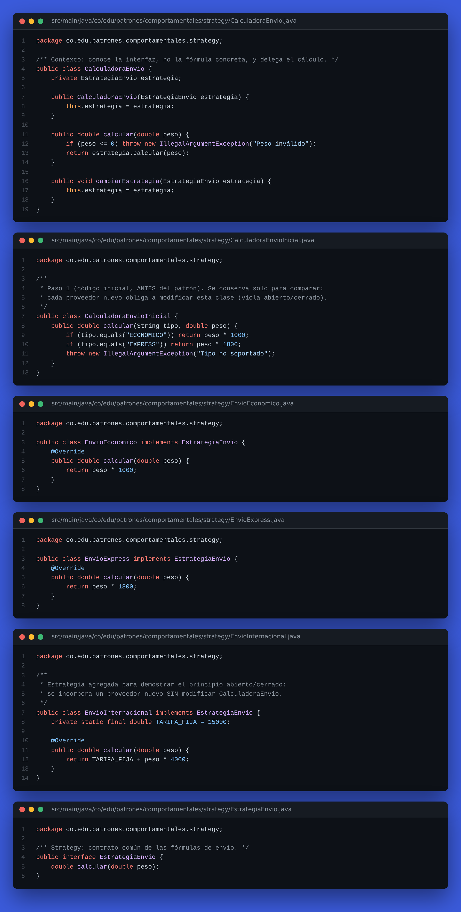

**Captura del funcionamiento (ejecución + pruebas)**

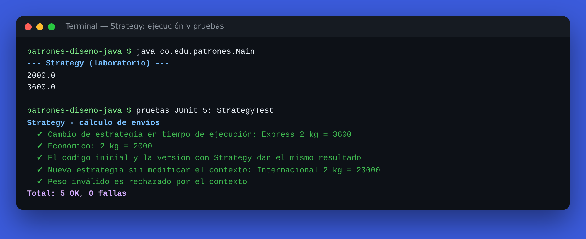

#### 2.9.2 Observer · _Laboratorio_

🔗 [Probar Observer en la página interactiva](https://srdiego18.github.io/Patrones-dise-o-java/#observer) · 📁 [Ver carpeta en el repositorio](../src/main/java/co/edu/patrones/comportamentales/observer)

**Código fuente**

<details open><summary><code>NotificadorCorreo.java</code></summary>

```java
package co.edu.patrones.comportamentales.observer;

import java.util.ArrayList;
import java.util.List;

public class NotificadorCorreo implements ObservadorPedido {
    private final List<String> recibidos = new ArrayList<>();

    @Override
    public void actualizar(String estado) {
        recibidos.add(estado);
        System.out.println("Correo: pedido " + estado);
    }

    public List<String> getRecibidos() {
        return recibidos;
    }
}
```

</details>

<details open><summary><code>NotificadorSms.java</code></summary>

```java
package co.edu.patrones.comportamentales.observer;

/** Paso 5: observador nuevo agregado SIN modificar la clase Pedido. */
public class NotificadorSms implements ObservadorPedido {
    private int mensajesEnviados = 0;

    @Override
    public void actualizar(String estado) {
        mensajesEnviados++;
        System.out.println("SMS: tu pedido está " + estado);
    }

    public int getMensajesEnviados() {
        return mensajesEnviados;
    }
}
```

</details>

<details open><summary><code>ObservadorPedido.java</code></summary>

```java
package co.edu.patrones.comportamentales.observer;

/** Observer: contrato de quien quiere enterarse de los cambios del pedido. */
public interface ObservadorPedido {
    void actualizar(String nuevoEstado);
}
```

</details>

<details open><summary><code>Pedido.java</code></summary>

```java
package co.edu.patrones.comportamentales.observer;

import java.util.ArrayList;
import java.util.List;

/** Subject: mantiene la lista de suscriptores y los notifica cuando cambia su estado. */
public class Pedido {
    private final List<ObservadorPedido> observadores = new ArrayList<>();
    private String estado = "CREADO";

    public void suscribir(ObservadorPedido observador) {
        if (!observadores.contains(observador)) { // evita duplicados
            observadores.add(observador);
        }
    }

    public void desuscribir(ObservadorPedido observador) {
        observadores.remove(observador);
    }

    public void cambiarEstado(String nuevoEstado) {
        this.estado = nuevoEstado;
        for (ObservadorPedido o : observadores) {
            o.actualizar(estado);
        }
    }

    public String getEstado() {
        return estado;
    }
}
```

</details>

<details open><summary><code>Tablero.java</code></summary>

```java
package co.edu.patrones.comportamentales.observer;

public class Tablero implements ObservadorPedido {
    private String ultimoEstado;

    @Override
    public void actualizar(String estado) {
        ultimoEstado = estado;
        System.out.println("Tablero actualizado: " + estado);
    }

    public String getUltimoEstado() {
        return ultimoEstado;
    }
}
```

</details>

<details><summary><code>ObserverTest.java</code> (pruebas)</summary>

```java
package co.edu.patrones.comportamentales;

import co.edu.patrones.comportamentales.observer.*;
import org.junit.jupiter.api.DisplayName;
import org.junit.jupiter.api.Test;

import static org.junit.jupiter.api.Assertions.*;

@DisplayName("Observer - pedidos")
class ObserverTest {

    @Test
    @DisplayName("Todos los suscriptores reciben el nuevo estado")
    void notificaATodos() {
        Pedido pedido = new Pedido();
        NotificadorCorreo correo = new NotificadorCorreo();
        Tablero tablero = new Tablero();
        pedido.suscribir(correo);
        pedido.suscribir(tablero);

        pedido.cambiarEstado("PAGADO");

        assertEquals("PAGADO", correo.getRecibidos().get(0));
        assertEquals("PAGADO", tablero.getUltimoEstado());
    }

    @Test
    @DisplayName("Se agrega un observador nuevo (SMS) sin modificar Pedido; no hay duplicados")
    void nuevoObservadorSinDuplicados() {
        Pedido pedido = new Pedido();
        NotificadorSms sms = new NotificadorSms();
        pedido.suscribir(sms);
        pedido.suscribir(sms); // duplicado ignorado

        pedido.cambiarEstado("ENVIADO");
        assertEquals(1, sms.getMensajesEnviados());
    }

    @Test
    @DisplayName("Un observador desuscrito deja de recibir notificaciones")
    void desuscribir() {
        Pedido pedido = new Pedido();
        NotificadorCorreo correo = new NotificadorCorreo();
        pedido.suscribir(correo);
        pedido.cambiarEstado("PAGADO");
        pedido.desuscribir(correo);
        pedido.cambiarEstado("ENVIADO");

        assertEquals(1, correo.getRecibidos().size());
    }
}
```

</details>

**Captura del código**

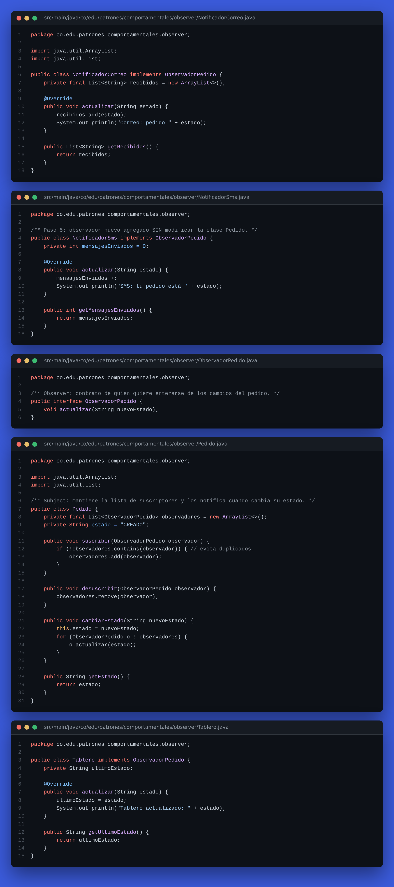

**Captura del funcionamiento (ejecución + pruebas)**

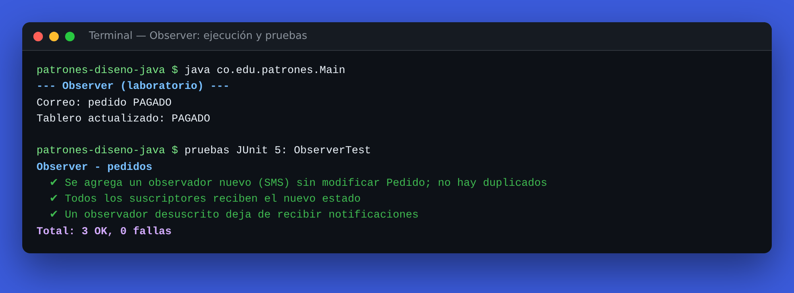

#### 2.9.3 State · _Trabajo autónomo_

🔗 [Probar State en la página interactiva](https://srdiego18.github.io/Patrones-dise-o-java/#state) · 📁 [Ver carpeta en el repositorio](../src/main/java/co/edu/patrones/comportamentales/state)

**Código fuente**

<details open><summary><code>EstadoCancelado.java</code></summary>

```java
package co.edu.patrones.comportamentales.state;

/** Estado final: ninguna operación es válida. */
public class EstadoCancelado implements EstadoPedido {
    @Override
    public String nombre() { return "CANCELADO"; }
}
```

</details>

<details open><summary><code>EstadoCreado.java</code></summary>

```java
package co.edu.patrones.comportamentales.state;

public class EstadoCreado implements EstadoPedido {
    @Override
    public String nombre() { return "CREADO"; }

    @Override
    public void pagar(PedidoTienda pedido) {
        pedido.cambiarEstado(new EstadoPagado());
    }

    @Override
    public void cancelar(PedidoTienda pedido) {
        // Regla: un pedido creado se cancela sin costo.
        pedido.registrarReembolso(0);
        pedido.cambiarEstado(new EstadoCancelado());
    }
}
```

</details>

<details open><summary><code>EstadoEnviado.java</code></summary>

```java
package co.edu.patrones.comportamentales.state;

/** Un pedido enviado no admite pago, reenvío ni cancelación (hereda los métodos por defecto). */
public class EstadoEnviado implements EstadoPedido {
    @Override
    public String nombre() { return "ENVIADO"; }
}
```

</details>

<details open><summary><code>EstadoPagado.java</code></summary>

```java
package co.edu.patrones.comportamentales.state;

public class EstadoPagado implements EstadoPedido {
    @Override
    public String nombre() { return "PAGADO"; }

    @Override
    public void enviar(PedidoTienda pedido) {
        pedido.cambiarEstado(new EstadoEnviado());
    }

    @Override
    public void cancelar(PedidoTienda pedido) {
        // Regla: un pedido pagado se cancela con reembolso total.
        pedido.registrarReembolso(pedido.getTotal());
        pedido.cambiarEstado(new EstadoCancelado());
    }
}
```

</details>

<details open><summary><code>EstadoPedido.java</code></summary>

```java
package co.edu.patrones.comportamentales.state;

/**
 * State: cada estado decide qué hacer ante cada operación.
 * Por defecto toda operación es inválida; cada estado concreto habilita solo sus transiciones.
 */
public interface EstadoPedido {
    String nombre();

    default void pagar(PedidoTienda pedido) {
        throw new IllegalStateException("No se puede pagar un pedido " + nombre());
    }

    default void enviar(PedidoTienda pedido) {
        throw new IllegalStateException("No se puede enviar un pedido " + nombre());
    }

    default void cancelar(PedidoTienda pedido) {
        throw new IllegalStateException("No se puede cancelar un pedido " + nombre());
    }
}
```

</details>

<details open><summary><code>PedidoTienda.java</code></summary>

```java
package co.edu.patrones.comportamentales.state;

/**
 * Contexto: delega cada operación en su estado actual.
 * No contiene ningún if/switch sobre el estado.
 */
public class PedidoTienda {
    private final String codigo;
    private final double total;
    private EstadoPedido estado = new EstadoCreado();
    private double reembolso = 0;

    public PedidoTienda(String codigo, double total) {
        if (total <= 0) throw new IllegalArgumentException("Total inválido");
        this.codigo = codigo;
        this.total = total;
    }

    public void pagar()    { estado.pagar(this); }
    public void enviar()   { estado.enviar(this); }
    public void cancelar() { estado.cancelar(this); }

    // Visibilidad de paquete: solo los estados cambian el estado.
    void cambiarEstado(EstadoPedido nuevo) {
        System.out.println("Pedido " + codigo + ": " + estado.nombre() + " -> " + nuevo.nombre());
        this.estado = nuevo;
    }

    void registrarReembolso(double monto) {
        this.reembolso = monto;
    }

    public String getEstado()    { return estado.nombre(); }
    public double getTotal()     { return total; }
    public double getReembolso() { return reembolso; }
    public String getCodigo()    { return codigo; }
}
```

</details>

<details><summary><code>StateTest.java</code> (pruebas)</summary>

```java
package co.edu.patrones.comportamentales;

import co.edu.patrones.comportamentales.state.PedidoTienda;
import org.junit.jupiter.api.DisplayName;
import org.junit.jupiter.api.Test;

import static org.junit.jupiter.api.Assertions.*;

@DisplayName("State - ciclo de vida del pedido (trabajo autónomo)")
class StateTest {

    @Test
    @DisplayName("Prueba 1: flujo feliz CREADO -> PAGADO -> ENVIADO")
    void flujoFeliz() {
        PedidoTienda p = new PedidoTienda("P-1", 50000);
        assertEquals("CREADO", p.getEstado());
        p.pagar();
        assertEquals("PAGADO", p.getEstado());
        p.enviar();
        assertEquals("ENVIADO", p.getEstado());
    }

    @Test
    @DisplayName("Prueba 2: la cancelación tiene reglas distintas según el estado")
    void cancelacionSegunEstado() {
        PedidoTienda creado = new PedidoTienda("P-2", 50000);
        creado.cancelar();
        assertEquals("CANCELADO", creado.getEstado());
        assertEquals(0, creado.getReembolso(), 0.001);

        PedidoTienda pagado = new PedidoTienda("P-3", 50000);
        pagado.pagar();
        pagado.cancelar();
        assertEquals("CANCELADO", pagado.getEstado());
        assertEquals(50000, pagado.getReembolso(), 0.001);
    }

    @Test
    @DisplayName("Prueba 3: transiciones inválidas son rechazadas")
    void transicionesInvalidas() {
        PedidoTienda p = new PedidoTienda("P-4", 50000);
        assertThrows(IllegalStateException.class, p::enviar);   // no se envía sin pagar
        p.pagar();
        p.enviar();
        assertThrows(IllegalStateException.class, p::cancelar); // enviado no se cancela
        assertEquals("ENVIADO", p.getEstado());
    }
}
```

</details>

**Captura del código**

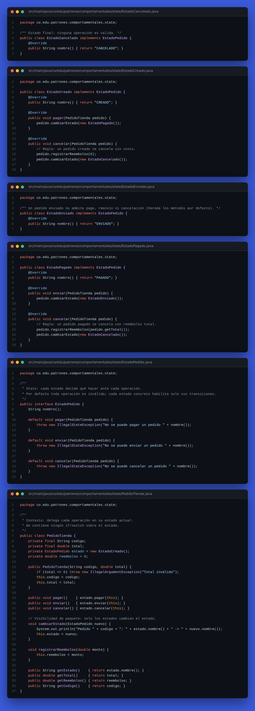

**Captura del funcionamiento (ejecución + pruebas)**

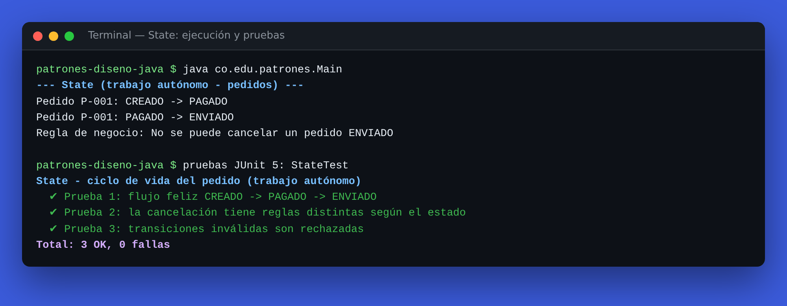

#### 2.9.4 Command · _Trabajo autónomo_

🔗 [Probar Command en la página interactiva](https://srdiego18.github.io/Patrones-dise-o-java/#command) · 📁 [Ver carpeta en el repositorio](../src/main/java/co/edu/patrones/comportamentales/command)

**Código fuente**

<details open><summary><code>AgregarProductoComando.java</code></summary>

```java
package co.edu.patrones.comportamentales.command;

public class AgregarProductoComando implements Comando {
    private final CarritoPedido carrito;
    private final String producto;
    private final int cantidad;

    public AgregarProductoComando(CarritoPedido carrito, String producto, int cantidad) {
        this.carrito = carrito;
        this.producto = producto;
        this.cantidad = cantidad;
    }

    @Override public void ejecutar() { carrito.agregar(producto, cantidad); }
    @Override public void deshacer() { carrito.quitar(producto, cantidad); }   // operación inversa
    @Override public String descripcion() { return "Agregar " + cantidad + " x " + producto; }
}
```

</details>

<details open><summary><code>CarritoPedido.java</code></summary>

```java
package co.edu.patrones.comportamentales.command;

import java.util.LinkedHashMap;
import java.util.Map;
import java.util.Collections;

/** Receptor: sabe cómo agregar y quitar productos del pedido. */
public class CarritoPedido {
    private final Map<String, Integer> items = new LinkedHashMap<>();

    public void agregar(String producto, int cantidad) {
        if (cantidad <= 0) throw new IllegalArgumentException("Cantidad inválida");
        items.merge(producto, cantidad, Integer::sum);
    }

    public void quitar(String producto, int cantidad) {
        int actual = items.getOrDefault(producto, 0);
        if (cantidad > actual) throw new IllegalArgumentException("No hay suficientes unidades de " + producto);
        if (actual == cantidad) items.remove(producto);
        else items.put(producto, actual - cantidad);
    }

    public int cantidadDe(String producto) {
        return items.getOrDefault(producto, 0);
    }

    public Map<String, Integer> getItems() {
        return Collections.unmodifiableMap(new LinkedHashMap<>(items));
    }
}
```

</details>

<details open><summary><code>Comando.java</code></summary>

```java
package co.edu.patrones.comportamentales.command;

/** Command: una solicitud convertida en objeto que se puede ejecutar y deshacer. */
public interface Comando {
    void ejecutar();
    void deshacer();
    String descripcion();
}
```

</details>

<details open><summary><code>GestorComandos.java</code></summary>

```java
package co.edu.patrones.comportamentales.command;

import java.util.ArrayDeque;
import java.util.Deque;
import java.util.List;
import java.util.ArrayList;

/**
 * Invocador: encola acciones del usuario para ejecutarlas después,
 * mantiene un historial y permite deshacer/rehacer.
 * No sabe QUÉ hace cada comando; solo llama a ejecutar()/deshacer().
 */
public class GestorComandos {
    private final Deque<Comando> cola = new ArrayDeque<>();
    private final Deque<Comando> historial = new ArrayDeque<>();
    private final Deque<Comando> rehacer = new ArrayDeque<>();
    private final List<String> bitacora = new ArrayList<>();

    public void encolar(Comando c) {
        cola.addLast(c);
    }

    /** Ejecuta todos los comandos pendientes en orden FIFO. */
    public void procesarCola() {
        while (!cola.isEmpty()) {
            Comando c = cola.pollFirst();
            c.ejecutar();
            historial.push(c);
            rehacer.clear();
            bitacora.add("EJECUTADO: " + c.descripcion());
        }
    }

    public void deshacer() {
        if (historial.isEmpty()) throw new IllegalStateException("No hay acciones para deshacer");
        Comando c = historial.pop();
        c.deshacer();
        rehacer.push(c);
        bitacora.add("DESHECHO: " + c.descripcion());
    }

    public void rehacer() {
        if (rehacer.isEmpty()) throw new IllegalStateException("No hay acciones para rehacer");
        Comando c = rehacer.pop();
        c.ejecutar();
        historial.push(c);
        bitacora.add("REHECHO: " + c.descripcion());
    }

    public int pendientes() { return cola.size(); }
    public List<String> getBitacora() { return bitacora; }
}
```

</details>

<details open><summary><code>QuitarProductoComando.java</code></summary>

```java
package co.edu.patrones.comportamentales.command;

public class QuitarProductoComando implements Comando {
    private final CarritoPedido carrito;
    private final String producto;
    private final int cantidad;

    public QuitarProductoComando(CarritoPedido carrito, String producto, int cantidad) {
        this.carrito = carrito;
        this.producto = producto;
        this.cantidad = cantidad;
    }

    @Override public void ejecutar() { carrito.quitar(producto, cantidad); }
    @Override public void deshacer() { carrito.agregar(producto, cantidad); }  // operación inversa
    @Override public String descripcion() { return "Quitar " + cantidad + " x " + producto; }
}
```

</details>

<details><summary><code>CommandTest.java</code> (pruebas)</summary>

```java
package co.edu.patrones.comportamentales;

import co.edu.patrones.comportamentales.command.*;
import org.junit.jupiter.api.DisplayName;
import org.junit.jupiter.api.Test;

import static org.junit.jupiter.api.Assertions.*;

@DisplayName("Command - acciones sobre el carrito del pedido (trabajo autónomo)")
class CommandTest {

    @Test
    @DisplayName("Prueba 1: las acciones encoladas no se ejecutan hasta procesar la cola")
    void colaDiferida() {
        CarritoPedido carrito = new CarritoPedido();
        GestorComandos gestor = new GestorComandos();
        gestor.encolar(new AgregarProductoComando(carrito, "Cuaderno", 2));

        assertEquals(1, gestor.pendientes());
        assertEquals(0, carrito.cantidadDe("Cuaderno"));

        gestor.procesarCola();
        assertEquals(0, gestor.pendientes());
        assertEquals(2, carrito.cantidadDe("Cuaderno"));
    }

    @Test
    @DisplayName("Prueba 2: deshacer revierte en orden inverso (LIFO)")
    void deshacerEnOrdenInverso() {
        CarritoPedido carrito = new CarritoPedido();
        GestorComandos gestor = new GestorComandos();
        gestor.encolar(new AgregarProductoComando(carrito, "Lápiz", 5));
        gestor.encolar(new QuitarProductoComando(carrito, "Lápiz", 2));
        gestor.procesarCola();
        assertEquals(3, carrito.cantidadDe("Lápiz"));

        gestor.deshacer(); // revierte "quitar 2"
        assertEquals(5, carrito.cantidadDe("Lápiz"));
        gestor.deshacer(); // revierte "agregar 5"
        assertEquals(0, carrito.cantidadDe("Lápiz"));
    }

    @Test
    @DisplayName("Prueba 3: rehacer y casos límite (nada que deshacer)")
    void rehacerYCasosLimite() {
        CarritoPedido carrito = new CarritoPedido();
        GestorComandos gestor = new GestorComandos();
        assertThrows(IllegalStateException.class, gestor::deshacer);

        gestor.encolar(new AgregarProductoComando(carrito, "Borrador", 1));
        gestor.procesarCola();
        gestor.deshacer();
        gestor.rehacer();
        assertEquals(1, carrito.cantidadDe("Borrador"));
        assertEquals(3, gestor.getBitacora().size());
    }
}
```

</details>

**Captura del código**

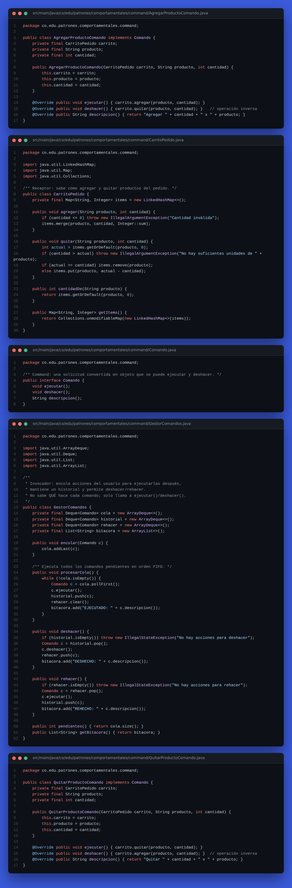

**Captura del funcionamiento (ejecución + pruebas)**

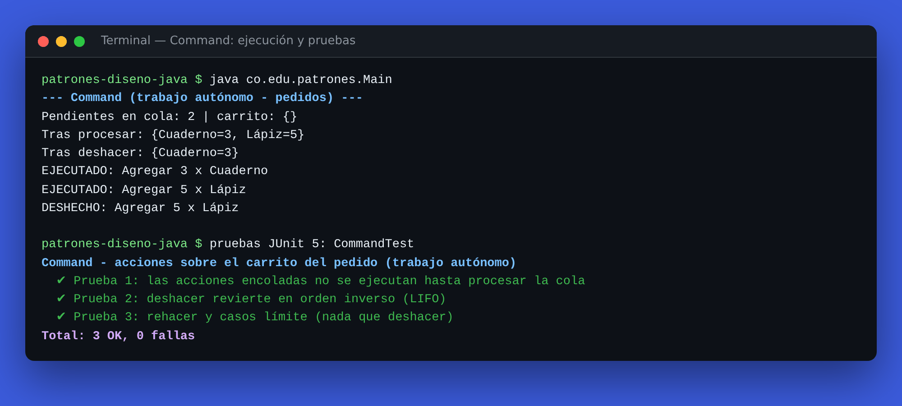

#### 2.9.5 Template Method · _Extra_

🔗 [Probar Template Method en la página interactiva](https://srdiego18.github.io/Patrones-dise-o-java/#templatemethod) · 📁 [Ver carpeta en el repositorio](../src/main/java/co/edu/patrones/comportamentales/templatemethod)

**Código fuente**

<details open><summary><code>GeneradorReporte.java</code></summary>

```java
package co.edu.patrones.comportamentales.templatemethod;

import java.util.List;
import java.util.Objects;

/**
 * Template Method: generar() fija el esqueleto validar -> consultar -> transformar -> exportar.
 * Es final para que ninguna subclase altere el orden. Solo exportar() varía.
 */
public abstract class GeneradorReporte {

    public final String generar(List<Venta> ventas) {
        validar(ventas);
        List<Venta> datos = consultar(ventas);
        List<Venta> transformados = transformar(datos);
        return encabezado() + exportar(transformados);
    }

    /** Paso común: los datos deben existir. */
    private void validar(List<Venta> ventas) {
        Objects.requireNonNull(ventas, "ventas");
        if (ventas.isEmpty()) throw new IllegalArgumentException("No hay ventas para reportar");
    }

    /** Paso común: descarta ventas con monto no positivo. */
    private List<Venta> consultar(List<Venta> ventas) {
        return ventas.stream().filter(v -> v.monto() > 0).toList();
    }

    /** Paso común: ordena de mayor a menor monto. */
    private List<Venta> transformar(List<Venta> ventas) {
        return ventas.stream()
                .sorted((a, b) -> Double.compare(b.monto(), a.monto()))
                .toList();
    }

    /** Hook: opcional, por defecto vacío. */
    protected String encabezado() {
        return "";
    }

    /** Paso variable: cada formato lo implementa. */
    protected abstract String exportar(List<Venta> ventas);
}
```

</details>

<details open><summary><code>ReporteCsv.java</code></summary>

```java
package co.edu.patrones.comportamentales.templatemethod;

import java.util.List;
import java.util.Locale;
import java.util.stream.Collectors;

public class ReporteCsv extends GeneradorReporte {
    @Override
    protected String encabezado() {
        return "producto,monto\n";
    }

    @Override
    protected String exportar(List<Venta> ventas) {
        return ventas.stream()
                .map(v -> v.producto() + "," + String.format(Locale.US, "%.2f", v.monto()))
                .collect(Collectors.joining("\n"));
    }
}
```

</details>

<details open><summary><code>ReporteJson.java</code></summary>

```java
package co.edu.patrones.comportamentales.templatemethod;

import java.util.List;
import java.util.Locale;
import java.util.stream.Collectors;

public class ReporteJson extends GeneradorReporte {
    @Override
    protected String exportar(List<Venta> ventas) {
        return ventas.stream()
                .map(v -> String.format(Locale.US, "{\"producto\":\"%s\",\"monto\":%.2f}", v.producto(), v.monto()))
                .collect(Collectors.joining(",", "[", "]"));
    }
}
```

</details>

<details open><summary><code>Venta.java</code></summary>

```java
package co.edu.patrones.comportamentales.templatemethod;

/** Dato de entrada del reporte. */
public record Venta(String producto, double monto) {
}
```

</details>

<details><summary><code>TemplateMethodTest.java</code> (pruebas)</summary>

```java
package co.edu.patrones.comportamentales;

import co.edu.patrones.comportamentales.templatemethod.*;
import org.junit.jupiter.api.DisplayName;
import org.junit.jupiter.api.Test;

import java.util.List;

import static org.junit.jupiter.api.Assertions.*;

@DisplayName("Template Method - reportes de ventas (extra)")
class TemplateMethodTest {

    private final List<Venta> ventas = List.of(
            new Venta("Cuaderno", 5000), new Venta("Anulada", 0), new Venta("Libro", 42000.5));

    @Test
    @DisplayName("CSV: encabezado, filtra montos inválidos y ordena de mayor a menor")
    void csv() {
        assertEquals("producto,monto\nLibro,42000.50\nCuaderno,5000.00", new ReporteCsv().generar(ventas));
    }

    @Test
    @DisplayName("JSON: mismos pasos comunes, solo cambia la exportación")
    void json() {
        assertEquals("[{\"producto\":\"Libro\",\"monto\":42000.50},{\"producto\":\"Cuaderno\",\"monto\":5000.00}]",
                new ReporteJson().generar(ventas));
    }

    @Test
    @DisplayName("La validación común aplica a todos los formatos")
    void validacionComun() {
        assertThrows(IllegalArgumentException.class, () -> new ReporteCsv().generar(List.of()));
        assertThrows(IllegalArgumentException.class, () -> new ReporteJson().generar(List.of()));
    }
}
```

</details>

**Captura del código**

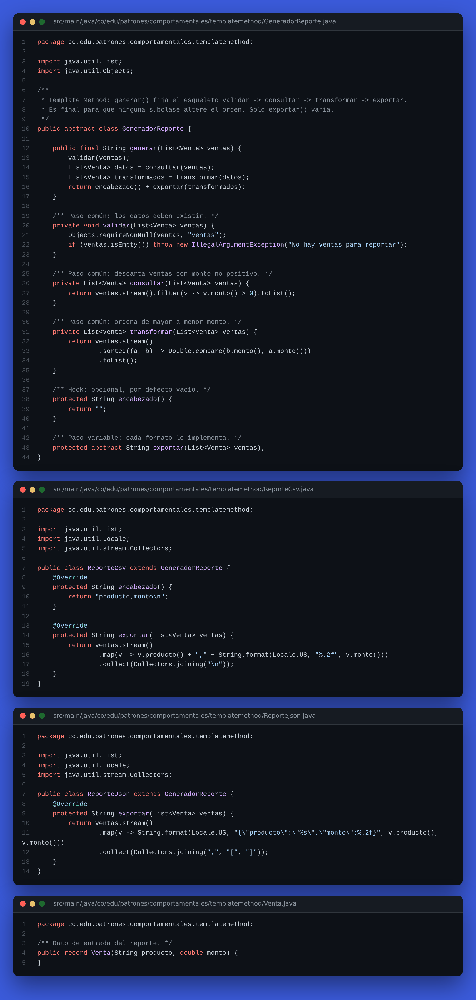

**Captura del funcionamiento (ejecución + pruebas)**

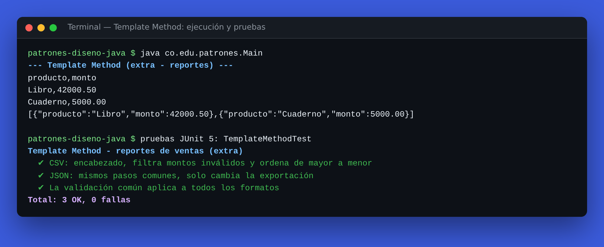

#### Ejecución completa y resumen de pruebas (Guía 2)

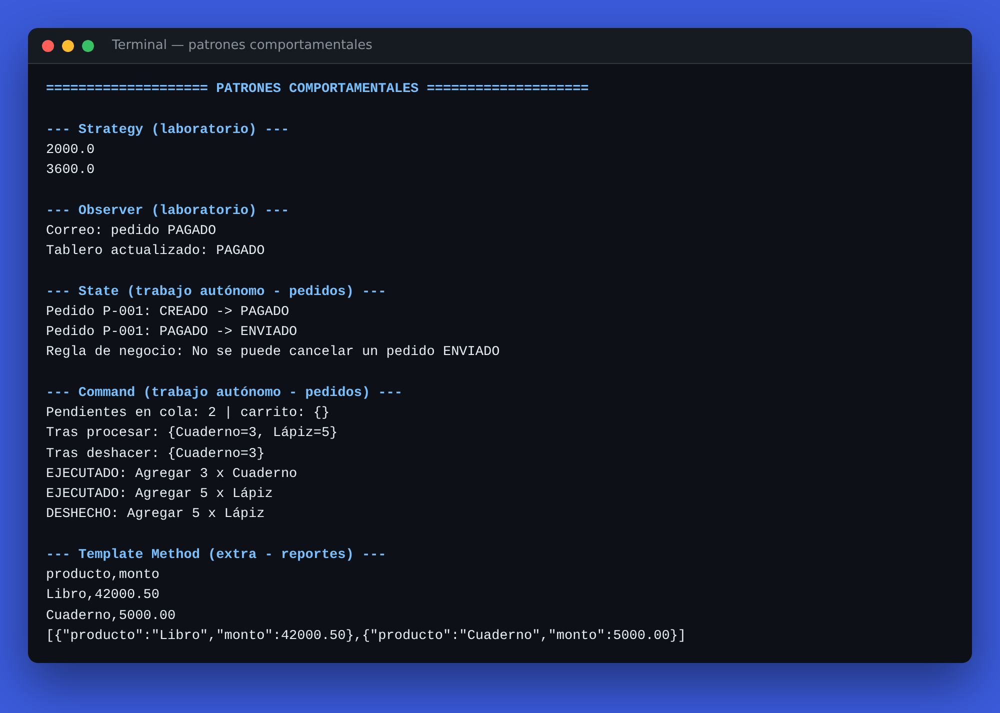


---
### 2.10 Autoevaluación frente a la rúbrica

| Criterio | Peso | Evidencia en el repositorio |
|---|---|---|
| Análisis y selección | 25 % | §2.5 (5 situaciones resueltas), §2.6, problema y alternativa de cada patrón en §2.7 |
| Implementación | 30 % | Strategy, Observer, State, Command **y Template Method (extra)** compilando y ejecutándose desde [`Main`](../src/main/java/co/edu/patrones/Main.java) — ver §2.9 |
| Diseño | 20 % | Diagramas de clases y de estados (Mermaid), interfaces, métodos `default`, visibilidad de paquete |
| Pruebas | 15 % | 17 pruebas JUnit 5 (≥ 3 por patrón) ejecutadas automáticamente con GitHub Actions, en [`src/test/.../comportamentales`](../src/test/java/co/edu/patrones/comportamentales) |
| Reflexión | 10 % | Justificación, alternativa y limitación de cada patrón (§2.7) |

---

## Referencias

- Gamma, E., Helm, R., Johnson, R., & Vlissides, J. (1994). *Design Patterns: Elements of Reusable Object-Oriented Software*. Addison-Wesley.
- Freeman, E., Robson, E., Bates, B., & Sierra, K. (2004). *Head First Design Patterns*. O'Reilly Media.
